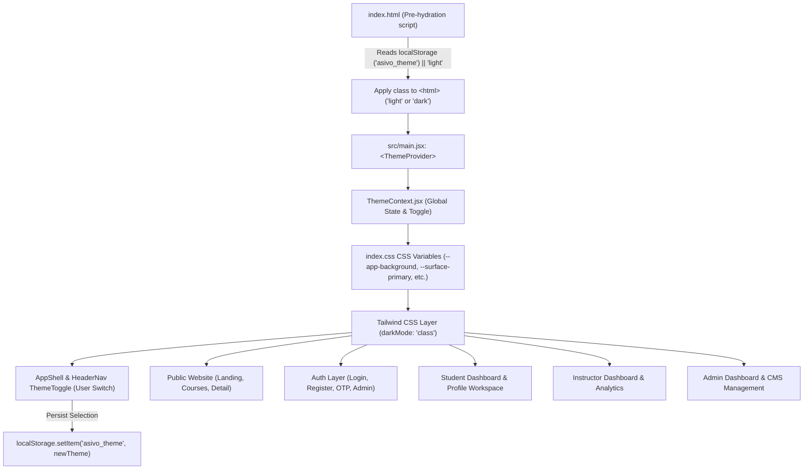

# ASIVO LMS — LIGHT THEME AUDIT (PHASE 1)
### Comprehensive Architecture & Component Inspection Report

**Audit Date:** November 3, 2026  
**Status:** APPROVED FOR FULL MIGRATION  
**Lead Architect:** Senior UI/UX Engineer & Frontend Architect  
**Project:** Asivo LMS (Web Application Frontend)

---

## 1. Executive Summary

A comprehensive, repository-wide UI audit was conducted across all 110+ JSX components, stylesheets, layouts, and configuration files in the ASIVO LMS frontend repository (`UI`). 

The application currently defaults to an "Ink & Onyx" luxury dark theme with hardcoded deep-black and charcoal backgrounds (`#070709`, `#0F0F13`, `#14141A`), champagne-gold accents (`#C5A880`), high-contrast white typography (`#F5F5F7`, `text-white`), and ultra-subtle white alpha borders (`border-white/[0.04]`).

### Key Pattern Occurrence Statistics

| Dark Pattern / Token | Match Count | Unique Files | Primary Locations |
| :--- | :--- | :--- | :--- |
| **`#14141A` / `#1B1B24` (Surface / Raised)** | 469 | 67 | Card containers, inputs, modal dialogs, table rows, button backgrounds |
| **`#0B1220` / `#0F0F13` (Obsidian / Primary Surface)** | 328 | 60 | AppShell sidebar, cards, dropdown menus, modals, hero containers |
| **`#000000` / `#070709` (Matte Canvas Background)** | 218 | 58 | `AppShell`, `AuthShell`, `LandingDashboard`, `Courses`, `index.css` |
| **`text-white`** | 521 | 80 | Headings, active nav states, button text, badges |
| **`bg-black` / `rgba(0,0,0`** | 92 | 49 | Overlays, backdrop blurs, drop shadows, code blocks |
| **`border-white/[0.04 - 0.15]`** | 680+ | 74 | Global borders, dividers, input borders, table borders |
| **`#C5A880` (Champagne Gold Accent)** | 380+ | 62 | Primary buttons, active indicators, ratings, badges |

---

## 2. Global Styling & Configuration Audit

### 2.1 `src/index.css`
- **Current State:**
  - `:root` declares dark CSS variables (`--canvas-matte: #070709`, `--canvas-obsidian: #0F0F13`, `--canvas-surface: #14141A`, `--text-primary: #F5F5F7`).
  - `html` and `body` hardcode `background-color: #070709; color: #F5F5F7;`.
  - Utility classes `.bg-glass`, `.bg-glass-card`, `.lms-premium-card`, `.lms-input`, `.btn-primary`, `.btn-secondary` are explicitly dark-styled.
  - Scrollbars hardcode `#070709` track and white alpha thumb.
- **Migration Requirement:**
  - Define canonical Light Theme tokens in `:root`, `html.light`, and `html[data-theme="light"]` as the authoritative default.
  - Set `html:not(.dark)` and `html.light` background to `#F8FAFC` and text to `#0F172A`.
  - Move dark tokens under `html.dark` and `html[data-theme="dark"]` to preserve dark mode toggleability.
  - Refactor utility classes to consume CSS variables with light defaults.

### 2.2 `tailwind.config.js`
- **Current State:**
  - `darkMode: 'class'` is present.
  - Custom colors map hardcoded hex codes (`canvas.matte: '#070709'`, `canvas.obsidian: '#0F0F13'`).
- **Migration Requirement:**
  - Extend color palette with semantic light tokens (`app-background: '#F8FAFC'`, `surface: { primary: '#FFFFFF', secondary: '#F1F5F9', tertiary: '#E2E8F0' }`).
  - Map `primary` to `#2563EB` (Primary Blue) and `accent` to `#06B6D4` (Cyan).
  - Map `text` to `{ primary: '#0F172A', secondary: '#475569', muted: '#64748B' }`.
  - Map `border` to `{ primary: '#E2E8F0', secondary: '#CBD5E1' }`.

### 2.3 Theme Context & Anti-Flash Pre-hydration
- **`src/context/ThemeContext.jsx`:**
  - Defaults to `'light'` in state.
  - Persists to `localStorage('asivo_theme')`.
  - Toggles `dark` class and `data-theme` attribute on `document.documentElement`.
- **`index.html`:**
  - Anti-FOUC script correctly defaults to `'light'`.
  - Ensures `<meta name="theme-color">` is set to `#F8FAFC`.

---

## 3. Structural Layouts & Navigation Audit

### 3.1 `src/design-system/layout/AppShell.jsx` (Workspace Shell)
- **Used by:** All authenticated Student, Instructor, and Admin dashboard pages.
- **Identified Dark Elements:**
  - Main container: `min-h-screen bg-[#070709] text-[#F5F5F7]`.
  - Sidebar: `bg-[#0F0F13]/95 border-r border-white/[0.04]`.
  - Navigation item inactive: `text-[#A1A1AA] hover:bg-white/[0.02]`.
  - Active nav indicator: `bg-[#C5A880]/10 border border-[#C5A880]/30 text-[#C5A880]`.
  - Header rail: `bg-[#070709]/85 border-b border-white/[0.04]`.
  - Quick action buttons (Catalog, Cart, Notifications): `bg-[#14141A] border-white/[0.04]`.
  - Notification Popover: `bg-[#0F0F13] border-white/[0.08]`.
  - Profile Dropdown: `bg-[#0F0F13] border-white/[0.08]`.
- **Migration Requirement:**
  - Background $\rightarrow$ `bg-[#F8FAFC] dark:bg-[#070709]`.
  - Sidebar $\rightarrow$ `bg-[#FFFFFF] dark:bg-[#0F0F13] border-r border-[#E2E8F0] dark:border-white/[0.04]`.
  - Active nav item $\rightarrow$ `bg-[#EFF6FF] dark:bg-[#2563EB]/20 text-[#2563EB] dark:text-[#60A5FA] border-[#2563EB]/30`.
  - Inactive nav item $\rightarrow$ `text-[#475569] dark:text-[#A1A1AA] hover:bg-[#F1F5F9] dark:hover:bg-white/[0.02]`.
  - Header $\rightarrow$ `bg-white/90 dark:bg-[#070709]/85 border-b border-[#E2E8F0] dark:border-white/[0.04]`.
  - Popovers & Dropdowns $\rightarrow$ `bg-white dark:bg-[#0F0F13] border border-[#E2E8F0] dark:border-white/[0.08] shadow-xl text-[#0F172A] dark:text-[#F5F5F7]`.
  - Embed `ThemeToggle` into top header rail and user profile dock.

### 3.2 `src/layouts/Navbar.jsx` & `src/design-system/layout/HeaderNav.jsx` (Public Header)
- **Identified Dark Elements:**
  - Sticky nav: `bg-[#070709]/95 backdrop-blur-xl border-b border-white/[0.04]`.
  - Search pill: `bg-[#0F0F13] border-white/[0.06] text-[#F5F5F7] placeholder-[#71717A]`.
  - Action buttons: `bg-[#0F0F13] border-white/[0.04] text-[#8E8E93]`.
  - Mobile drawer: `bg-[#070709] border-l border-white/[0.06]`.
- **Migration Requirement:**
  - Sticky nav $\rightarrow$ `bg-white/95 dark:bg-[#070709]/95 border-b border-[#E2E8F0] dark:border-white/[0.04] shadow-sm`.
  - Search pill $\rightarrow$ `bg-[#F1F5F9] dark:bg-[#0F0F13] border-[#E2E8F0] dark:border-white/[0.06] text-[#0F172A] dark:text-[#F5F5F7]`.
  - Action buttons $\rightarrow$ `bg-[#F8FAFC] dark:bg-[#0F0F13] border-[#E2E8F0] dark:border-white/[0.04] text-[#475569] hover:text-[#0F172A]`.
  - Integrate `ThemeToggle` component into desktop header and mobile menu.

### 3.3 `src/components/common/Footer.jsx` (Public Footer)
- **Identified Dark Elements:**
  - Root: `bg-[#070709] border-t border-white/[0.04] text-[#8E8E93]`.
  - Microservice badge: `bg-[#0F0F13] border-white/[0.04] text-[#A1A1AA]`.
  - Links: `text-[#8E8E93] hover:text-[#F5F5F7]`.
- **Migration Requirement:**
  - Root $\rightarrow$ `bg-[#FFFFFF] dark:bg-[#070709] border-t border-[#E2E8F0] dark:border-white/[0.04] text-[#475569] dark:text-[#8E8E93]`.
  - Badges $\rightarrow$ `bg-[#F1F5F9] dark:bg-[#0F0F13] border-[#E2E8F0] dark:border-white/[0.04] text-[#334155] dark:text-[#A1A1AA]`.
  - Links $\rightarrow$ `hover:text-[#2563EB] dark:hover:text-[#F5F5F7]`.

---

## 4. Authentication Pages Audit

**Files:** `AuthShell.jsx`, `Login.jsx`, `Register.jsx`, `ForgotPassword.jsx`, `OtpVerify.jsx`, `ResetOtp.jsx`, `OtpLogin.jsx`, `SocialAuthButtons.jsx`

- **Identified Dark Elements:**
  - Root shell: `bg-[#070709] text-[#F5F5F7]`.
  - Left brand showcase column: `bg-[#0F0F13] border-r border-white/[0.04]`.
  - Form card container: `bg-[#0F0F13] border border-white/[0.04] shadow-2xl`.
  - Input fields: `bg-[#0F0F13]/90 border border-white/[0.06] text-[#F5F5F7] placeholder-[#71717A]`.
  - Social auth buttons (Google/GitHub/LinkedIn): `bg-[#14141A]/50 border-white/[0.06]`.
  - Primary button: `bg-[#C5A880] text-[#070709]`.
- **Migration Requirement:**
  - Root shell $\rightarrow$ `bg-[#F8FAFC] dark:bg-[#070709] text-[#0F172A] dark:text-[#F5F5F7]`.
  - Brand column $\rightarrow$ `bg-[#F1F5F9] dark:bg-[#0F0F13] border-r border-[#E2E8F0] dark:border-white/[0.04]`.
  - Form card $\rightarrow$ `bg-[#FFFFFF] dark:bg-[#0F0F13] border border-[#E2E8F0] dark:border-white/[0.04] shadow-xl`.
  - Inputs $\rightarrow$ `bg-[#FFFFFF] dark:bg-[#0F0F13]/90 border-[#E2E8F0] dark:border-white/[0.06] text-[#0F172A] dark:text-[#F5F5F7]`.
  - Primary CTA $\rightarrow$ `bg-[#2563EB] hover:bg-[#1D4ED8] text-white font-bold shadow-md`.

---

## 5. Course Catalog & Public Showcase Audit

**Files:** `LandingDashboard.jsx`, `Courses.jsx`, `CourseDetail.jsx`, `BannerSlider.jsx`, `CourseCard.jsx`

- **Identified Dark Elements:**
  - Backgrounds: `bg-[#070709]`, hero banner section `bg-[#0F0F13]`.
  - Course cards: `bg-[#0F0F13] border-white/[0.04] hover:border-white/[0.09] shadow-2xl`.
  - Filters & sorting tabs: `bg-[#14141A] border-white/[0.04] text-[#A1A1AA]`.
  - Search command bar: `bg-[#0F0F13] border border-white/[0.08]`.
  - Star ratings & pricing: Text colors hardcoded for dark contrast.
- **Migration Requirement:**
  - Page canvas $\rightarrow$ `bg-[#F8FAFC] dark:bg-[#070709]`.
  - Course cards $\rightarrow$ `bg-[#FFFFFF] dark:bg-[#0F0F13] border border-[#E2E8F0] dark:border-white/[0.04] shadow-sm hover:shadow-md hover:border-[#CBD5E1]`.
  - Filter chips $\rightarrow$ `bg-white dark:bg-[#14141A] border-[#E2E8F0] dark:border-white/[0.06] text-[#475569] hover:bg-[#F1F5F9]`.
  - Search command bar $\rightarrow$ `bg-white dark:bg-[#0F0F13] border-[#E2E8F0] dark:border-white/[0.08] shadow-sm`.
  - Card title $\rightarrow$ `text-[#0F172A] dark:text-[#F5F5F7] hover:text-[#2563EB]`.

---

## 6. Student Dashboard & Workspaces Audit

**Files:** `StudentDashboard.jsx`, `MyLearning.jsx`, `ClassroomView.jsx`, `ShoppingCartWorkspace.jsx`, `Cart.jsx`, `Wishlist.jsx`, `Orders.jsx`, `ProfileWorkspace.jsx`, `InstructorApplication.jsx`

- **Identified Dark Elements:**
  - KPI summary tiles: `bg-[#0F0F13] border-white/[0.04] text-white`.
  - Enrolled course progress bars: Track `bg-[#14141A]`, fill gold/emerald.
  - Video player container in `ClassroomView.jsx`: Root dark canvas.
  - Cart item rows: `bg-[#0F0F13] border-white/[0.04]`.
  - Multi-step forms (`InstructorApplication.jsx`): Inputs, drop zones, step indicators hardcoded in dark styling.
- **Migration Requirement:**
  - KPI cards $\rightarrow$ `bg-white dark:bg-[#0F0F13] border-[#E2E8F0] dark:border-white/[0.04] shadow-sm text-[#0F172A]`.
  - Cart / Wishlist $\rightarrow$ `bg-white dark:bg-[#0F0F13] border-[#E2E8F0] dark:border-white/[0.04]`.
  - Video player $\rightarrow$ Clean slate frame (`bg-[#0B1220]` for native video contrast) with light surround controls.
  - Form steps $\rightarrow$ Active step `bg-[#EFF6FF] text-[#2563EB] border-[#2563EB]/40`.

---

## 7. Instructor & Admin Dashboards Audit

**Files:** `InstructorDashboard.jsx`, `CreateCourse.jsx`, `EditCourse.jsx`, `BannerManagement.jsx`, `Users.jsx`, `Orders.jsx`, `Instructors.jsx`, `Coupons.jsx`, `AdminCommandCenter.jsx`, `WebsiteManagementHub.jsx`

- **Identified Dark Elements:**
  - Data tables: `<table>` containers `bg-[#0F0F13]`, header row `bg-[#14141A] text-[#A1A1AA]`, cell rows `border-b border-white/[0.04] hover:bg-white/[0.02]`.
  - Modal windows: `bg-[#0F0F13] border border-white/[0.08] shadow-2xl`.
  - Pinned footer action bars: `bg-[#0F0F13]/95 backdrop-blur-md border-t border-white/[0.06]`.
  - Form inputs & selects: `bg-[#14141A] border-white/[0.06] text-white`.
  - Status badges: Gold, mercury, pewter badges calibrated for dark surfaces.
- **Migration Requirement:**
  - Data tables $\rightarrow$ Container `bg-white dark:bg-[#0F0F13] border-[#E2E8F0] dark:border-white/[0.06] rounded-2xl shadow-sm`.
  - Table header $\rightarrow$ `bg-[#F1F5F9] dark:bg-[#14141A] text-[#475569] dark:text-[#A1A1AA] font-bold text-xs uppercase tracking-wider`.
  - Table rows $\rightarrow$ `border-b border-[#E2E8F0] dark:border-white/[0.04] hover:bg-[#F8FAFC] dark:hover:bg-white/[0.02] text-[#0F172A] dark:text-[#F5F5F7]`.
  - Modals $\rightarrow$ `bg-white dark:bg-[#0F0F13] border-[#CBD5E1] dark:border-white/[0.08] shadow-2xl`.
  - Pinned footer $\rightarrow$ `bg-white/95 dark:bg-[#0F0F13]/95 backdrop-blur-md border-t border-[#E2E8F0] dark:border-white/[0.06]`.
  - Primary button $\rightarrow$ `bg-[#2563EB] hover:bg-[#1D4ED8] text-white shadow-sm`.

---

## 8. Shared UI Primitives Audit

**Files:** `Button.jsx`, `Badge.jsx`, `Input.jsx`, `Skeleton.jsx`, `EmptyState.jsx`, `Portal.jsx`

- **`Button.jsx`:**
  - Primary variant: `bg-[#C5A880] text-[#070709]` $\rightarrow$ update to `bg-[#2563EB] text-white hover:bg-[#1D4ED8] shadow-sm`.
  - Secondary variant: `bg-[#14141A] text-[#E5E5E7]` $\rightarrow$ update to `bg-white text-[#334155] border-[#CBD5E1] hover:bg-[#F1F5F9] shadow-sm`.
  - Outline & Ghost variants: Calibrate text contrast for light background (`text-[#475569] hover:text-[#0F172A] hover:bg-[#F1F5F9]`).
- **`Badge.jsx`:**
  - Update variant tokens for light backgrounds:
    - `default`: `bg-[#F1F5F9] text-[#334155] border-[#E2E8F0]`
    - `gold/primary`: `bg-[#EFF6FF] text-[#2563EB] border-[#BFDBFE]`
    - `emerald`: `bg-emerald-50 text-emerald-700 border-emerald-200`
    - `amber`: `bg-amber-50 text-amber-700 border-amber-200`
    - `danger`: `bg-rose-50 text-rose-700 border-rose-200`
- **`Input.jsx`:**
  - Container `bg-[#0F0F13]/90` $\rightarrow$ `bg-white dark:bg-[#0F0F13] border-[#CBD5E1] dark:border-white/[0.06] text-[#0F172A] dark:text-[#F5F5F7]`.
  - Floating label color: `text-[#64748B]` resting, `text-[#2563EB]` focused.
- **`Skeleton.jsx`:**
  - Shimmer pulse: `bg-[#E2E8F0] dark:bg-[#14141A]` with animated gradient.
- **`EmptyState.jsx`:**
  - Card container: `bg-white dark:bg-[#0F0F13] border-[#E2E8F0] dark:border-white/[0.06] text-[#0F172A]`.

---

## 9. Migration Architecture Blueprint

---

## 10. Audit Conclusion

The application is thoroughly mapped and ready for systematic migration. By implementing centralized CSS tokens, creating a robust `ThemeContext` with pre-hydration support, updating `AppShell`, `HeaderNav`, `Navbar`, and `AuthShell`, re-architecting `CourseCard` and UI primitives, and applying targeted class-level remappings, we will deliver an enterprise-grade Light Theme as the first-class default while keeping Dark Mode fully functional for users who choose it.
