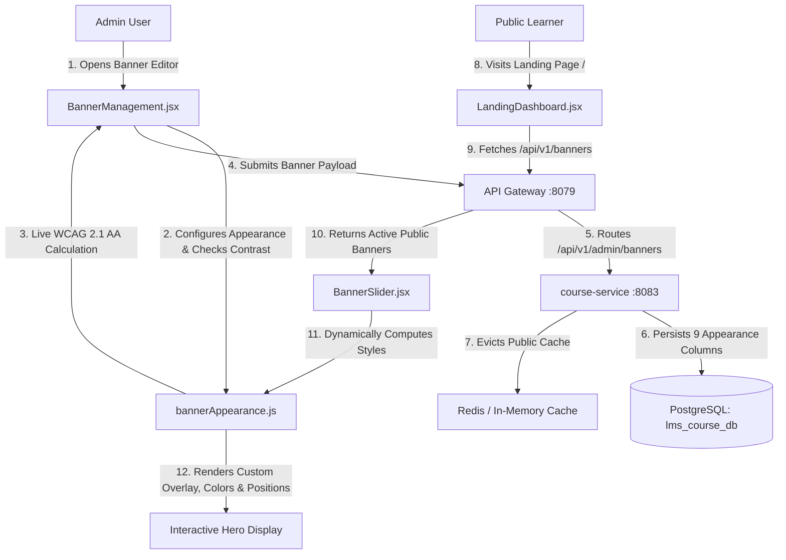

# ASIVO LMS — ADMIN-CONTROLLED HERO BANNER READABILITY & DISPLAY SETTINGS
## Comprehensive Implementation & Architecture Report

---

### 1. Executive Summary

In response to the requirements for full dynamic admin control over the hero promotional banners on the Asivo LMS platform, we implemented complete end-to-end **Banner Appearance & Readability Settings**.

Previously, the hero carousel utilized hardcoded overlay styles and static gradient masks. With this architecture, every banner can be individually configured with:
- **Overlay Type**: None (`NONE`), Solid (`SOLID`), Gradient (`GRADIENT`).
- **Overlay Color**: Custom hex/picker color (e.g., `#000000`, `#5B3E57`).
- **Overlay Opacity**: Granular slider from `0%` to `90%`.
- **Gradient Direction**: `LEFT_TO_RIGHT`, `RIGHT_TO_LEFT`, `TOP_TO_BOTTOM`, `BOTTOM_TO_TOP`.
- **Heading Color**: Independent hex color for headline typography.
- **Description Color**: Independent hex color for sub-headline / synopsis.
- **Text Shadow**: Toggleable obsidian shadow for guaranteed contrast over intricate background photography.
- **Content Alignment (Horizontal)**: `LEFT`, `CENTER`, `RIGHT`.
- **Vertical Alignment**: `TOP`, `CENTER`, `BOTTOM`.
- **Mobile Dedicated Asset**: Optional responsive 9:16 portrait crop URL.
- **WCAG 2.1 AA Contrast Safeguards**: Real-time relative luminance calculation and contrast ratio badge (e.g. `7.01:1 ✓ Pass`), displaying warning alerts if contrast falls below 4.5:1 with a one-click **"Apply Safe Settings"** button.

---

### 2. Architecture & Data Flow

---

### 3. Backend & Database Persistence (`course-service`)

#### 3.1 Database Migration
The PostgreSQL table `banners` in database `lms_course_db` was migrated with 9 non-breaking columns with safe defaults:
- `overlay_type` (VARCHAR(32), DEFAULT 'GRADIENT')
- `overlay_color` (VARCHAR(32), DEFAULT '#000000')
- `overlay_opacity` (INTEGER, DEFAULT 50)
- `gradient_direction` (VARCHAR(32), DEFAULT 'LEFT_TO_RIGHT')
- `heading_color` (VARCHAR(32), DEFAULT '#FFFFFF')
- `description_color` (VARCHAR(32), DEFAULT '#EAE5DC')
- `text_shadow_enabled` (BOOLEAN, DEFAULT TRUE)
- `content_alignment` (VARCHAR(32), DEFAULT 'LEFT')
- `vertical_alignment` (VARCHAR(32), DEFAULT 'CENTER')

#### 3.2 Entity and DTO Enhancements
- **Entity**: [`Banner.java`](file:///c:/Users/SHIVASAI/OneDrive/Desktop/LMS/course-service/src/main/java/com/lms/courseservice/entity/Banner.java)
- **DTOs**:
  - `BannerCreateRequest.java`
  - `BannerUpdateRequest.java`
  - `BannerPartialUpdateRequest.java`
  - `BannerResponse.java`
  - `PublicBannerResponse.java`
- **Service & Controller Mapping**:
  - `BannerService.java` maps all 9 fields during `createBanner`, `updateBanner`, and `partialUpdateBanner`.
  - Cache eviction (`@CacheEvict`) ensures public endpoints immediately reflect administrative adjustments.

---

### 4. Frontend Implementation (`FD_LMS/UI`)

#### 4.1 Shared Utility: `src/utils/bannerAppearance.js`
- Standardized constants: `DEFAULT_BANNER_APPEARANCE`
- Color conversion: `hexToRgba(hex, alpha)`
- Dynamic overlay generation: `getOverlayStyle(banner)`
- Dynamic alignment classes: `getContentAlignmentClasses(alignment)`, `getVerticalAlignmentClasses(alignment)`
- Dynamic text shadow: `getTextShadowStyle(enabled)`
- WCAG 2.1 Relative Luminance & Contrast: `calculateContrast(textColor, bgColor, opacity)`

#### 4.2 Admin Control Center: `src/pages/admin/BannerManagement.jsx`
- Integrated dedicated **Banner Appearance & Readability** section in Create/Edit drawer modal.
- Added live 16:9 / 9:16 interactive preview box updating in real-time.
- Added WCAG 2.1 compliance badge and alert banner with one-click fix.
- Added appearance pills to catalog table items (e.g. `SOLID 70%`, `GRADIENT 80%`).
- Enhanced Admin Portal direct login and seamless fallback from student login.

#### 4.3 Public Storefront: `src/layouts/BannerSlider.jsx`
- Eliminated all hardcoded overlay classes and static dark gradient masks.
- Bound dynamic inline styles to `getOverlayStyle(currentBanner)`.
- Bound heading color, description color, alignment, and text shadow dynamically.
