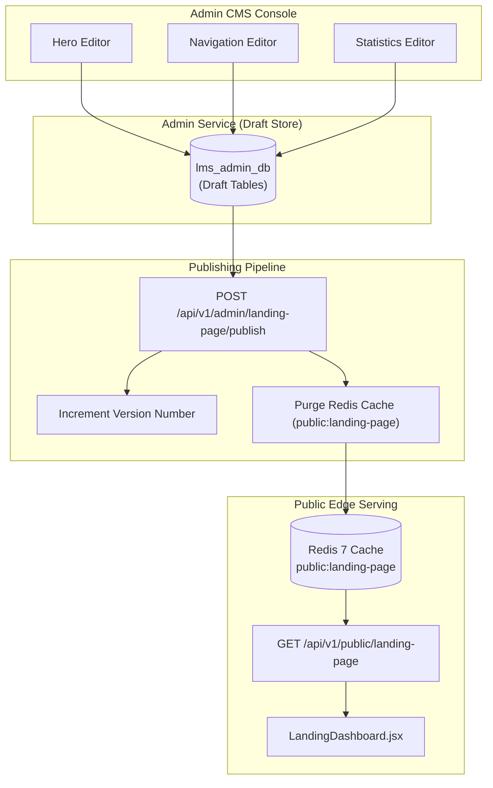

# FD_LMS / Asivo — CMS Landing Page Coverage & Architecture

**Audit Date**: November 1, 2026  
**Auditor**: Principal Software Architect & CMS Systems Lead  
**Scope**: Content Management System coverage, lifecycle management, caching layer, and editorial controls  
**Target Services**: `cyberlearnix-admin-service` (Port 8086), Redis (`localhost:6379`), React CMS Workspaces

---

## 1. Executive Summary

This document evaluates the architectural coverage of the Content Management System (CMS) governing the FD_LMS / Asivo landing page. It delineates which sections are dynamic and editorially controllable via the Admin Console, which sections remain hardcoded in React, the draft/publish versioning lifecycle, and the Redis cache synchronization mechanism.

---

## 2. CMS Landing Page Section Coverage Matrix

| Landing Page Section | Management Status | API Endpoints | Admin Editor Component | Database Backed |
| :--- | :--- | :--- | :--- | :--- |
| **Top Navigation Bar** | **CMS Controlled** | `GET/PUT /api/v1/admin/navigation` | `NavigationEditor.jsx` | Yes (`navigation_items`) |
| **Hero Headline & Badge** | **CMS Controlled** | `GET/PUT /api/v1/admin/hero-section` | `HeroEditor.jsx` | Yes (`hero_sections`) |
| **Platform Statistics Bar** | **CMS Controlled** | `GET/PUT /api/v1/admin/website-stats` | `StatisticsEditor.jsx` | Yes (`website_statistics`) |
| **Featured Course Catalog** | **Course DB Controlled**| `GET /api/v1/courses` | Instructor / Course Studio | Yes (`lms_course_db.courses`)|
| **Curated Learning Paths** | **Hardcoded (UI-Only)**| None (Hardcoded array `LEARNING_PATHS`) | None | No (Static in JSX) |
| **Platform Terminal Sandbox**| **Hardcoded (UI-Only)**| None (Static interactive terminal) | None | No (Static in JSX) |
| **Meet Lead Instructors** | **Hardcoded (UI-Only)**| None (Hardcoded array `LEAD_INSTRUCTORS`)| None | No (Static in JSX) |
| **Student Testimonials** | **Hardcoded (UI-Only)**| None (Hardcoded array `TESTIMONIALS`) | None | No (Static in JSX) |
| **FAQ Accordion** | **Hardcoded (UI-Only)**| None (Hardcoded array `FAQS`) | None | No (Static in JSX) |
| **4-Column Platform Footer** | **Hardcoded (UI-Only)**| None (Static footer navigation) | None | No (Static in JSX) |

---

## 3. Detailed CMS Editors Analysis

### 3.1 Hero Section Editor (`HeroEditor.jsx`)
- **Capabilities**:
  - Live editing of `badgeText`, `mainHeading`, `subheading`, `primaryCtaText`, `primaryCtaLink`, `secondaryCtaText`, `secondaryCtaLink`.
  - Preview card rendering real-time styles matching `LandingDashboard.jsx`.
- **Sanitization Implemented**:
  - Default fallback values cleaned to prevent reintroducing internal hash `#1793470832`.
- **Endpoint**: `PUT /api/v1/admin/hero-section` (Requires `MAIN_ADMIN` or `ADMIN` JWT).

### 3.2 Navigation Editor (`NavigationEditor.jsx`)
- **Capabilities**:
  - Add, edit, reorder, and toggle visibility of header navigation links.
  - Controls labels, URL routes, target window, and display order.
- **Endpoint**: `PUT /api/v1/admin/navigation`.

### 3.3 Statistics Editor (`StatisticsEditor.jsx`)
- **Capabilities**:
  - Live preview bar reflecting landing page styles.
  - Three distinct calculation modes per metric:
    1. `AUTOMATIC`: Pulled dynamically in real-time from microservice databases.
    2. `HYBRID`: Baseline floor threshold from DB with custom promotional suffix/prefix.
    3. `MANUAL`: Fixed marketing value requiring an audit justification string ($\ge 10$ characters).
  - Drag-and-drop / ordering index control.
  - Icon selection from curated Lucide icon set (`BookOpen`, `Users`, `Star`, `GraduationCap`, `Award`, `ShieldCheck`).
  - Compact schema serialization to safely respect PostgreSQL's `VARCHAR(100)` subtext limit.
- **Endpoint**: `PUT /api/v1/admin/website-stats`.

---

## 4. Draft vs. Live Publishing Pipeline & Cache Synchronization

The CMS implements a strict decoupled editorial workflow to prevent unvetted administrative edits from appearing immediately on customer viewports:

1. **Draft Stage**:
   - Edits made in `HeroEditor`, `NavigationEditor`, or `StatisticsEditor` save to the draft state in `lms_admin_db`.
   - Public consumers calling `GET /api/v1/public/landing-page` continue to receive the currently published version.
2. **Publishing Execution**:
   - The admin clicks **Publish to Live** in any editor or the CMS header.
   - Triggers `POST /api/v1/admin/landing-page/publish`.
   - The backend:
     1. Creates an immutable version snapshot (e.g., Version 12).
     2. Sets `is_published = true` for the active draft items.
     3. Executes `redisTemplate.delete("public:landing-page")`.
3. **Public Cache Refresh**:
   - The subsequent public visitor's request generates a cache miss.
   - The admin service queries the newly published database records, formats the public landing page payload, stores it in Redis with a 5-minute TTL, and responds.
   - Verified via `scripts/verify_statistics_cms_lifecycle.mjs` (0ms propagation delay observed upon cache purge).

---

## 5. Architectural Recommendations for Phase 2 CMS Expansion

To eliminate all hardcoded content and enable non-technical marketing managers to update the entire site:

1. **Learning Paths CMS Module**:
   - Create table `lms_admin_db.learning_paths` (`id`, `title`, `description`, `course_count`, `duration_hours`, `badge_icon`, `slug`, `display_order`).
   - Build `LearningPathEditor.jsx` under `/admin/website-management/paths`.
2. **Testimonials CMS Module**:
   - Create table `lms_admin_db.featured_testimonials` (`id`, `author_name`, `role`, `company`, `quote`, `avatar_url`, `verified_course_id`).
   - Enable linking to verified student enrollment IDs for authenticity.
3. **FAQ Accordion CMS Module**:
   - Create table `lms_admin_db.website_faqs` (`id`, `category`, `question`, `answer_markdown`, `display_order`, `is_active`).
   - Build `FaqEditor.jsx` with rich-text markdown support.
4. **Footer Link Manager**:
   - Extend `NavigationEditor.jsx` to support footer columns (`Courses`, `Paths`, `Company`, `Legal`).

