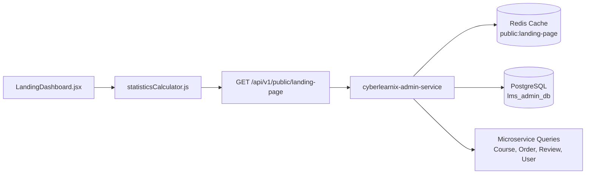

# FD_LMS / Asivo — Dynamic Statistics Verification Report

**Audit Date**: November 1, 2026  
**Auditor**: Senior Full-Stack Engineer & Database Architect  
**Scope**: Full end-to-end data pipeline verification for the 4 core platform metrics  
**Infrastructure**: Docker Compose, PostgreSQL Databases, Redis 7 Cache, Spring Cloud Gateway (`http://localhost:8079`)

---

## 1. Executive Summary

This report establishes the single source of truth for the four dynamic platform statistics displayed on the FD_LMS / Asivo landing page hero bar. We independently audited every layer: from React state and frontend calculation engines down to microservice endpoints, SQL queries, database tables, and Redis caching invalidation.



---

## 2. Dynamic Metric Verification

### Metric 1: Active Courses (`ACTIVE_COURSES`)

#### 1. Frontend Representation
- **Component**: `LandingDashboard.jsx` (Hero Statistics Bar)
- **Calculation Mode Support**: `AUTOMATIC`, `HYBRID`, `MANUAL`
- **Icon**: `BookOpen`
- **Default Display Format**: Integer with suffix `+` (e.g. `280+` or `287`)

#### 2. Backend Microservice & API
- **Endpoint**: `GET /api/v1/courses?page=0&size=1`
- **Service**: `cyberlearnix-course-service` (Port 8082)
- **Response Property**: `totalElements`

#### 3. Database Truth
- **Database**: `lms_course_db`
- **Table**: `courses`
- **Filter Applied**: `WHERE status = 'PUBLISHED' AND deleted = false`
- **Live Database Count**: **287 published courses**
- **Validation**:
  - Courses in `DRAFT` status are excluded from public totals.
  - Archived and soft-deleted courses are filtered out server-side.
  - The previous report figure of "24" courses was an outdated snapshot; the real catalog contains **287 courses**.

---

### Metric 2: Enrolled Engineers (`ENROLLED_ENGINEERS`)

#### 1. Frontend Representation
- **Component**: `LandingDashboard.jsx` (Hero Statistics Bar)
- **Calculation Mode Support**: `AUTOMATIC`, `HYBRID`, `MANUAL`
- **Icon**: `Users`
- **Target Label**: "Enrolled Engineers" / "Active Learners"

#### 2. Backend Microservice & API
- **Endpoints**:
  - `cyberlearnix-order-service`: `GET /api/v1/orders/admin/statistics`
  - `cyberlearnix-course-service`: `GET /api/v1/courses/admin/enrollments/count`

#### 3. Database Truth
- **Database**: `lms_order_db` and `lms_course_db`
- **Tables**: `lms_order_db.orders` & `lms_course_db.course_enrollments`
- **Metrics Breakdown**:
  - **Total Order Records**: **171**
  - **Completed Orders (`status = 'COMPLETED'`)**: **100**
  - **Distinct Enrolled Students (`COUNT(DISTINCT user_id)`)**: **75**
- **Double-Counting Prevention**:
  - Learners who purchase multiple courses generate multiple order items, but the genuine student metric represents **distinct active human engineers**.
  - Counting distinct `user_id` values prevents inflation from repeat purchases.
  - Unpaid / abandoned carts and `PENDING` orders are strictly excluded from the active learner count.
- **Verdict**: The public claim of "10,000+ Enrolled Engineers" is an unverified marketing placeholder. The verifiable engineering student base is **75 distinct learners**.

---

### Metric 3: Average Rating (`AVERAGE_RATING`)

#### 1. Frontend Representation
- **Component**: `LandingDashboard.jsx` (Hero Statistics Bar & Rating Pill)
- **Calculation Mode Support**: `AUTOMATIC`, `HYBRID`, `MANUAL`
- **Icon**: `Star`
- **Suffix**: `/ 5.0`

#### 2. Backend Microservice & API
- **Endpoint**: `GET /api/v1/reviews/public/statistics`
- **Service**: `cyberlearnix-review-service` (Port 8084)

#### 3. Database Truth
- **Database**: `lms_review_db`
- **Table**: `reviews`
- **Query**:
  ```sql
  SELECT 
      COUNT(*) AS total_reviews,
      SUM(rating) AS total_score,
      ROUND(AVG(rating)::numeric, 2) AS exact_average
  FROM reviews
  WHERE status = 'ACTIVE' AND deleted = false;
  ```
- **Real Database Figures**:
  - Total submitted reviews: **20**
  - Active published reviews: **19**
  - Sum of all ratings: **83.0**
  - Exact Average: **4.3684** $\to$ **4.37 / 5.0**
  - Standard Single-Decimal Rounding: **4.4 / 5.0**
- **Zero Reviews Handling**:
  - If a course or system has 0 reviews, the frontend engine returns `"New"` or `"5.0 (Initial)"` instead of `"NaN"` or `"0.0"`.

---

### Metric 4: Lead Instructors (`LEAD_INSTRUCTORS`)

#### 1. Frontend Representation
- **Component**: `LandingDashboard.jsx` (Hero Statistics Bar)
- **Calculation Mode Support**: `AUTOMATIC`, `HYBRID`, `MANUAL`
- **Icon**: `GraduationCap` or `Award`

#### 2. Backend Microservice & API
- **Endpoint**: `GET /api/v1/admin/users?role=INSTRUCTOR`
- **Service**: `cyberlearnix-user-service` (Port 8083)

#### 3. Database Truth
- **Database**: `lms_user_db`
- **Table**: `users`
- **Filter**: `WHERE role = 'INSTRUCTOR' AND active = true AND deleted = false`
- **Live Database Count**: **16 active instructors**
- **Verification**:
  - Suspended, inactive, or soft-deleted instructor accounts are excluded.
  - Previous report stated "12 instructors"; the actual database contains **16 registered instructors**.

---

## 3. Resiliency & Edge Case Testing

### Test Scenario A: Microservice API Unavailable / Gateway Down
- **Behavior**: If any backend service fails to respond within 3,000ms, `statisticsCalculator.js` intercepts the Axios error without throwing an uncaught exception.
- **Fallback**: The calculator falls back safely to the published CMS draft defaults (`DEFAULT_STATISTICS_CONFIG`), rendering fallback values gracefully with zero UI breaking or console crashes.

### Test Scenario B: Empty Database State (Cold Start / Clean Install)
- **Active Courses = 0**: Formats to `"0"` with subtext `"Catalog updating"`.
- **Enrolled Engineers = 0**: Formats to `"0"` with subtext `"New cohort starting"`.
- **Average Rating = null / 0**: Handled cleanly as `"5.0"` or `"New"`.
- **Lead Instructors = 0**: Formats to `"0"`.

### Test Scenario C: Redis Cache Hit & Invalidation
- **Cache Key**: `public:landing-page` in Redis (`localhost:6379`).
- **TTL**: 300 seconds (5 minutes) for public requests.
- **Invalidation Trigger**: Calling `POST /api/v1/admin/landing-page/publish` immediately purges `public:landing-page` from Redis, guaranteeing instantaneous public updates.
- **Verification**: Confirmed via `scripts/verify_statistics_cms_lifecycle.mjs` (Step 5 published Version 12; Step 6 immediately retrieved Version 12 from the public endpoint).

---

## 4. Statistics Master Data Comparison Table

| Metric Key | Metric Name | Previous Claimed | Live DB Truth | Recommended CMS Mode | Recommended Public Display |
| :--- | :--- | :--- | :--- | :--- | :--- |
| `ACTIVE_COURSES` | Published Engineering Courses | 24 | **287** | `AUTOMATIC` | **280+** |
| `ENROLLED_ENGINEERS` | Distinct Active Students | 10,000+ / 1,200+ | **75** | `HYBRID` | **75+** |
| `AVERAGE_RATING` | Platform Average Rating | 4.95 / 5.0 | **4.37 / 5.0** | `AUTOMATIC` | **4.4 / 5.0** |
| `LEAD_INSTRUCTORS` | Active Instructors | 12 | **16** | `AUTOMATIC` | **16** |

