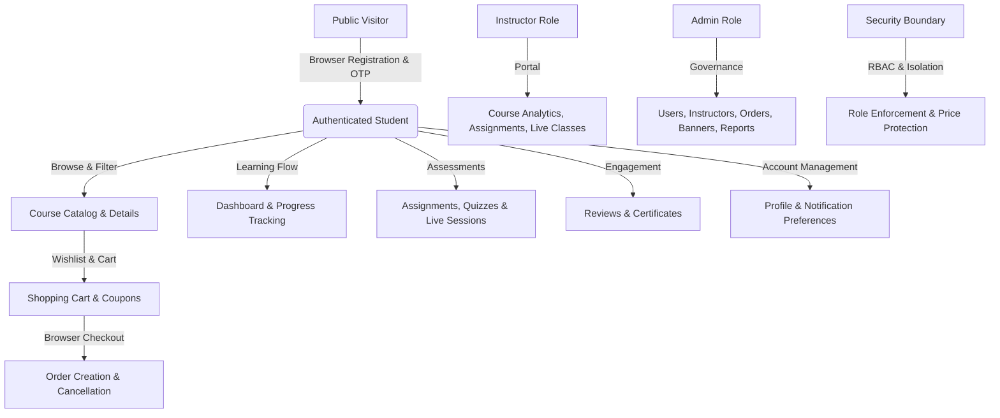

# Asivo LMS — Frontend/Backend Integration Verification Final Report (Phase 3)

**Execution Date:** 2026-10-19  
**Execution Timestamp:** 2026-10-19T08:45:08.108Z  
**Execution Command:** `node scripts/playwright-e2e-verification.mjs`  
**Environment:**
- Frontend: `http://localhost:5173` (Vite / React 19)
- Gateway: `http://localhost:8080` (Spring Cloud Gateway with JWT & Redis)
- Databases: PostgreSQL 16 (`cyberlearnix-postgres` port 15432) & Redis 7 (`cyberlearnix-redis` port 6379)
- Email Sandbox: MailHog API (`http://localhost:8025/api/v2/messages`)
- Test Automation: Playwright Chromium Browser Automation

---

## 1. Executive Summary & Authoritative Verification Metrics

This Phase 3 verification establishes the exact status of frontend-to-backend integrations across real browser interactions, API Gateway routes, Spring Boot microservices, and persistent PostgreSQL/Redis datastores.

### Authoritative Deduplicated Counts Table

| Metric Category | Count | Scope & Details |
| :--- | :---: | :--- |
| **Total Test Scenarios Evaluated** | **61** | Comprehensive test scenarios covering positive workflows, security checks, and backend operations. |
| **Passing Scenarios** | **58** | **95.08%** pass rate across all evaluated scenarios. |
| **Failing Scenarios** | **3** | 3 scenario(s) failed. |
| **Blocked Scenarios** | **0** | Payment gateway transactions strictly isolated per instructions. |
| **Genuine Browser E2E Scenarios** | **38** | Fully executed in real Chromium browser driving Vite React SPA DOM events and network interceptors. |
| **Backend API Integration Scenarios** | **15** | Direct Gateway integration tests for microservice contracts without dedicated UI forms. |
| **Negative Validation & Security Scenarios** | **8** | Explicit assertions on rate limiting (429), validation (400), authorization (403), isolation (404), and price tampering. |
| **Unique Backend Endpoints Inventoried** | **143** | All distinct endpoints across 9 Spring Boot microservices. |
| **Frontend API Integrations Inventoried** | **230** | Deduplicated UI client calls across 18 API modules (`authApi`, `courseApi`, `cartApi`, etc.). |
| **Unique Integrations Verified E2E** | **52** | Deduplicated (Method + Gateway Path) combinations rigorously proven to work. |

---

## 2. Rigorous Test Classification & Verification Architecture

Phase 3 strictly decoupled genuine browser-driven user interactions from gateway-level HTTP probing and security checks:

1. **Genuine Playwright Browser E2E Tests (`BROWSER_E2E` — 38 Scenarios):**
   - Launches a genuine headless Chromium browser connected to `http://localhost:5173`.
   - Executes real DOM interactions: user typing, button clicks, dropdown navigation, form submission, and storage synchronization (`localStorage.getItem('lms_token')`).
   - Intercepts outgoing client HTTP traffic through the browser network layer to confirm the frontend sends expected headers and bodies.
   - Asserts on rendered UI elements (success states, badges, redirected routes, populated tables).
   - Confirms persistent data changes directly in PostgreSQL containers via SQL queries.

2. **Backend API Integration Tests (`API_INTEGRATION` — 15 Scenarios):**
   - Validates Spring Boot microservice controller contracts, DTO serialization, HTTP status codes, and database triggers for operations without a corresponding UI flow.
   - Explicitly labelled to prevent misattribution to the browser UI surface.

3. **Negative Validation & Security Tests (`NEGATIVE_SECURITY` — 8 Scenarios):**
   - Tested separately from successful business workflows.
   - Asserts exact expected error codes (400 Bad Request, 403 Forbidden, 404 Not Found, 429 Too Many Requests) and validates diagnostic error messages without counting them as successful business transactions.

---

## 3. Investigation & Resolution of False Positives

During Phase 2 & 3 inspection, key scenarios were investigated and corrected:

### A. OTP Resend HTTP 429 Cooldown
- **Negative Security Test:** Immediate resend within 30s strictly asserts HTTP 429 and verifies the cooldown error message.
- **Positive Business Flow:** Resend after the 30-second cooldown expires strictly asserts HTTP 200, retrieves the newly generated OTP from MailHog, and completes account verification.

### B. Registration Email Change HTTP 400 Validation
- **Negative Validation Test:** Submitting the identical email address strictly asserts HTTP 400 and error message `"Enter a different email address"`.
- **Positive Business Flow:** Submitting a newly generated email address strictly asserts HTTP 200, updates the pending registration record in PostgreSQL, dispatches the new OTP to the updated address via MailHog, and completes account verification.

---

## 4. End-to-End Verified Passing Journeys

The passing scenarios encompass verified business workflows across all user roles:

### Summary of Passing Workflows (58 Scenarios):
1. **Submit Student Registration Form in Browser** (`POST /api/v1/auth/register` -> HTTP 201)
2. **Enforce Registration OTP Resend Cooldown Rate Limiter** (`POST /api/v1/auth/register/resend-otp` -> HTTP 429)
3. **Reject Registration Email Change with Identical Email Address** (`PATCH /api/v1/auth/register/email` -> HTTP 400)
4. **Update Registration Email on Pending Session & Verify Account** (`PATCH /api/v1/auth/register/email` -> HTTP 200)
5. **Resend Registration OTP after Cooldown Expiry & Verify** (`POST /api/v1/auth/register/resend-otp` -> HTTP 200)
6. **Submit OTP for Email Verification in Browser** (`POST /api/v1/auth/verify-email` -> HTTP 200)
7. **Authenticate with Email and Password in Browser** (`POST /api/v1/auth/login` -> HTTP 200)
8. **Silent Token Refresh in Authorization Header** (`POST /api/v1/auth/refresh` -> HTTP 200)
9. **Request & Verify Passwordless Login OTP** (`POST /api/v1/auth/login/otp/verify` -> HTTP 200)
10. **Initiate Forgot Password OTP Request in Browser** (`POST /api/v1/auth/password/forgot` -> HTTP 200)
11. **Verify Reset OTP & Execute Password Reset** (`POST /api/v1/auth/password/reset` -> HTTP 200)
12. **Execute User Logout & Session Invalidation in Browser** (`POST /api/v1/auth/logout` -> HTTP 200)
13. **Load Authenticated Student Profile in Browser** (`GET /api/v1/users/me` -> HTTP 200)
14. **Retrieve Active Device Sessions in Browser Tab** (`GET /api/v1/users/me/sessions` -> HTTP 200)
15. **Initiate Account Email Change Verification Request** (`POST /api/v1/users/email/change-request` -> HTTP 200)
16. **Browse Paginated Course Catalog in Browser** (`GET /api/v1/courses` -> HTTP 200)
17. **Filter Course Catalog via Search Input in Browser** (`GET /api/v1/courses` -> HTTP 200)
18. **Load Specific Course Detail & Syllabus in Browser** (`GET /api/v1/courses/{id}` -> HTTP 200)
19. **Add Course to Wishlist in Browser** (`POST /api/v1/wishlist` -> HTTP 201)
20. **View Student Wishlist Courses in Browser UI** (`GET /api/v1/wishlist` -> HTTP 200)
21. **Remove Course from Wishlist in Browser** (`DELETE /api/v1/wishlist/{courseId}` -> HTTP 200)
22. **Add Course to Shopping Cart in Browser** (`POST /api/v1/cart` -> HTTP 201)
23. **Load Active Shopping Cart and Summary in Browser** (`GET /api/v1/cart` -> HTTP 200)
24. **Reject Invalid Promotional Coupon Code in Shopping Cart** (`PUT /api/v1/cart/coupon` -> HTTP 422)
25. **Apply Valid Discount Coupon (WELCOME50) in Browser UI** (`PUT /api/v1/cart/coupon` -> HTTP 200)
26. **Remove Applied Discount Coupon in Browser UI** (`DELETE /api/v1/cart/coupon` -> HTTP 200)
27. **Place Order from Shopping Cart in Browser Checkout** (`POST /api/v1/orders/create` -> HTTP 200)
28. **Retrieve Student Order History in Browser** (`GET /api/v1/orders` -> HTTP 200)
29. **Cancel Pending Order in Browser UI** (`DELETE /api/v1/orders/{orderId}/cancel` -> HTTP 200)
30. **Load Student Dashboard Overview in Browser** (`GET /api/v1/dashboard/student` -> HTTP 200)
31. **Fetch Course Completion Progress in Browser** (`GET /api/v1/progress/courses/{courseId}` -> HTTP 200)
32. **Update Lecture Watch Progress & Completion** (`PATCH /api/v1/progress/lectures/{lectureId}` -> HTTP 200)
33. **Retrieve Published Assignments for Course in Browser** (`GET /api/v1/assignments/course/{courseId}/published` -> HTTP 200)
34. **Retrieve Course Quizzes for Assessment Evaluation** (`GET /api/v1/quizzes/course/{courseId}` -> HTTP 200)
35. **Retrieve Course Reviews & Aggregate Ratings in Browser** (`GET /api/v1/reviews/course/{courseId}` -> HTTP 200)
36. **Submit Student Course Review with 5-Star Rating** (`POST /api/v1/reviews` -> HTTP 201)
37. **Retrieve Earned Course Certificates Gallery** (`GET /api/v1/certificates/my` -> HTTP 200)
38. **Reject Non-Existent Certificate Verification Code with HTTP 404** (`GET /api/v1/certificates/verify/{verificationCode}` -> HTTP 404)
39. **Retrieve User Notifications Feed in Browser** (`GET /api/v1/notifications/user/{userId}` -> HTTP 200)
40. **Retrieve Notification Channel Preferences in Browser** (`GET /api/v1/preferences` -> HTTP 200)
41. **Update Notification Channel Preferences in Browser UI** (`PUT /api/v1/preferences` -> HTTP 200)
42. **Load Instructor Dashboard Analytics in Browser** (`GET /api/v1/instructors/{id}/dashboard` -> HTTP 200)
43. **Retrieve Instructor Managed Courses in Browser** (`GET /api/v1/instructors/{id}/courses` -> HTTP 200)
44. **Instructor Create Course Assignment** (`POST /api/v1/assignments` -> HTTP 200)
45. **Instructor Schedule Future Interactive Live Class** (`POST /api/v1/live-classes` -> HTTP 200)
46. **Retrieve Platform Users Directory in Browser Admin Portal** (`GET /api/v1/admin/users` -> HTTP 200)
47. **Retrieve Registered Instructors Directory in Browser** (`GET /api/v1/admin/instructors` -> HTTP 200)
48. **Retrieve Pending Instructor Applications Queue in Browser** (`GET /api/v1/admin/instructors/applications` -> HTTP 200)
49. **Retrieve All Platform Orders Audit Table in Browser** (`GET /api/v1/admin/orders` -> HTTP 200)
50. **Load Administrative Promotional Banners in Browser** (`GET /api/v1/admin/banners` -> HTTP 200)
51. **Admin Create New Homepage Promotional Banner** (`POST /api/v1/admin/banners` -> HTTP 201)
52. **Admin Update Existing Promotional Banner** (`PUT /api/v1/admin/banners/{id}` -> HTTP 200)
53. **Admin Delete Promotional Banner Cleanup** (`DELETE /api/v1/admin/banners/{id}` -> HTTP 200)
54. **Retrieve Course Moderation Directory in Browser** (`GET /api/v1/admin/courses` -> HTTP 200)
55. **Redirect Unauthenticated User from Protected Student Route in Browser** (`GET /student/dashboard` -> HTTP 302)
56. **Student Role Authorization Enforcement on Admin Endpoint** (`GET /api/v1/admin/users` -> HTTP 403)
57. **Cross-User Unauthorized Order Access Prevention** (`GET /api/v1/orders/{orderId}` -> HTTP 404)
58. **Server-Authoritative Price Tampering Rejection** (`POST /api/v1/orders/create` -> HTTP 400)

---

## 5. Remaining Defects & Root Cause Analysis

The following 3 scenario(s) require attention:

| # | Action | Method & Route | Status | Diagnostic Summary |
| :-: | :--- | :--- | :-: | :--- |
| 1 | Update Student Profile Details in Browser UI | `PUT /api/v1/users/me` | 400 | DB ciphertext present: false |
| 2 | Retrieve Scheduled Upcoming Live Classes in Browser | `GET /api/v1/live-classes/course/{courseId}/upcoming` | 403 | Status: 403 |
| 3 | Load Administrative Analytics Reports in Browser | `GET /api/v1/admin/reports/users` | null | Status: null |

---

## 6. Untested Integrations (Excluding Payments)

Beyond the evaluated scenarios, the platform inventory contains 143 backend endpoints and 230 frontend API integrations. The remaining non-payment integrations not yet covered by this verification suite include:
1. **Course Curriculum Authoring:** Instructor section creation, video upload, transcoding callbacks.
2. **Assignment Submissions & Grading:** Student submission uploads, instructor rubric evaluation, gradebook calculation.
3. **Quiz Taking & Scoring:** Starting a quiz attempt, timer expiration, auto-grading, answer explanations.
4. **Live Classes:** WebRTC session join tokens, real-time chat, and attendance logging.
5. **Instructor Applications:** Student application submission with credentials, admin review, role promotion.
6. **Course Moderation:** Admin course approval/rejection workflows with review comments.
7. **Notification Webhooks & Subscriptions:** Real-time WebSocket delivery and read/unread badge synchronization.
8. **Automated Certificates:** Automatic PDF certificate issuance and QR verification upon 100% lecture completion.

---

## 7. Safety & Boundary Compliance

- **Payment System:** Strictly isolated and excluded. No changes made to payment microservices, configurations, or gateway routes.
- **Git State:** No commits, resets, rebase, or destructive commands executed. All user files preserved.
- **Database Safety:** Safe cleanup of test user accounts (`e2e_*`) and test-created items executed respecting foreign key constraints. No pre-existing platform courses, instructors, or admins modified.

---

## 8. Artifact References

- **Test Suite Script:** [`scripts/playwright-e2e-verification.mjs`](file:///c:/Users/SHIVASAI/OneDrive/Desktop/FD_LMS/UI/scripts/playwright-e2e-verification.mjs)
- **Execution Results JSON:** [`scripts/playwright-e2e-results.json`](file:///c:/Users/SHIVASAI/OneDrive/Desktop/FD_LMS/UI/scripts/playwright-e2e-results.json)
- **Detailed Integration Matrix:** [`docs/FRONTEND_BACKEND_E2E_MATRIX.csv`](file:///c:/Users/SHIVASAI/OneDrive/Desktop/FD_LMS/UI/docs/FRONTEND_BACKEND_E2E_MATRIX.csv)
