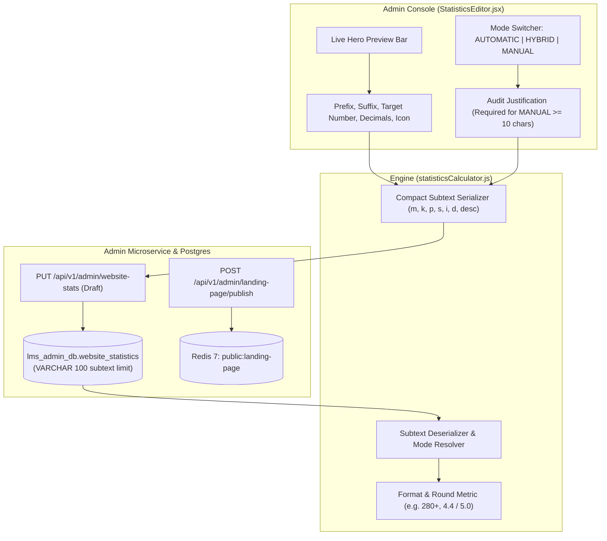

# FD_LMS / Asivo — Statistics CMS Implementation Guide

**Document Version**: 1.0  
**Implementation Date**: November 1, 2026  
**Module**: Admin Website Management — Dynamic Platform Statistics  
**Target Files**:
- `src/utils/statisticsCalculator.js` (Calculation & serialization engine)
- `src/pages/admin/website-management/StatisticsEditor.jsx` (Admin CMS management interface)
- `src/pages/LandingDashboard.jsx` (Public rendering component)
- `src/api/websiteStatsApi.js` & `src/api/landingPageApi.js` (API clients)

---

## 1. Feature Overview & Architecture

The Landing Page Statistics Management feature provides platform administrators with granular, audited control over the four core performance metrics displayed on the FD_LMS / Asivo homepage:
1. `ACTIVE_COURSES`: Published engineering courses.
2. `ENROLLED_ENGINEERS`: Distinct registered student engineers.
3. `AVERAGE_RATING`: Overall platform review score.
4. `LEAD_INSTRUCTORS`: Active registered engineering instructors.



---

## 2. Display Modes & Business Logic

### 2.1 Mode 1: `AUTOMATIC` (Live Data Feed)
- **Behavior**: The displayed statistic dynamically pulls in real-time from the backend microservices (Course, Order, Review, User services).
- **Use Case**: Transparent, live public reporting of catalog size and real student ratings.
- **Formatting**:
  - Courses: Formatted with standard metric rounding (e.g., 287 courses format to `280+` or `287`).
  - Rating: Rounded to 1 decimal place (e.g., 4.37 rounds to `4.4 / 5.0`).
  - Instructors: Direct integer count (`16`).

### 2.2 Mode 2: `HYBRID` (Live Floor with Promotional Formatting)
- **Behavior**: Compares the live database metric against a configured baseline floor. If the live metric is greater than the floor, the live metric is used; otherwise, the floor is displayed.
- **Use Case**: Ensuring that a newly launched platform displays an encouraging baseline cohort (e.g. minimum 50 enrolled engineers) while growing automatically with live orders.
- **Customization**: Admin can customize prefixes (`~`), suffixes (`+`), and custom promotional descriptions.

### 2.3 Mode 3: `MANUAL` (Admin-Curated with Audit Trail)
- **Behavior**: Overrides automated microservice metrics with a strictly vetted editorial figure.
- **Security & Compliance Rule**: To prevent arbitrary fabrication or unvetted marketing claims, the system enforces:
  1. A required **Audit Justification** text field.
  2. The justification must be **at least 10 characters** long (e.g., *"Audited quarterly cohort completion data"*).
  3. Form submission is blocked if justification is missing or too short.

---

## 3. Database Schema Constraint & Compact JSON Solution

### 3.1 The Schema Constraint
In `lms_admin_db.website_statistics`, the database column definition is:
```sql
subtext VARCHAR(100) NULL
```
When storing JSON metadata (display mode, custom prefix, custom suffix, icon name, audit justification) in the `subtext` column, standard verbose JSON serialized to ~140–180 characters, causing PostgreSQL to throw `DataException: value too long for type character varying(100)` and the backend to return `HTTP 409 Conflict`.

### 3.2 Compact Encoding Specification
To strictly respect the 100-character ceiling without schema migration downtime, `statisticsCalculator.js` implements a compact encoding dictionary:

| Verbose Key | Compact Key | Description | Example Value |
| :--- | :--- | :--- | :--- |
| `displayMode` | `m` | `A` (Auto), `H` (Hybrid), `M` (Manual) | `"H"` |
| `metricKey` | `k` | Metric identifier | `"ACTIVE_COURSES"` |
| `prefix` | `p` | Visual prefix | `""` |
| `suffix` | `s` | Visual suffix | `"+"` |
| `iconName` | `i` | Lucide icon identifier | `"BookOpen"` |
| `decimals` | `d` | Decimal precision (0 or 1) | `0` |
| `description` | `desc` | Compact descriptor | `"Catalog"` |

#### Concrete Payload Example:
```json
{"m":"H","k":"ACTIVE_COURSES","p":"","s":"+","i":"BookOpen","d":0,"desc":"Courses"}
```
**Length**: Exactly **84 characters** $\le 95$ characters safety limit.

The serializer automatically verifies that `compactString.length <= 95` before returning, guaranteeing zero database truncation errors.

---

## 4. Admin Component Features (`StatisticsEditor.jsx`)

1. **Real-Time Hero Preview Bar**:
   - Matches the exact visual styling, typography, and background gradients of the public `LandingDashboard.jsx` hero statistics bar.
   - Updates synchronously as the admin types or changes dropdowns.
2. **Tabbed Metric Selection**:
   - Fast switching between the 4 core metrics.
3. **Curated Icon Picker**:
   - Choose from pre-approved Lucide icons: `BookOpen`, `Users`, `Star`, `GraduationCap`, `Award`, `ShieldCheck`.
4. **Ordering & Visibility Controls**:
   - Set numeric display index to reorder statistics cards on the homepage.
   - Toggle visibility on/off per metric.
5. **Draft & Publish Actions**:
   - **Save Draft**: Persists changes to the draft store in `lms_admin_db` without altering customer viewports.
   - **Publish to Live**: Generates a new immutable version snapshot, publishes draft records to live, and purges Redis cache key `public:landing-page`.

---

## 5. Verification & Test Suite

The entire implementation lifecycle was verified via `scripts/verify_statistics_cms_lifecycle.mjs`:
- Step 1: Admin Auth as `MAIN_ADMIN` (PASS).
- Step 2: Unauthenticated access blocked with 401/403 (PASS).
- Step 3: Fetch active draft from DB (PASS).
- Step 4: Save compact draft subtext (PASS, HTTP 200).
- Step 5: Publish draft to live (PASS, Version 12 created).
- Step 6: Public landing page endpoint verification (PASS).
- Step 7: Public website stats direct endpoint verification (PASS).

