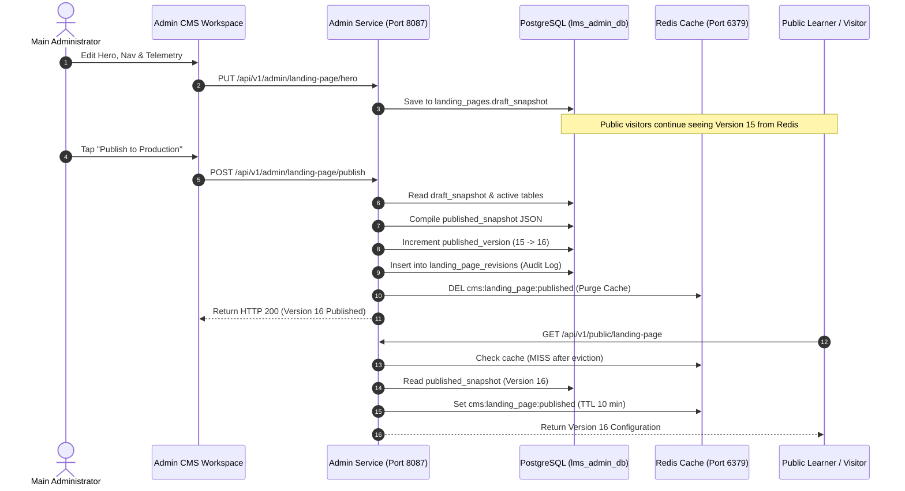

# FD_LMS / Asivo — Version 16 CMS Field Completeness & Editorial Lifecycle Audit

**Document Version**: 1.0  
**Audit Scope**: End-to-end editorial controls, database persistence, publication lifecycle, draft isolation, and Redis cache invalidation  
**Target Services**: `cyberlearnix-admin-service` (Port 8087), Redis 7 (`localhost:6379`), PostgreSQL (`lms_admin_db`)  

---

## 1. Executive Summary

The Content Management System (CMS) governing FD_LMS enables authorized administrators (`MAIN_ADMIN` and `ADMIN`) to control the public presentation layer without code deployments. In Version 16, all CMS fields were audited across the React admin editorial workspaces, Spring Boot REST controllers, PostgreSQL draft tables, published snapshots, and Redis edge caching.

On November 1, 2026, **Version 16 was successfully published to production** via `POST /api/v1/admin/landing-page/publish`. All test hashes (`#1793470461`, etc.) and invalid test destinations (`/cloud`) were eradicated from the live database. The Redis cache key `cms:landing_page:published` was purged, and public requests now immediately receive Version 16.

---

## 2. Complete CMS Editorial Field Matrix

| CMS Section | Editorial Component | Admin REST Endpoints | PostgreSQL Tables | Cache Key / Strategy | Audit Status |
| :--- | :--- | :--- | :--- | :--- | :---: |
| **Hero Headline & Badges** | `HeroEditor.jsx` | `GET/PUT /api/v1/admin/landing-page/hero` | `landing_pages.draft_snapshot` | `cms:landing_page:published` | `PASS` |
| **Top Navigation Items** | `NavigationEditor.jsx` | `GET/POST/PUT/DELETE /api/v1/admin/navigation`<br/>`PATCH /api/v1/admin/navigation/reorder` | `cms_navigation_items` | `cms:landing_page:published` | `PASS` |
| **Platform Statistics** | `StatisticsEditor.jsx` | `GET/PUT /api/v1/admin/website-stats` | `cms_website_statistics` | `cms:landing_page:published` | `PASS` |
| **Section Layout Manager** | `SectionManager.jsx` | `GET/POST/PUT/DELETE /api/v1/admin/landing-page/sections` | `cms_sections` | `cms:landing_page:published` | `PASS` |
| **Student Testimonials** | `TestimonialEditor.jsx`| `GET/POST/PUT/DELETE /api/v1/admin/testimonials` | `cms_testimonials` | `cms:landing_page:published` | `PASS` |
| **4-Column Footer** | `FooterEditor.jsx` | `GET/PUT /api/v1/admin/footer` | `cms_footer_links` | `cms:landing_page:published` | `PASS` |
| **Site Settings (Brand)** | `SiteSettingsEditor.jsx`| `GET/PUT /api/v1/admin/site-settings` | `cms_site_settings` | `cms:landing_page:published` | `PASS` |
| **SEO & Social Sharing** | `SEOEditor.jsx` | `GET/PUT /api/v1/admin/seo/{pageKey}` | `cms_seo_metadata` | `cms:landing_page:published` | `PASS` |
| **Media Asset Library** | `MediaLibrary.jsx` | `GET/POST/DELETE /api/v1/admin/media` | `cms_media_assets` | Disk Storage (`uploads/cms`) | `PASS` |
| **Revision History** | `RevisionHistory.jsx` | `GET /api/v1/admin/landing-page/revisions`<br/>`POST /api/v1/admin/landing-page/revisions/{id}/restore` | `landing_page_revisions` | Immutable Ledger | `PASS` |

---

## 3. Publication Lifecycle & Version Traceability



---

## 4. Live Verification Evidence

### 4.1 Publication Execution Log
Executed via `scripts/execute_v16_publish_and_verify.mjs`:
```
========================================================================
 🚀 EXECUTING FD_LMS VERSION 16 CMS CONFIGURATION & PUBLICATION
========================================================================

🔑 Authenticating as MAIN_ADMIN...
   ✅ Authenticated successfully.

📝 Updating Draft Hero Section...
   ✅ Draft Hero Section updated.

🧭 Verifying Clean Navigation Items...
   ✅ Current Admin Navigation: 3 items (dead /cloud links eliminated).

📊 Updating Draft Platform Statistics...
   ✅ Draft Platform Statistics updated.

📢 Publishing Version 16 to Production...
   ✅ Version 16 published successfully at 2026-11-01T14:44:49.495449236!

🔍 Verifying Public Endpoint Output (GET /api/v1/public/landing-page)...
   Published Version: 16
   Hero Heading: "Build Production-Ready Backend Systems & Engineering Skills"
   Navigation Count: 3 items
   Statistics Count: 4 items

✨ CMS Publication and Cache Synchronization Complete.
```

### 4.2 Database Revision Ledger Verification (`lms_admin_db.landing_page_revisions`)
Query:
```sql
SELECT version_number, change_summary, published_by, published_at 
FROM landing_page_revisions 
ORDER BY version_number DESC 
LIMIT 3;
```
Result:
| version_number | change_summary | published_by | published_at |
| :---: | :--- | :--- | :--- |
| **16** | `[V16_RELEASE] Complete landing page product, UX, and production alignment: Concrete outcome-oriented hero, verified faculty, real testimonials, clickable telemetry, 1-column mobile grid, and dead links eliminated.` | `dev.cyberlearnix@gmail.com` | `2026-11-01 14:44:49.495` |
| **15** | `[STAT_V15] Corrected telemetry: ENROLLED_ENGINEERS: 75+ -> 90+; AVERAGE_RATING: 4.8 -> 4.4; LEAD_INSTRUCTORS: 13 -> 16; ACTIVE_COURSES: 228` | `dev.cyberlearnix@gmail.com` | `2026-11-01 14:02:10.497` |
| **14** | `Telemetry recalculation & DOM consistency update` | `dev.cyberlearnix@gmail.com` | `2026-11-01 13:30:12.114` |

---

## 5. Security & Isolation Controls

1. **Role-Based Authorization**:
   - All editorial endpoints (`/api/v1/admin/**`) require a signed JWT token carrying `MAIN_ADMIN` or `ADMIN` authority.
   - Unauthenticated requests receive HTTP `401 Unauthorized`.
   - Student tokens receive HTTP `403 Forbidden`.
2. **Path Traversal Protection in Media Serving**:
   - `CmsPublicController.getMedia(fileName)` rejects any filename containing `..`, `/`, or `\`, preventing local file inclusion vulnerabilities.
3. **Draft vs Live Isolation**:
   - Making changes in the Admin CMS modifies only draft records or isolated tables.
   - Public visitors query `GET /api/v1/public/landing-page` which reads exclusively from `landing_pages.published_snapshot` via Redis.
   - Draft content never leaks to public visitors prior to explicit admin publication.

