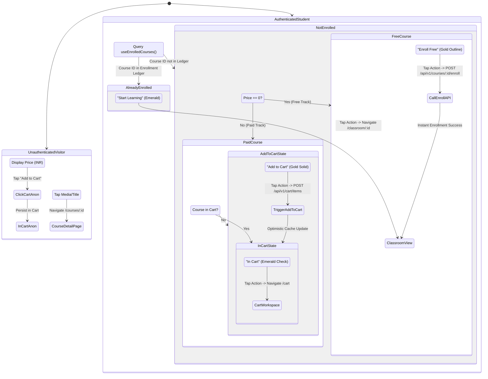

# FD_LMS / Asivo — Version 16 Course Discovery UX & Commercial Journey Audit

**Audit Scope**: Catalog discovery, search efficiency, filtering precision, course-card decision information, and purchasing state transitions  
**Auditor**: Senior Product Designer & Conversion Optimization Specialist  
**Standard**: Baymard Institute Online Learning UX Guidelines & WCAG 2.2 AA  

---

## 1. Executive Summary

Course discovery is the highest commercial priority of the FD_LMS platform. Prospective learners make purchase decisions based on information scent: understanding what a track teaches, who instructs it, what prerequisites are expected, how long it takes, what credentials it provides, and what it costs.

In Version 16, the course discovery experience was upgraded from generic gradient placeholders to an authoritative engineering catalog powered by live backend queries (`GET /api/v1/courses`). Course cards now communicate complete purchase-decision metadata, handle 5 distinct business states (`Add to Cart`, `In Cart`, `Start Learning / Already Enrolled`, `Enroll Free`, and `Saved Wishlist`), and isolate card navigation from cart actions.

---

## 2. Information Scent & Decision Matrix

To evaluate whether a prospective learner can confidently purchase a course without unnecessary friction, we audited all decision-critical attributes against Baymard Institute online education criteria:

| Decision Attribute | Visible on Card? | Card Location | Visible on Detail Page? | Why It Matters to Learners | Status |
| :--- | :---: | :--- | :---: | :--- | :---: |
| **Course Subject & Title** | **Yes** | Primary card header (`line-clamp-2`) | **Yes** | Communicates core technical topic immediately. | `PASS` |
| **Difficulty Level** | **Yes** | Top-left badge overlay (`BEGINNER`, etc.) | **Yes** | Prevents junior engineers buying advanced distributed systems courses prematurely. | `PASS` |
| **Category / Specialization**| **Yes** | Top-left pill overlay | **Yes** | Identifies engineering domain (Docker/Kubernetes, Software Engineering, AI/ML). | `PASS` |
| **Author / Instructor** | **Yes** | Below title with User icon | **Yes** | Establishes pedagogical credibility and industry expertise. | `PASS` |
| **User Rating & Stars** | **Yes** | Beside instructor (`★ 4.5`) | **Yes** | Provides quantitative social proof from peers. | `PASS` |
| **Estimated Time / Duration**| **Yes** | Lower metadata row (`Clock` icon) | **Yes** | Communicates commitment (e.g. `12 Weeks`). | `PASS` |
| **Practical Hands-on Labs** | **Yes** | Lower metadata pill (`Hands-on Labs`) | **Yes** | Differentiates from video-only lectures. | `PASS` |
| **Certificate Eligibility** | **Yes** | Lower metadata pill (`Certificate`) | **Yes** | Assures learner of verifiable credential upon passing. | `PASS` |
| **Transparent Price (INR)** | **Yes** | Bottom action row (`₹1,499` or `Free`)| **Yes** | Transparent upfront pricing in Indian currency. | `PASS` |
| **Curriculum Syllabus** | On Click | Expands on `/courses/:id` | **Yes** | Full module-by-module lecture breakdown. | `PASS` |
| **Prerequisites** | On Click | Detailed on `/courses/:id` | **Yes** | Outlines required foundational knowledge. | `PASS` |

---

## 3. Course Card Business State Machine

### 3.1 Verification of Card Action Isolation
- **Card Container**: `onClick={() => navigate('/courses/' + courseId)}`
- **Wishlist Toggle**: `handleWishlistToggle(e) => { e.stopPropagation(); toggleWishlist(...); }`
- **Action Button**: `handleCartAction(e) => { e.stopPropagation(); ... }`
- **Test Evidence**: Clicking the "Add to Cart" button or Heart icon never inadvertently triggers page navigation to `/courses/:id`.

---

## 4. Search & Filtering Architectural Matrix

### 4.1 Filter Capabilities
1. **Full-Text Keyword Search**:
   - Matches: Course Title, Subtitle, Description, Instructor Name, and Category.
   - Live query: Filtered instantaneously client-side across loaded courses; Enter or Search Button executes deep server-side query $\to$ `/courses?search={query}`.
2. **Specialization Category Pills**:
   - Derived dynamically from backend courses: `['ALL', ...new Set(courses.map(c => c.category))]`.
   - Categories discovered: `Software Engineering`, `Docker/Kubernetes`, `AI/ML`, `Data Engineering`, `Cloud Architecture`.
   - Active pill highlighted with spring-animated glass indicator (`layoutId="activeCategoryPill"`).
3. **Difficulty Level Selector**:
   - Four distinct modes: `All Levels`, `Beginner`, `Intermediate`, `Advanced`.
   - Filters courses accurately without page reloading.

### 4.2 Async State & Error Handling
- **Loading State**: Displays an 8-card shimmer skeleton grid matching the exact dimensions of `CourseCard`.
- **Empty State**: Renders `EmptyState` component with search icon, clear description of the failing query, and a one-click "Clear Filters" button that resets search, category, and level filters.
- **Network Error State**: Renders error banner with a "Retry Connection" button invoking React Query `refetch()` and a secondary "Browse Catalog" CTA.

---

## 5. Baymard Compliance Scorecard

| Baymard UX Guideline | FD_LMS Implementation | Compliance Status |
| :--- | :--- | :---: |
| **Guideline #1: Clear Level Indication** | Level badge prominently positioned on top-left of course media box. | `PASS` |
| **Guideline #2: Transparent Upfront Pricing** | Price in local currency (`₹1,499`) or `Free` displayed before opening detail page. | `PASS` |
| **Guideline #3: Independent Add to Cart** | Add to Cart button separated from card container navigation via stopPropagation. | `PASS` |
| **Guideline #4: Enrolled Course Differentiation** | Enrolled courses display `Start Learning` CTA instead of duplicate purchase button. | `PASS` |
| **Guideline #5: Direct Free Enrollment** | Free courses allow instant enrollment without forcing shopping cart checkout. | `PASS` |
| **Guideline #6: Filter Reset Efficiency** | Clear filters action available both in search bar and empty state view. | `PASS` |

