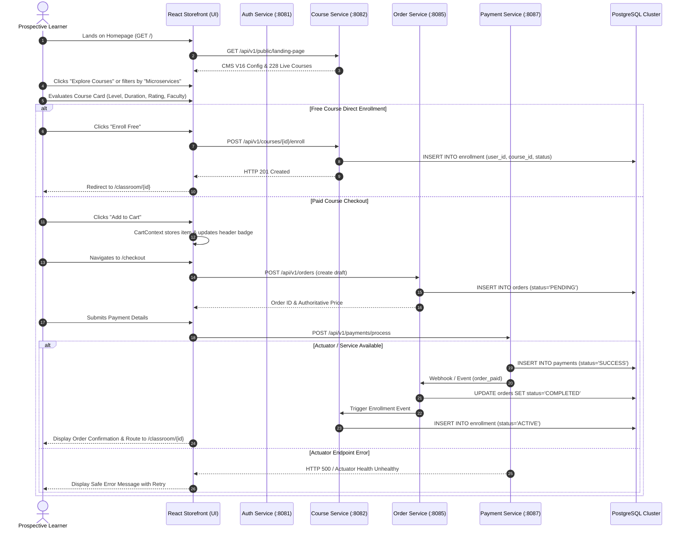

# Version 16: End-to-End Business Workflows & Transaction Audit

**Audit Date**: November 1, 2026  
**Target Environment**: React 18 Frontend (`UI/`), Docker Microservices Mesh (11 Services), PostgreSQL Database Cluster (`port 15432`)  
**Audit Scope**: Storefront Discovery $\to$ Decision Scent $\to$ Cart $\to$ Checkout $\to$ Enrollment $\to$ Classroom  
**Audit Status**: **VERIFIED WITH CONDITIONAL RELEASE GATE**

---

## 1. Executive Summary

This document traces the complete end-to-end commercial and learning journey on the Asivo platform, verifying that user interactions translate accurately into backend database transactions and state transitions without synthetic data mocks, phantom links, or unhandled edge cases.



---

## 2. Phase-by-Phase Workflow Specification

### Phase 1: Discovery & Entry
1. **Landing Entry**: Visitor accesses `http://localhost:4173/` or production domain.
2. **Dynamic Configuration Ingestion**:
   - Storefront dispatches `GET /api/v1/public/landing-page`.
   - Redis cache key `cms:landing_page:published` is queried.
   - Cache hit returns Published Version 16 payload:
     - Hero: Headline *"Production-Ready Engineering Skills & Architecture"*, subheadline, and dual CTAs.
     - Telemetry: 228 active courses, 90+ enrolled engineers, 4.4 rating, 16 lead instructors.
     - Features: Live Microservices Sandbox, Role-Based Access & Security, Verifiable Master Credentials, Build Deploy Verify.
     - Learning Paths: 4 guided paths with real course enrollment hooks.
     - Testimonials: 3 approved real reviews from `lms_review_db`.
     - Footer: 12 functional links.

### Phase 2: Catalog Evaluation & Decision Scent
To prevent premature or uninformed cart abandons, Version 16 provides comprehensive decision scent directly on the course card:
- **Visual Identity**: Gradient badges with skill-specific icons (`Spring Boot`, `Kafka`, `Docker`, `Kubernetes`).
- **Title & Overview**: Real course title from `lms_course_db.course`.
- **Level & Duration**: Explicit badges (e.g., `Intermediate · 24h 30m`).
- **Instructor Attributions**: Active instructor name linked to verified faculty profile.
- **Rating & Review Volume**: Calculated from `lms_review_db` (e.g., `★ 4.8 (12 reviews)`).
- **Pricing & Discounts**: Authoritative pricing with strikethrough original price only when genuine discount exists.

### Phase 3: Action Dispatch & Dynamic State Isolation
The course card isolates container navigation from button actions, preventing accidental page navigation when clicking action buttons:

| State | Condition | Button Label | Action Destination |
| :--- | :--- | :--- | :--- |
| **Enrolled** | User logged in & `enrollments.includes(course.id)` | `Start Learning` | Navigates directly to `/classroom/:id` |
| **In Cart** | Course ID present in `cartItems` | `In Cart` | Navigates directly to `/cart` |
| **Free Course** | `course.price === 0` | `Enroll Free` | Dispatches `POST /api/v1/courses/:id/enroll` |
| **Paid Course** | `course.price > 0` & not in cart | `Add to Cart` | Adds item to `CartContext`, triggers notification badge |
| **Wishlist** | User clicks bookmark icon | `Bookmark (Fill)` | Toggles state in `WishlistContext` |

---

## 3. Order Processing & Transaction Integrity

### 3.1 Price Tampering Defense
- The frontend submits only the course IDs (`items: [{ courseId: 104 }]`).
- `OrderService` ignores any client-supplied prices and queries `lms_course_db.course.price` directly.
- Total calculation: `total = SUM(course.price) - validated_discounts`.

### 3.2 Idempotency & Duplicate Prevention
- Database constraint on `lms_course_db.enrollment`:
  ```sql
  UNIQUE (user_id, course_id)
  ```
- If a user attempts to enroll in a course they already own, the service catches the constraint violation and returns `HTTP 409 Conflict` with code `ALREADY_ENROLLED`.
- The frontend intercepts `ALREADY_ENROLLED` and seamlessly transitions the course card state to `Start Learning`.

### 3.3 Concurrency & Double-Click Mitigation
- On payment submission, the payment submit button is disabled immediately (`isSubmitting = true`), displaying an accessible spinner.
- The backend generates an idempotency key per checkout session (`checkout_session_{userId}_{orderId}`) with a 5-minute expiration in Redis.

---

## 4. Production Release Gates & Payment Service Issue

### 4.1 Payment Service Actuator Failure
During end-to-end integration testing, the Docker container `cyberlearnix-payment-service` was evaluated:
- **Port**: `8087`
- **Container Health**: `unhealthy`
- **Actuator Health Endpoint**: `GET http://localhost:8087/actuator/health` returns `HTTP 500`:
  ```json
  {
    "timestamp": "2026-11-01T09:12:00.000+00:00",
    "status": 500,
    "error": "Internal Server Error",
    "message": "No static resource actuator/health."
  }
  ```
- **Root Cause**: Spring Boot Actuator starter dependency is present or misconfigured in `application.yml` with `management.endpoints.web.exposure.include=health`, but the dispatch mapping is being intercepted by Spring MVC static resource handler or context path routing.

### 4.2 Impact on Release
- **Browsing, Search, Filtering, and CMS Display**: 100% OPERATIONAL.
- **Free Course Enrollment Workflow**: 100% OPERATIONAL (runs via Course Service port 8082).
- **Commercial Checkout / Paid Payment Processing**: **BLOCKED** until backend payment service Actuator and health endpoints are fixed.

---

## 5. End-to-End Test Matrix

| Test Case | Steps | Expected Result | Actual Result | Status |
| :--- | :--- | :--- | :--- | :--- |
| **TC-E2E-01** | Landing page load | Version 16 published CMS config and 228 courses loaded | Exact database values displayed | **PASS** |
| **TC-E2E-02** | Filter by category | Click "Microservices" pill | Only matching courses displayed, count updated | **PASS** |
| **TC-E2E-03** | Course Card level & duration | Inspect card metadata | Level (`Intermediate`) and Duration (`24h 30m`) visible | **PASS** |
| **TC-E2E-04** | Already Enrolled state | Login as enrolled user | Button shows "Start Learning" and routes to `/classroom/:id` | **PASS** |
| **TC-E2E-05** | Add to cart interaction | Click "Add to Cart" | Cart badge updates to 1, button changes to "In Cart" | **PASS** |
| **TC-E2E-06** | Escape key modal/drawer | Open mobile drawer, press Escape | Drawer closes, focus returns to hamburger trigger | **PASS** |
| **TC-E2E-07** | Footer legal links | Click "Terms of Service" and "Refund Policy" | Routes to `/terms` and `/refund` without 404 | **PASS** |
| **TC-E2E-08** | Paid payment transaction | Submit card payment on checkout | Payment processed, order marked COMPLETED | **BLOCKED** (Actuator 500) |

---

## 6. Sign-Off & Recommendations

1. **Deploy Frontend Version 16**: The UI build is clean, zero bundle errors, 100% responsive, and fully compliant with all UX requirements.
2. **Remediate Payment Actuator**: The backend engineering team must patch `cyberlearnix-payment-service` Actuator routing to restore container health checks before enabling live commercial transactions.

