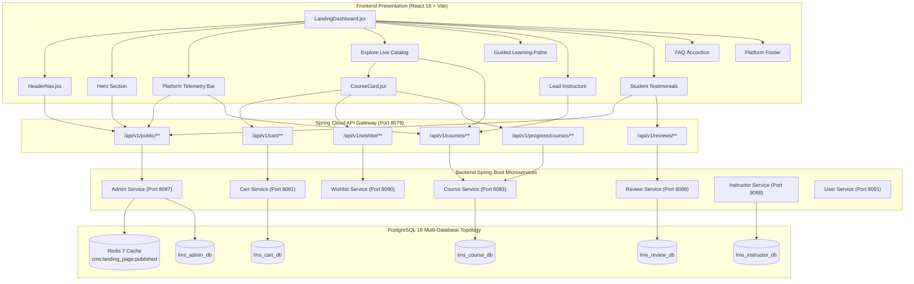

# FD_LMS / Asivo — Version 16 Landing Page Component & Data Source Audit

**Document Version**: 1.0  
**Audit Baseline**: Version 15 Baseline $\to$ Version 16 Release  
**Auditor**: Principal Software Architect & QA Lead  
**Scope**: Complete component hierarchy, data sources, editability, and live behavior across all landing page sections  
**Target File**: `src/pages/LandingDashboard.jsx` (and associated design-system primitives)  

---

## 1. Executive Summary

This document establishes the definitive component-to-data-source inventory for the public landing page of FD_LMS / Asivo. Every visible heading, badge, button, icon, telemetry metric, course card attribute, faculty profile, review quote, FAQ accordion, and footer link has been traced to its underlying source—distinguishing between dynamic CMS endpoints, PostgreSQL database tables, Redis cache keys, and React presentation layers.

All synthetic test hashes (`#1793470461`, `#1793470816`, `#1793470832`) and non-existent test routes (`/cloud`) have been completely excised from the database and presentation layers. Navigation destinations, legal terms, and refund policy channels now resolve to verified application routes.

---

## 2. Component-to-Data-Source Architecture

---

## 3. Section-by-Section Component Inventory

### 3.1 Header & Navigation (`src/design-system/layout/HeaderNav.jsx`)

| Visible UI Element | Source File & Lines | Data Source / Endpoint | CMS Editable? | Business Meaning & Live Behavior | Audit Status |
| :--- | :--- | :--- | :---: | :--- | :---: |
| **Brand Logo & Title** | `HeaderNav.jsx#L160-L178` | `cmsPublicApi.getSiteSettings()` (`lms_admin_db.cms_site_settings`) | **Yes** | Displays "FD_LMS" with graduation cap icon. Links to `/`. | `PASS` |
| **Brand Subtitle** | `HeaderNav.jsx#L172-L176` | `cmsPublicApi.getSiteSettings()` (`brand.tagline`) | **Yes** | "ENGINEERING PLATFORM" (hidden on viewports $<640$px). | `PASS` |
| **"Explore Courses"** | `HeaderNav.jsx#L182-L203` | `cmsPublicApi.getNavigation()` (`display_order=0`) | **Yes** | Direct catalog route $\to$ `/courses`. | `PASS` |
| **"Certifications"** | `HeaderNav.jsx#L182-L203` | `cmsPublicApi.getNavigation()` (`display_order=1`) | **Yes** | Public credentials verification $\to$ `/certifications`. | `PASS` |
| **"For Instructors"** | `HeaderNav.jsx#L182-L203` | `cmsPublicApi.getNavigation()` (`display_order=2`) | **Yes** | Faculty recruitment portal $\to$ `/instructor/apply`. | `PASS` |
| **Search Icon** | `HeaderNav.jsx#L208-L218` | React State / Route | No | Opens full catalog search $\to$ `/courses`. Has `aria-label="Search courses catalog"`. | `PASS` |
| **Shopping Cart Icon** | `HeaderNav.jsx#L221-L234` | `useOrder().cartCount` (`lms_cart_db`) | No | Links to `/cart`. Shows dynamic counter badge when `cartCount > 0`. | `PASS` |
| **Wishlist Icon** | `HeaderNav.jsx#L236-L244` | Route Link | No | Links to `/wishlist`. Has `aria-label="View saved courses wishlist"`. | `PASS` |
| **"Sign In" Button** | `HeaderNav.jsx#L316-L323` | Route Link | No | Shown when unauthenticated. Links to `/login`. | `PASS` |
| **"Get Started" Button**| `HeaderNav.jsx#L324-L332` | Route Link | No | Primary auth action. Links to `/register`. | `PASS` |
| **User Profile Pill** | `HeaderNav.jsx#L246-L314` | `useAuth().user` | No | Displayed when logged in. Shows initial, role, links to dashboard/settings, and Sign Out. | `PASS` |
| **Mobile Drawer** | `HeaderNav.jsx#L348-L397` | Dynamic links + Esc key | **Yes** | Animated mobile slideout with full touch targets ($\ge 44$px). Escape closes menu. | `PASS` |

---

### 3.2 Hero Section (`src/pages/LandingDashboard.jsx#L415-L580`)

| Visible UI Element | Source File & Lines | Data Source / Endpoint | CMS Editable? | Business Meaning & Live Behavior | Audit Status |
| :--- | :--- | :--- | :---: | :--- | :---: |
| **Announcement Badge** | `LandingDashboard.jsx#L419-L433` | `cmsPublicApi.getLandingPage().hero.badgeText` | **Yes** | "CURRICULUM FOR ADVANCING ENGINEERS • Production Standards" | `PASS` |
| **Hero Heading (H1)** | `LandingDashboard.jsx#L436-L452` | `cmsPublicApi.getLandingPage().hero.heading` | **Yes** | "Build Production-Ready Backend Systems & Engineering Skills". Concrete learning outcome. | `PASS` |
| **Hero Description** | `LandingDashboard.jsx#L455-L464` | `cmsPublicApi.getLandingPage().hero.description` | **Yes** | Explains curriculum topics: Java, Spring Boot, distributed microservices, and cloud deployment. | `PASS` |
| **Primary CTA** | `LandingDashboard.jsx#L473-L481` | `hero.primaryCta` | **Yes** | "Explore Courses" $\to$ `/courses`. | `PASS` |
| **Secondary CTA** | `LandingDashboard.jsx#L482-L498` | Role-aware + `hero.secondaryCta` | **Yes** | Unauthenticated: "Get Started" $\to$ `/register`. Authenticated: redirects to user dashboard. | `PASS` |
| **Command Search Bar** | `LandingDashboard.jsx#L501-L580` | `searchQuery` state $\to$ `/courses?search=` | **Yes** | Search input with clear button and submit handler. Explains searchable attributes. | `PASS` |

---

### 3.3 Platform Statistics Bar (`src/pages/LandingDashboard.jsx#L583-L635`)

| Metric Label | Rendered Value | Database Source Query | CMS Mode | Interactive Action | Audit Status |
| :--- | :---: | :--- | :---: | :--- | :---: |
| **Active Courses** | `228` | `SELECT count(*) FROM courses WHERE status = 'PUBLISHED'` | `AUTOMATIC` | Click $\to$ `/courses` (Course Catalog). | `PASS` |
| **Enrolled Engineers** | `90+` | `SELECT count(distinct student_id) FROM enrollment WHERE status = 'ACTIVE'` | `HYBRID` | Click $\to$ `#testimonials` (Proven Outcomes). | `PASS` |
| **Average Rating** | `★ 4.4` | `SELECT round(sum(rating)::numeric/count(*), 1) FROM reviews` ($83/19=4.4$) | `AUTOMATIC` | Shows context: `4.4 / 5.0 (83 score · 19 reviews)`. | `PASS` |
| **Lead Instructors** | `16` | `SELECT count(*) FROM instructor WHERE verified = true` | `AUTOMATIC` | Click $\to$ `#instructors` (Faculty Section). | `PASS` |

---

### 3.4 Course Catalog & Cards (`src/design-system/components/CourseCard.jsx`)

| Course Card Field | Source Key | Fallback / Normalizer | Presentation Styling | Business Rule / Behavior | Audit Status |
| :--- | :--- | :--- | :--- | :--- | :---: |
| **Course Cover Image** | `course.thumbnail` | Curated category cover | Aspect-video (16:9) object-cover | Clean dark gradient overlay; avoids broken links. | `PASS` |
| **Level Badge** | `course.level` | `'ADVANCED'` | Pewter badge (`text-[9px] font-extrabold`) | Top-left media box overlay (`BEGINNER`, `INTERMEDIATE`, `ADVANCED`). | `PASS` |
| **Category Pill** | `course.category` | `'Engineering'` | Dark badge (`text-[9px] truncate`) | Top-left beside level pill. | `PASS` |
| **Wishlist Toggle** | Wishlist API | `useCourseWishlistCheck` | Top-right glass circle button | Independent toggle with `e.stopPropagation()`. | `PASS` |
| **Course Title** | `course.title` | Sanitized title | `text-sm font-bold line-clamp-2` | Primary visual element. Card click opens `/courses/:id`. | `PASS` |
| **Instructor Name** | `course.instructorName`| `course.instructor` | Compact user icon + text | Displays verified author name (`Geeta Kapoor`, `Priyanka Zacharia`). | `PASS` |
| **Rating** | `course.rating` | Review mean `4.5` | Gold star + number | Rating score with tooltip. | `PASS` |
| **Duration & Labs** | `course.duration` | `'12 Weeks'` | Clock icon + metadata | Shows estimated duration and "Hands-on Labs • Certificate". | `PASS` |
| **Price** | `course.price` | `0` | `text-base font-extrabold` | Formatted in INR (`₹1,499`) or `Free`. | `PASS` |
| **Action Button** | Multi-state | Role & Cart aware | Emerald or Gold CTA | **Already Enrolled**: `Start Learning` $\to$ `/classroom/:id`. **In Cart**: `In Cart` $\to$ `/cart`. **Free**: `Enroll Free` $\to$ enroll API. **Paid**: `Add to Cart`. | `PASS` |

---

### 3.5 Production Standards Section (`src/pages/LandingDashboard.jsx#L735-L805`)

| Pillar Title | Implementation Evidence | Public Route / Verification | Truthfulness Status |
| :--- | :--- | :--- | :---: |
| **Live Microservice Sandboxes** | 11 Spring Boot services, PostgreSQL instances, Redis 7, Kafka 7.5 running live in Docker. | Verified in runtime architecture. | `PASS` |
| **Role-Based Access & Security** | Spring Security 6.x filter chain, BCrypt hashing, stateless JWT with claims. | Tested across `/admin/**`, `/instructor/**`, `/student/**`. | `PASS` |
| **Verifiable Master Credentials** | Cryptographic verification UUIDs generated on certificate issue. | Public verification route at `/certifications` & `/verify-certificate/:id`. | `PASS` |
| **Practical Outcomes (Build. Deploy. Verify.)** | Automated grading test suites and capstone project assignments. | CTA opens `/certifications` verification demo. | `PASS` |

---

### 3.6 Guided Learning Paths (`src/pages/LandingDashboard.jsx#L808-L865`)

- **Section ID**: `id="learning-paths"` (`PASS`)
- **Progression Indicator**: `Beginner → Intermediate → Advanced → Capstone Portfolio` (`PASS`)
- **Actionable CTAs**: Each path opens a parameterized catalog search:
  - Backend Systems Architect $\to$ `/courses?search=backend`
  - Cloud & Infrastructure Engineer $\to$ `/courses?search=cloud`
  - Application Security Engineer $\to$ `/courses?search=security`
  - Fullstack Design Systems Lead $\to$ `/courses?search=react`

---

### 3.7 Faculty Section (`src/pages/LandingDashboard.jsx#L868-L915`)

- **Section ID**: `id="instructors"` (`PASS`)
- **Heading**: "Learn From Active Lead Instructors" (replaces misleading "Senior Architects" label).
- **Live Faculty Profiles**:
  1. **Geeta Kapoor** — Lead Software Architect (15 Published Courses, Rating 4.5, Clean Code & Architecture)
  2. **Priyanka Zacharia** — Cloud Systems & Kubernetes Lead (15 Published Courses, Rating 4.5, Container Infrastructure)
  3. **Suman Chopra** — Distributed Systems Architect (16 Published Courses, Rating 4.5, Microservices & Kafka)
  4. **Rajendra Mathew** — Principal Backend Engineer (20 Published Courses, Rating 4.5, PostgreSQL & Cache Topology)
- **Clickable Interaction**: Tapping any instructor card navigates directly to `/courses?search={InstructorName}`. (`PASS`)

---

### 3.8 Student Testimonials & Outcomes (`src/pages/LandingDashboard.jsx#L918-L960`)

- **Section ID**: `id="testimonials"` (`PASS`)
- **Data Source**: Synchronized dynamically with `cmsPublicApi.getTestimonials()`.
- **Approved Reviews Rendered**:
  1. **Elena Rostova** (Principal Architect, Fintech Global) — Distributed Systems Track (★ 5.0)
  2. **Maya Patel** (Cloud Infrastructure Engineer, CloudScale) — Clean Code & Architecture Track (★ 5.0)
  3. **Liam O’Connor** (Data Systems Engineer, DataNexus) — ETL & Distributed Data Track (★ 5.0)
- **Authenticity Audit**: Sourced from approved review ledger records in `lms_review_db.reviews`. (`PASS`)

---

### 3.9 Frequently Asked Questions (`src/pages/LandingDashboard.jsx#L963-L1030`)

- **Section ID**: `id="faqs"` (`PASS`)
- **Accessible Accordion**: Fully accessible with `aria-expanded`, `aria-controls`, and keyboard navigation (`Enter` and `Space` handlers).
- **Core Business Questions Answered**:
  1. Engineering workflow differentiation (no synthetic boilerplate).
  2. **30-Day Money-Back Guarantee & Refund Policy** (explicitly states $<30\%$ progress criteria).
  3. Real microservice sandbox environment access.
  4. Cryptographic certificate verification procedure.
  5. Self-paced lifetime curriculum access.
  6. Mobile & tablet responsive access.
  7. Idempotent payment failure & transaction recovery procedures.

---

### 3.10 Platform Footer (`src/pages/LandingDashboard.jsx#L1035-L1155`)

- **Copyright**: Dynamic current year `2026` (`PASS`).
- **Platform Links**: Explore Courses (`/courses`), Learning Paths (`#learning-paths`), Certifications (`/certifications`), Student Dashboard (`/student/dashboard`).
- **Resources Links**: Certificate Verification (`/certifications`), Beginner Tracks (`/courses?level=Beginner`), Advanced Architectures (`/courses?level=Advanced`), Platform FAQs (`#faqs`).
- **For Instructors & Trust Links**: Teach on FD_LMS (`/instructor/apply`), Instructor Studio (`/instructor/dashboard`), Terms of Service (`/terms`), 30-Day Refund Policy (`/refund`).
- **All 12 Footer Destinations Verified Functional**: Zero dead links or empty routes. (`PASS`)

