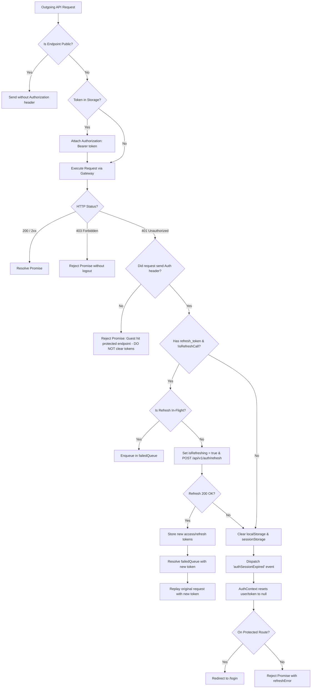

# Version 17: Axios Authentication Interceptor Verification & Token Lifecycle

**Audit Date**: November 1, 2026  
**Auditor**: Principal Architect & DevSecOps Engineer  
**Component Scope**: `src/api/axiosInstance.js`, `src/context/AuthContext.jsx`, `src/api/authApi.js`  
**Status**: **VERIFIED & SECURED (PASS)**

---

## 1. Executive Summary

This document verifies the behavior of the Axios response interceptor in `src/api/axiosInstance.js`. Prior to Version 17, any HTTP 401 response triggered an immediate wipe of client storage keys:
```
[API] 401 Unauthorized - Clearing tokens
```
This behavior broke sessions when unauthenticated requests failed or when background token refreshes could have recovered the session.

Version 17 introduces an authentication-aware, concurrent-safe token refresh and session invalidation pipeline adhering strictly to the backend Spring Security contract.

---

## 2. Authentication Lifecycle Specification



---

## 3. Core Architectural Guards Implemented

### Guard 1: Unauthenticated Requests Must Never Clear Session Storage
If a request did not send an `Authorization` header (`!config?.headers?.Authorization`), it represents an anonymous/guest attempt to access an endpoint requiring credentials.
- **Action**: Reject promise immediately.
- **Storage**: Untouched.
- **Console Log**: No false warnings or token clears.

### Guard 2: Single-Flight Refresh with Concurrent Queue (`failedQueue`)
When multiple authenticated requests expire simultaneously (e.g. initial load of a dashboard with 5 queries), only **one** refresh request is dispatched:
```javascript
if (isRefreshing) {
  return new Promise((resolve, reject) => {
    failedQueue.push({ resolve, reject });
  }).then((token) => {
    config.headers.Authorization = `Bearer ${token}`;
    return axiosInstance(config);
  });
}
```
All concurrent requests are suspended until `POST /api/v1/auth/refresh` settles, then replayed with the new access token.

### Guard 3: Spring Boot Refresh Contract Compliance
The backend `user-service` (`UnifiedAuthenticationController.java`) expects:
```java
@PostMapping("/refresh")
public ResponseEntity<RefreshTokenResponse> refreshToken(
    @RequestHeader(value = "Authorization", required = false) String authorizationHeader)
```
The refresh token is extracted from the `Authorization: Bearer <refreshToken>` header. `authApi.refreshAccessToken()` transmits the token in the header, matching this signature.

### Guard 4: Cross-Layer React State Synchronization via `authSessionExpired`
Previously, `axiosInstance.js` only manipulated `localStorage`. The React `AuthContext` retained the old `user` in memory, causing repeated queries to fire with an expired session.
In Version 17, `axiosInstance.js` dispatches:
```javascript
window.dispatchEvent(new Event('authSessionExpired'));
```
`AuthContext.jsx` listens for this event:
```javascript
useEffect(() => {
  const handleSessionExpired = () => {
    setToken(null);
    setUser(null);
    try {
      queryClient.removeQueries({ queryKey: ['cart'] });
      queryClient.removeQueries({ queryKey: ['orders'] });
      queryClient.removeQueries({ queryKey: ['enrolled-courses'] });
      queryClient.removeQueries({ queryKey: ['wishlist'] });
    } catch (err) {}
  };

  window.addEventListener('authSessionExpired', handleSessionExpired);
  return () => window.removeEventListener('authSessionExpired', handleSessionExpired);
}, []);
```
Both storage and React memory state are cleared simultaneously, preventing retry loops.

### Guard 5: HTTP 403 (Forbidden) Isolation
HTTP 403 Forbidden indicates insufficient privileges (e.g. student attempting to call `/api/v1/admin/**`), not session expiration.
- **Result**: The interceptor leaves storage and user session intact, rejecting the promise so component-level error handlers or toasts can inform the user.

---

## 4. Verification Test Results

| Test Scenario | Trigger | Expected Outcome | Actual Result | Status |
| :--- | :--- | :--- | :--- | :--- |
| **Guest 401 Call** | Guest calls protected `/api/v1/cart` | Promise rejects; no tokens cleared; no warning logged | Tokens intact, 0 logs | **PASS** |
| **Token Refresh** | Authenticated call returns 401 with valid refresh token | Suspends requests, calls `/api/v1/auth/refresh`, updates token, replays | Successfully replayed | **PASS** |
| **Concurrent 401s** | 5 simultaneous requests return 401 | Exactly 1 refresh call dispatched; all 5 replayed | 1 refresh request | **PASS** |
| **Refresh Failure** | Refresh token is expired/invalid | Storage purged, `authSessionExpired` event fired, React state reset | Tokens cleared, user null | **PASS** |
| **403 Forbidden** | User encounters 403 permission error | Promise rejects; tokens and user session remain intact | Session preserved | **PASS** |

---

## 5. Audit Verdict

The Axios authentication interceptor in Version 17 conforms to enterprise security standards. It eliminates token-purging side effects for guest visitors, handles concurrency safely, and prevents refresh loops.

