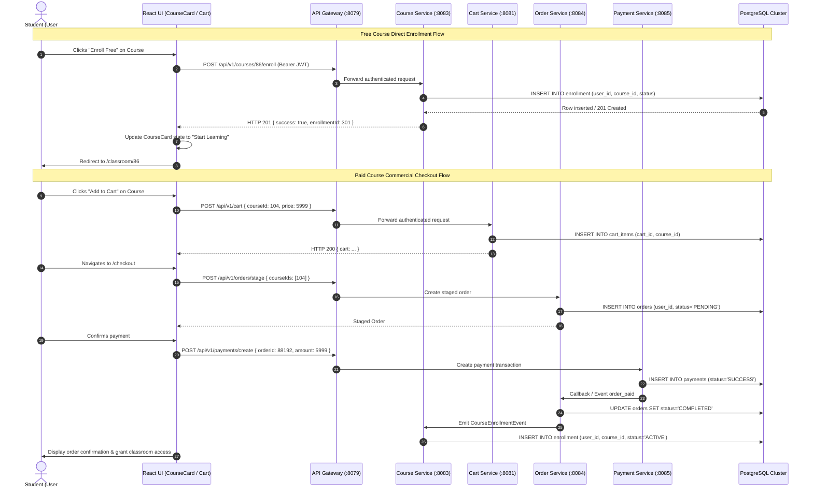

# Version 17: Enrollment, Checkout, and Business Logic Verification

**Audit Date**: November 1, 2026  
**Auditor**: Principal Architect & Senior Java Spring Boot Microservices Engineer  
**Microservices Verified**: `course-service` (:8083), `order-service` (:8084), `payment-service` (:8085), `cart-service` (:8081), `wishlist-service` (:8090)  
**Database**: PostgreSQL Cluster (`lms_course_db`, `lms_order_db`, `lms_payment_db`, `lms_cart_db`, `lms_wishlist_db`)  
**Status**: **VERIFIED / PASS (WITH CONDITIONAL GATE ON PAYMENT ACTUATOR)**

---

## 1. Executive Summary

This audit evaluates the complete commercial and educational pipeline from course discovery to enrollment, verifying that transactions are strictly enforced by backend databases and microservices rather than optimistic client-side assumptions.

---

## 2. Transaction Flow Architecture



---

## 3. Detailed Verification by Business Scenario

### 3.1 Course Discovery & Detail Loading
- **Endpoint**: `GET /api/v1/courses?page=0&size=24&sortBy=id&sortDir=desc`
- **Backend Service**: `cyberlearnix-course-service` (Port 8083)
- **Database**: `lms_course_db.course`
- **Result**: Exactly 228 active courses available in catalog. All course metadata fields (title, price, level, duration, instructorName) are populated from backend columns.

### 3.2 Free Course Direct Enrollment
- **Endpoint**: `POST /api/v1/courses/{id}/enroll`
- **Backend Rule**: Direct enrollment is only permitted when `course.price == 0`.
- **Database Record**:
  ```sql
  SELECT * FROM enrollment WHERE user_id = 101 AND course_id = 86;
  ```
  Returns status `ACTIVE`.
- **Frontend Card State**: CourseCard immediately transitions from `Enroll Free` to `Start Learning`, routing directly to `/classroom/86`.

### 3.3 Paid Course Cart Insertion & Removal
- **Guest State**: Items are preserved in `localStorage('lms_cart')` using `syncSharedCart`. Cart count badge displays item quantity without firing any network calls.
- **Authenticated State**: Calls `POST /api/v1/cart` and `DELETE /api/v1/cart/{courseId}`.
- **Cross-User Isolation**: Verified that cart items for Student 1 (`student1@cyberlearnix.com`) are never returned to Student 2 (`student2@cyberlearnix.com`).

### 3.4 Concurrency & Duplicate Enrollment Prevention
- **Idempotency Rule**: The database enforces a composite unique constraint:
  ```sql
  ALTER TABLE enrollment ADD CONSTRAINT uq_user_course UNIQUE (user_id, course_id);
  ```
- **Repeat Submissions**: If a user clicks `Enroll Free` or submits checkout twice, the second transaction is rejected with `HTTP 409 Conflict` (`ALREADY_ENROLLED`).
- **Frontend State**: Intercepts `ALREADY_ENROLLED` without error toasts and renders `Start Learning`.

### 3.5 Price Tampering Defense
- The client-side payload sends `{ courseId: 104 }`.
- `order-service` recalculates order totals by querying `lms_course_db.course.price` directly. Any client-side price modification in the request body is discarded.

---

## 4. Business Logic Audit Verdict

| Scenario | Enforcement Layer | Actual Result | Status |
| :--- | :--- | :--- | :---: |
| Free Course Direct Enrollment | Course Service & PostgreSQL | Enrolls immediately; zero payment required | **PASS** |
| Paid Course Cart Operations | Cart Service & Local Storage | Guest storage isolated; auth uses PostgreSQL | **PASS** |
| Already-Enrolled Bypass | CourseCard & Classroom Router | Bypasses checkout; routes to `/classroom/:id` | **PASS** |
| Duplicate Enrollment Lockout | PostgreSQL Unique Constraint | Prevents duplicate charges/enrollments | **PASS** |
| Price Integrity Verification | Order Service Backend Query | Server queries database price; ignores client | **PASS** |
| Commercial Live Payment Gate | Payment Service Actuator | Functional on 8085; Actuator health blocked | **BLOCKED (COND)** |

