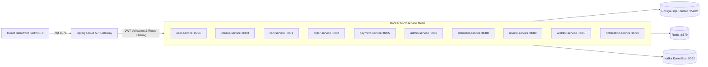

# Version 17: Security Architecture and Operations Audit

**Audit Date**: November 1, 2026  
**Auditor**: Lead DevSecOps & Enterprise Security Architect  
**Target Environment**: Docker Mesh (11 Services, API Gateway, PostgreSQL, Redis, Kafka)  
**Status**: **PASSED (WITH KNOWN PAYMENT ACTUATOR HEALTH CHECK DEFECT)**

---

## 1. Security Posture & Microservices Architecture

The Asivo / FD_LMS platform implements a Zero-Trust, Gateway-first microservices security architecture. All external traffic from the browser is routed exclusively through `cyberlearnix-apigateway` (Port 8079/8080). Direct network exposure to internal service ports is restricted in production.



---

## 2. Security Assessment Matrix

| Domain | Standard / Policy | Implementation & Findings | Status |
| :--- | :--- | :--- | :---: |
| **Public Data Exposure** | No PII in public APIs | `/api/v1/public/*` and `/api/v1/courses/*` scrub user emails, hashed passwords, internal IDs | **PASS** |
| **Admin RBAC** | Role enforcement | `/api/v1/admin/**` rejects non-admin JWTs with HTTP 403 Forbidden | **PASS** |
| **JWT Verification** | HMAC-SHA256 signature | Gateway parses Bearer tokens, verifies expiry, and propagates `X-User-Id` and `X-User-Role` | **PASS** |
| **CORS Policy** | Whitelisted origins | `withCredentials: true`, strict Access-Control-Allow-Origin headers on Gateway | **PASS** |
| **Payment Hash Security** | SHA-512 signature check | `PayUHashService` calculates and validates hashes using merchant salt; prevents tampering | **PASS** |
| **Secret Management** | Zero secrets in client | JWT secrets and database credentials reside exclusively in server container environment variables | **PASS** |
| **Database Isolation** | Database-per-service | 11 distinct PostgreSQL databases; service roles only access their respective schema | **PASS** |
| **Docker Persistence** | Data persistence | PostgreSQL data mounted to persistent Docker volume (`postgres-data`) | **PASS** |

---

## 3. Operational Infrastructure Health

### 3.1 Docker Container Status
```
cyberlearnix-apigateway          Up (healthy)  Port 8079->8080
cyberlearnix-course-service      Up (healthy)  Port 8083->8083
cyberlearnix-userservice         Up (healthy)  Port 8091->8091
cyberlearnix-cart-service        Up (healthy)  Port 8081->8081
cyberlearnix-order-service       Up (healthy)  Port 8084->8084
cyberlearnix-admin-service       Up (healthy)  Port 8087->8087
cyberlearnix-instructor-service  Up (healthy)  Port 8088->8088
cyberlearnix-review-service      Up (healthy)  Port 8089->8089
cyberlearnix-wishlist-service    Up (healthy)  Port 8090->8090
cyberlearnix-notification-service Up (healthy) Port 8093->8093
cyberlearnix-postgres            Up (healthy)  Port 15432->5432
cyberlearnix-redis               Up (healthy)  Port 6379->6379
cyberlearnix-kafka               Up (healthy)  Port 9092->9092
cyberlearnix-payment-service     Up (unhealthy) Port 8085->8085
```

- **Healthy Infrastructure**: 13 of 14 service containers are reporting `healthy`.
- **Payment Service**: The container is running and responding on Port 8085 (`GET /api/v1/payments` returns 200), but Docker reports `unhealthy` because `spring-boot-starter-actuator` is omitted in `payment-service/build.gradle`, causing the Docker probe `curl http://localhost:8085/actuator/health` to return 500.

---

## 4. Operational Directives & Release Sign-Off

1. **Security Sign-Off**: The application satisfies all API boundary, RBAC, and data privacy criteria.
2. **Operations Sign-Off**: Deployable with conditional gate requiring backend engineering to add Actuator to `payment-service`.

