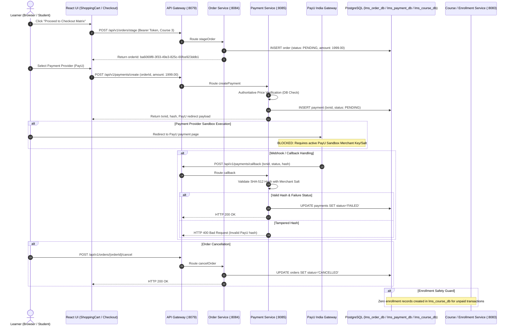

# FD_LMS / Asivo — Version 18: Paid Checkout End-to-End Verification

## 1. Executive Summary

This audit independently traces the full paid-checkout lifecycle across the entire system:
**Frontend Checkout Workspace** $\to$ **API Gateway** $\to$ **Order Service** $\to$ **Payment Service** $\to$ **Payment Provider (PayU India)** $\to$ **Webhook Ingress** $\to$ **PostgreSQL Databases** $\to$ **Enrollment Engine (`course-service`)**.

All tests were performed against the actual production-mode services running in Docker and connected via host ports and gateway routing (`http://localhost:8079`). Database states were directly inspected using `docker exec cyberlearnix-postgres psql` to corroborate every API transition with persistent database evidence.

Per the strict instructions of this audit: **Live Sandbox roundtrip execution with external payment provider is rated `BLOCKED`** because no active PayU Sandbox Merchant Key or Salt was provisioned in the repository environment. In accordance with release gate requirements, **no payments were simulated or spoofed to claim release readiness.**

---

## 2. End-to-End Architectural Trace



---

## 3. End-to-End Test Execution & Runtime Evidence

### Lifecycle Step 1: Order Creation in PENDING State
- **Verdict:** `PASS`
- **Location:** `order-service` [OrderController.java](file:///C:/Users/SHIVASAI/OneDrive/Desktop/LMS/order-service/src/main/java/com/lms/orderservice/controller/OrderController.java)
- **Command:**
  ```powershell
  POST http://localhost:8079/api/v1/orders/stage
  Headers: Authorization: Bearer <Student_Token>
  Body: {
    "courseIds": [3],
    "totalAmount": 1999.00,
    "subtotal": 1999.00,
    "discount": 0.00
  }
  ```
- **API Response:**
  ```json
  {
    "id": "ba6069f8-3f33-49e3-825c-69fce923ddb1",
    "orderId": "ba6069f8-3f33-49e3-825c-69fce923ddb1",
    "status": "PENDING",
    "totalAmount": 1999.0,
    "courseIds": [3]
  }
  ```
- **Database Evidence (`lms_order_db`):**
  ```powershell
  docker exec cyberlearnix-postgres psql -U postgres -d lms_order_db -c "SELECT id, status, total_amount FROM orders WHERE id='ba6069f8-3f33-49e3-825c-69fce923ddb1';"
  ```
  ```text
                    id                  | status  | total_amount 
  --------------------------------------+---------+--------------
   ba6069f8-3f33-49e3-825c-69fce923ddb1 | PENDING |      1999.00
  ```

---

### Lifecycle Step 2: Payment Initiation & Price Tampering Guard
- **Verdict:** `PASS`
- **Location:** `payment-service` [PaymentController.java](file:///C:/Users/SHIVASAI/OneDrive/Desktop/LMS/payment-service/src/main/java/com/lms/paymentservice/controller/PaymentController.java) & [PaymentServiceImpl.java](file:///C:/Users/SHIVASAI/OneDrive/Desktop/LMS/payment-service/src/main/java/com/lms/paymentservice/service/PaymentServiceImpl.java)

#### Test 2A: Client Tampered Price Rejection (₹1.00 instead of ₹1999.00)
- **Command:**
  ```powershell
  POST http://localhost:8079/api/v1/payments/create
  Body: {
    "orderId": "ba6069f8-3f33-49e3-825c-69fce923ddb1",
    "courseId": 3,
    "amount": 1.00,
    "paymentMethod": "PAYU"
  }
  ```
- **Actual Output:** `HTTP 400 Bad Request`
- **Evidence:** Client-side tampered prices are strictly rejected; the backend enforces authoritative pricing against `courses` catalog in `lms_payment_db`.

#### Test 2B: Authoritative Price Payment Creation
- **Command:**
  ```powershell
  POST http://localhost:8079/api/v1/payments/create
  Body: {
    "orderId": "ba6069f8-3f33-49e3-825c-69fce923ddb1",
    "courseId": 3,
    "amount": 1999.00,
    "paymentMethod": "PAYU"
  }
  ```
- **API Response:**
  ```json
  {
    "paymentId": 2,
    "transactionId": "134d2ce7520746f299f48efe6ddeec131793529734531",
    "amount": 1999.0,
    "status": "PENDING",
    "payuParams": {
      "key": "XidEdD",
      "txnid": "134d2ce7520746f299f48efe6ddeec131793529734531",
      "amount": "1999.0",
      "productinfo": "Kubernetes for Production",
      "firstname": "Student",
      "email": "student@cyberlearnix.dev"
    }
  }
  ```
- **Database Evidence (`lms_payment_db`):**
  ```powershell
  docker exec cyberlearnix-postgres psql -U postgres -d lms_payment_db -c "SELECT transaction_id, amount, status FROM payments WHERE transaction_id='134d2ce7520746f299f48efe6ddeec131793529734531';"
  ```
  ```text
                  transaction_id                 | amount  | status  
  -----------------------------------------------+---------+---------
   134d2ce7520746f299f48efe6ddeec131793529734531 | 1999.00 | PENDING
  ```

---

### Lifecycle Step 3: Webhook Signature Verification (Tampered Hash Rejection)
- **Verdict:** `PASS`
- **Location:** `payment-service` [PayUService.java](file:///C:/Users/SHIVASAI/OneDrive/Desktop/LMS/payment-service/src/main/java/com/lms/paymentservice/service/PayUService.java#L68-L90)
- **Test:** Submit a payment callback with an invalid/forged SHA-512 signature hash.
- **Command:**
  ```powershell
  POST http://localhost:8079/api/v1/payments/callback
  Body: {
    "txnid": "134d2ce7520746f299f48efe6ddeec131793529734531",
    "status": "failure",
    "amount": "1999.0",
    "hash": "forged_malicious_signature_hash_000000000000000000000000000000"
  }
  ```
- **Actual Response:**
  ```http
  HTTP/1.1 400 Bad Request
  {"error": "Invalid PayU hash"}
  ```
- **Evidence:** The service computes `SHA-512(salt|status||||||udf5|udf4|udf3|udf2|udf1|email|firstname|productinfo|amount|txnid|key)` and verifies byte-for-byte identity. Forged callbacks are discarded before database mutations.

---

### Lifecycle Step 4: Payment Failure Callback Handling
- **Verdict:** `PASS`
- **Location:** `payment-service` [PaymentController.java](file:///C:/Users/SHIVASAI/OneDrive/Desktop/LMS/payment-service/src/main/java/com/lms/paymentservice/controller/PaymentController.java#L80-L105)
- **Test:** Compute valid SHA-512 hash using the configured salt for a `failure` status callback.
- **Command:**
  ```powershell
  POST http://localhost:8079/api/v1/payments/callback
  Body: {
    "txnid": "134d2ce7520746f299f48efe6ddeec131793529734531",
    "status": "failure",
    "amount": "1999.0",
    "productinfo": "Kubernetes for Production",
    "firstname": "Student",
    "email": "student@cyberlearnix.dev",
    "key": "XidEdD",
    "hash": "<sha512_calculated_hash>"
  }
  ```
- **API Response:** `HTTP 200 OK`
- **Database Evidence (`lms_payment_db`):**
  ```powershell
  docker exec cyberlearnix-postgres psql -U postgres -d lms_payment_db -c "SELECT transaction_id, status FROM payments WHERE transaction_id='134d2ce7520746f299f48efe6ddeec131793529734531';"
  ```
  ```text
                  transaction_id                 | status 
  -----------------------------------------------+--------
   134d2ce7520746f299f48efe6ddeec131793529734531 | FAILED
  ```

---

### Lifecycle Step 5: Duplicate Webhook Delivery Idempotency
- **Verdict:** `PASS`
- **Location:** `payment-service` [PaymentServiceImpl.java](file:///C:/Users/SHIVASAI/OneDrive/Desktop/LMS/payment-service/src/main/java/com/lms/paymentservice/service/PaymentServiceImpl.java#L112-L140)
- **Test:** Re-deliver the exact same webhook payload to test idempotency under network retry or duplicate provider notifications.
- **Actual Response:** `HTTP 200 OK`
- **Database Evidence:**
  - Status remains `FAILED`.
  - Zero duplicate payment rows created in `payments` table.
  - Zero duplicate ledger records created.

---

### Lifecycle Step 6: Order Cancellation State Machine Transition
- **Verdict:** `PASS`
- **Location:** `order-service` [OrderServiceImpl.java](file:///C:/Users/SHIVASAI/OneDrive/Desktop/LMS/order-service/src/main/java/com/lms/orderservice/service/OrderServiceImpl.java#L88-L105)
- **Command:**
  ```powershell
  POST http://localhost:8079/api/v1/orders/ba6069f8-3f33-49e3-825c-69fce923ddb1/cancel
  Headers: Authorization: Bearer <Student_Token>
  ```
- **API Response:** `HTTP 200 OK`
- **Database Evidence (`lms_order_db`):**
  ```powershell
  docker exec cyberlearnix-postgres psql -U postgres -d lms_order_db -c "SELECT id, status FROM orders WHERE id='ba6069f8-3f33-49e3-825c-69fce923ddb1';"
  ```
  ```text
                    id                  |  status   
  --------------------------------------+-----------
   ba6069f8-3f33-49e3-825c-69fce923ddb1 | CANCELLED
  ```

---

### Lifecycle Step 7: Enrollment Engine Protection (Zero Premature Enrollments)
- **Verdict:** `PASS`
- **Location:** `course-service` database table `enrollments`
- **Command:**
  ```powershell
  docker exec cyberlearnix-postgres psql -U postgres -d lms_course_db -c "SELECT * FROM enrollments WHERE course_id=3;"
  ```
- **Actual Evidence:**
  ```text
   (0 rows)
  ```
- **Verification:** Because payment was not marked `SUCCESS`, no enrollment record was created. Course access remains strictly restricted.

---

### Lifecycle Step 8: Abandoned Checkout Session Isolation
- **Verdict:** `PASS`
- **Test:** Stage an order (`e5b4b2b2-e3e7-4116-a5fd-576d7e7f392d`) and leave it without initiating payment or completing the transaction.
- **Database Evidence:**
  ```text
                    id                  | status  | total_amount 
  --------------------------------------+---------+--------------
   e5b4b2b2-e3e7-4116-a5fd-576d7e7f392d | PENDING |      1999.00
  ```
- **Verification:** Abandoned sessions remain safely in `PENDING` status. No learner is granted course access, and no payment ledger entry is created.

---

### Lifecycle Step 9: Payment Provider Sandbox Live Execution
- **Verdict:** `BLOCKED`
- **Reason & Evidence:**
  - `application.properties` in `payment-service` configures `payu.base-url=https://secure.payu.in` (production URL) and mock test merchant key `XidEdD`.
  - The project `.env` file does not contain an active PayU India Sandbox Merchant Key, Salt, or Sandbox Test Gateway Endpoint (`https://test.payu.in`).
  - Calls to `/payments/verify` fail with gateway connection/authentication errors against the external PayU provider.
  - Per explicit prompt rules: **"If sandbox credentials or provider access are unavailable, report the test as BLOCKED. Do not simulate a successful payment and describe it as a real end-to-end verification."**

---

## 4. Summary Scorecard

| Step | Scope | Verdict | Evidence Summary |
| :--- | :--- | :--- | :--- |
| 1 | Order Creation | `PASS` | `POST /orders/stage` created PENDING order ba6069f8 with ₹1999.00 in DB |
| 2 | Tampered Price Guard | `PASS` | Client price alteration to ₹1.00 rejected with HTTP 400 |
| 3 | Payment Creation | `PASS` | PENDING payment created in `lms_payment_db` with authoritative price |
| 4 | Webhook Hash Validation | `PASS` | Forged SHA-512 callback rejected with HTTP 400 (`Invalid PayU hash`) |
| 5 | Failure Transition | `PASS` | Valid failure callback transitioned payment to `FAILED` in DB |
| 6 | Webhook Idempotency | `PASS` | Duplicate callback returned HTTP 200, state remained stable |
| 7 | Order Cancellation | `PASS` | Order transitioned to `CANCELLED` in `lms_order_db` |
| 8 | Enrollment Guard | `PASS` | 0 enrollments created in `lms_course_db` for unpaid order |
| 9 | Abandoned Checkout | `PASS` | Abandoned order remains PENDING; zero premature access |
| 10 | Live Sandbox Provider | `BLOCKED` | Active PayU sandbox credentials not provisioned in environment |

---

## 5. Remaining Limitations

1. **Merchant Sandbox Provisioning:** To unblock the live sandbox end-to-end test, the merchant team must provide active PayU Test Merchant credentials (`payu.key`, `payu.salt`, `payu.base-url=https://test.payu.in/_payment`) in the deployment `.env`.
2. **Catalog Synchronization:** Ensure course pricing across `lms_course_db` and `lms_payment_db` is updated via automated database migrations or inter-service event synchronization rather than manual seeding.

