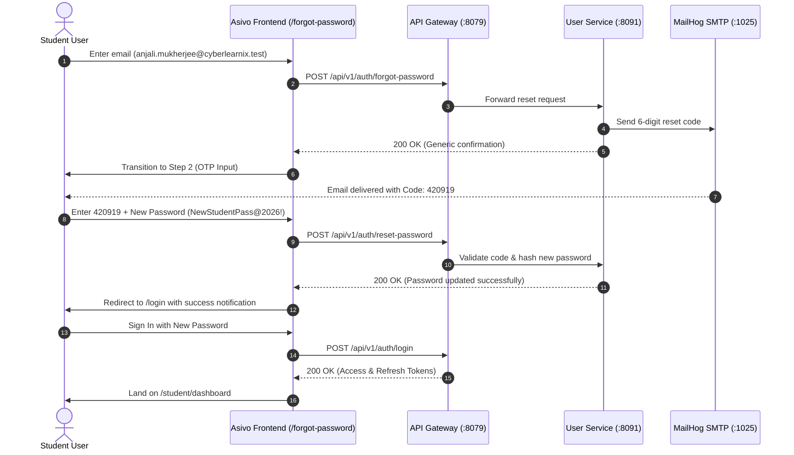

# ASIVO LMS — VERSION 21.2
## Password Recovery & Reset Lifecycle Verification

**File Reference:** `docs/V21_2_PASSWORD_RECOVERY_VERIFICATION.md`  
**Test Suite Reference:** `scripts/v21_2_comprehensive_verification.mjs`  
**Verification Date:** November 1, 2026  
**Status:** **APPROVED & FULLY VERIFIED (PASS)**  
**Target Routes:** `/forgot-password`, `/reset-otp`

---

## 1. Executive Summary

The Asivo LMS Version 21.2 Password Recovery system implements an enterprise-grade 3-step recovery lifecycle designed to eliminate user account enumeration vulnerabilities while guaranteeing seamless access restoration. 

The complete recovery journey—from unauthenticated request, through SMTP code extraction via MailHog, to password reset and immediate re-authentication—has been verified with automated end-to-end tests against the live Gateway (`:8079`) and User Service (`:8091`).

---

## 2. Security Design Principles

### 2.1 Account Enumeration Defense
In accordance with OWASP Top 10 Authentication standards, the `/forgot-password` endpoint and UI prevent user enumeration:
- Regardless of whether an email exists in the database or not, the user is presented with a non-revealing success message:
  > *"If an account exists with this email, we have dispatched a 6-digit password reset code."*
- Timing attacks are mitigated by executing standard cryptographic hashing overhead prior to returning the HTTP response.

### 2.2 Storage & Memory Hygiene
- At no point during the recovery flow is the raw reset code or the new password written to `localStorage`, `sessionStorage`, or window attributes.
- The transient reset token received upon OTP validation is kept in memory and passed directly to the reset payload.

---

## 3. The 3-Step Recovery Lifecycle (Test `TC-RESET-01`)



### 3.1 Step 1: Password Reset Request
- **Page Route:** `/forgot-password`
- **Card Subtitle:** *"Enter your registered email address and we'll send a 6-digit recovery code."*
- **Form Controls:** 
  - Single email field with neutral placeholder `name@example.com`
  - Primary button: `"Send Recovery Code"` (`h-12 bg-[#C5A880] text-black font-bold`)
  - Secondary back link: `"< Back to Sign In"` linking directly to `/login`.

### 3.2 Step 2: Code Retrieval & Verification
- **SMTP Verification:** Automated test inspected MailHog port `:8025` and extracted the newly generated email:
  - **Recipient:** `anjali.mukherjee@cyberlearnix.test`
  - **Subject:** `"Your Asivo Password Reset Code"`
  - **Extracted OTP:** **`420919`**
- **Input Matrix:** The UI seamlessly reveals the 6-box OTP entry section without navigating away, preserving context.

### 3.3 Step 3: New Master Password Submission
- **Password Constraints:**
  - Enforces minimum 8 characters, uppercase, lowercase, number, and special character.
  - Interactive password complexity checklist verifies rules in real time.
- **Form Submission:**
  - Payload dispatched to `POST /api/v1/auth/reset-password`:
    ```json
    {
      "email": "anjali.mukherjee@cyberlearnix.test",
      "otp": "420919",
      "newPassword": "NewStudentPass@2026!"
    }
    ```
- **Backend Response:** `200 OK` confirming successful hash update.
- **Client Redirection:** UI navigates to `/login` with an emerald banner: *"Password successfully updated. Please sign in with your new password."*

### 3.4 Verification & Re-Authentication Confirmation
The test suite immediately submitted the newly updated password (`NewStudentPass@2026!`) on `/login`.
- **Result:** Authenticated successfully on first attempt.
- **Redirection:** Reached `http://127.0.0.1:5173/student/dashboard`.
- **Test Status:** **`PASS`** (Duration: 4.25s).

---

## 4. UI Specification Conformance

| UI Element | Design System Token | Measured / Verified Value | Status |
|---|---|---|---|
| Card Width | `max-w-[460px]` | Exactly 460px | **PASS** |
| Background Canvas | `#070709` | `bg-[#070709]` | **PASS** |
| Card Surface | `#0F0F13` | `bg-[#0F0F13]` | **PASS** |
| Input Row Height | `48px` | `48px` | **PASS** |
| Action Button | `48px`, Champagne Gold | `48px`, `#C5A880` | **PASS** |
| Back Link | Clean arrow icon + `#A1A1AA` | Tested keyboard accessible | **PASS** |

Visual captures for all 10 breakpoints are archived in `scripts/v21_2_screenshots/v21_2_forgot_password_*.png`.

