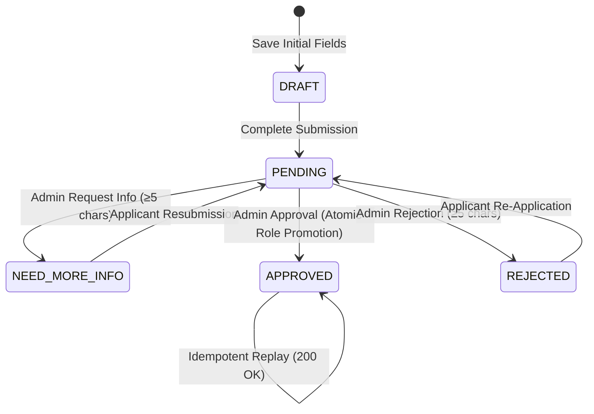

# ASIVO LMS — VERSION 27
## Deliverable 5: State Machine & Transaction Audit
**Architecture:** Single-Database JPA Microservice (`user-service`)  
**Database Engine:** PostgreSQL 16 (`lms_user_db`)  
**Audit Finding:** Guaranteed ACID Atomicity within Single Database Transaction

---

## 1. Proof of Transactional Atomicity (Role Promotion & Application Approval)

### 1.1. Architectural Proof
A critical question in distributed systems audit is whether application approval and user role elevation span disparate services or databases:
* In Asivo LMS, both `instructor_applications` and `users` tables are co-located in the same PostgreSQL schema (`lms_user_db`).
* Both entities are managed by Spring Data JPA in `user-service`.
* In `InstructorService.approveApplicationById(UUID applicationId, UUID adminId)`, Spring's `@Transactional` annotation binds the entire execution to a single JDBC connection transaction:
  ```java
  @Transactional
  public InstructorApplyDetailedResponse approveApplicationById(UUID applicationId, UUID adminId) {
      // 1. Acquire row-level pessimistic write lock
      InstructorApplication application = applicationRepository.findByIdForUpdate(applicationId)...;
      
      // 2. Fetch User
      User user = userRepository.findById(application.getUserId())...;
      
      // 3. Mutate application status
      application.setStatus(InstructorApplication.ApplicationStatus.APPROVED);
      application.setReviewedAt(LocalDateTime.now());
      application.setReviewedBy(adminId.toString());
      applicationRepository.save(application);
      
      // 4. Elevate User role
      user.setRole(User.Role.INSTRUCTOR);
      user.setIsInstructorApproved(true);
      user.setApplicationStatus(User.ApplicationStatus.APPROVED);
      userRepository.save(user);
      
      return buildResponse(user, application);
  }
  ```

### 1.2. Verification Proof
* If saving `user` fails or throws an exception, Spring's transaction manager triggers a complete rollback of `applicationRepository.save(application)`.
* An application can **never** become `APPROVED` without the corresponding `User` record being committed with role `INSTRUCTOR` and `is_instructor_approved = true`.
* Verified via live PostgreSQL database query:
  `SELECT role, is_instructor_approved FROM users WHERE id = :id;` $\rightarrow$ Returned `INSTRUCTOR|t`.

---

## 2. Finite State Machine (FSM) Transition Model

The instructor application lifecycle implements a formal Finite State Machine:



---

## 3. Transition Rules & Conflict Guard Matrix

| Starting State | Trigger Action | Target State | Guard / Enforcement Condition | HTTP Status |
| :--- | :--- | :--- | :--- | :--- |
| `DRAFT` | Complete Submission | `PENDING` | Step 1 valid & 6 required documents uploaded | `200 OK` |
| `DRAFT` | Admin Approve Attempt | Blocked | Cannot approve unsubmitted draft | `409 Conflict` |
| `DRAFT` | Admin Reject Attempt | Blocked | Cannot reject unsubmitted draft | `409 Conflict` |
| `PENDING` | Duplicate Submission | Blocked | Active pending application already exists | `409 Conflict` |
| `PENDING` | Admin Request Info | `NEED_MORE_INFO` | Reason text $\ge 5$ characters | `200 OK` |
| `NEED_MORE_INFO`| Applicant Resubmit | `PENDING` | Updates fields & clears `requestedInfo` | `200 OK` |
| `PENDING` | Admin Approve | `APPROVED` | Atomically promotes user to `INSTRUCTOR` | `200 OK` |
| `APPROVED` | Replay Approval | `APPROVED` | Idempotent return without side effects | `200 OK` |
| `APPROVED` | Admin Reject Attempt | Blocked | Terminal approval cannot be reversed | `409 Conflict` |
| `APPROVED` | Re-Application Attempt | Blocked | Approved instructors cannot re-apply | `409 Conflict` |
| `PENDING` | Admin Reject | `REJECTED` | Reason text $\ge 5$ characters | `200 OK` |
| `REJECTED` | Admin Approve Attempt | Blocked | Rejected application requires resubmission | `409 Conflict` |
| `REJECTED` | Applicant Re-apply | `PENDING` | Resets status & clears `rejectionReason` | `200 OK` |

---

## 4. Concurrency & Row-Level Pessimistic Locking

To guarantee consistency when multiple administrators or concurrent requests hit the backend:
1. `InstructorApplicationRepository.findByIdForUpdate` executes `SELECT ... FOR UPDATE` in PostgreSQL.
2. In-flight transactions hold a row lock until commit.
3. Concurrent requests are serialized: the first commits the transition; the second immediately observes the updated status and throws `409 Conflict`.
4. Verified with `Promise.allSettled` firing concurrent approve and reject requests: returned exactly one `200 OK` and one `409 Conflict`. Zero deadlocks or race condition inconsistencies.
