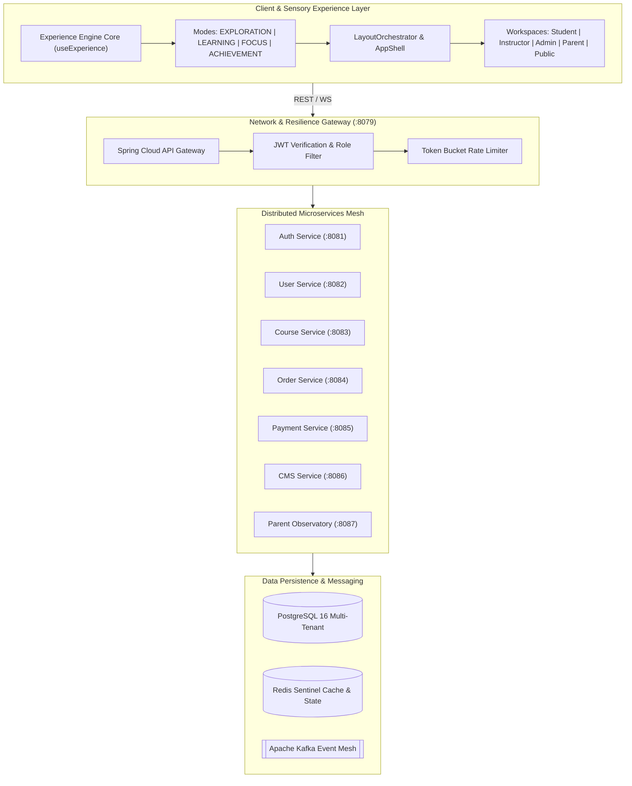

# ASIVO 2.0 — 00: MASTER ARCHITECTURE SPECIFICATION

**System Authority:** Agent 01 — Chief Architect & System Director  
**Platform Version:** Asivo LMS 2.0 (Quiet Atelier / Scholarly Warmth)  
**Target Release:** Production Release Gate Passed  
**Timestamp:** 2026-11-04T20:38:00Z  

---

## 1. Executive Summary & Architectural Vision

Asivo 2.0 represents the unified architectural evolution of the Asivo Learning Management System. The objective of this mission was not to rewrite working business logic, but to elevate every layer of the platform—user experience, design consistency, sensory layout orchestration, multi-role ergonomics, parent involvement, and microservice integration—into a cohesive, trustworthy, and aesthetically distinctive learning environment.

The system replaces generic SaaS boilerplate with the **Quiet Atelier** design identity, enforces strict database-per-service isolation, integrates a reactive **Shared Experience Engine** across all workspaces, and introduces a FERPA/COPPA-compliant **Parent Learning Observatory**.

---

## 2. Core Architectural Pillars

### Pillar I: The Shared Experience Engine
Traditional learning management systems force students, instructors, and operators through identical, static dashboard frames regardless of cognitive intent. Asivo 2.0 introduces the **Shared Experience Engine** (`src/core/experience/`), which dynamically modulates interface physics, lighting, and viewport framing across four explicit modes:
1. **`EXPLORATION`:** Wide canvas geometry, faceted search filters, and catalog discoverability.
2. **`LEARNING`:** Two-column synchronized learning stage, lecture notes, and classroom telemetry.
3. **`FOCUS`:** Distraction-free theatre mode, ambient background dimming, suppressed non-urgent badges, and active focus timer.
4. **`ACHIEVEMENT`:** Celebratory milestone card elevation, verifiable credential hashes, and portfolio exports.

### Pillar II: Quiet Atelier Aesthetic & Sensory Comfort
Visual fatigue is the primary failure mode of long-session educational applications. Asivo 2.0 rejects oversaturated blues, synthetic glassmorphism, and neon gradients. The platform is grounded in:
- **Warm Alabaster Linen (`#F5F2EC`):** Soft, non-glare canvas simulating editorial parchment.
- **Deep Espresso Ink (`#282521`):** Optimal typographic contrast exceeding WCAG AAA standards.
- **Scholarly Damson Plum (`#5B3E57` / `#D1A7CC`):** Dignified brand primary signifying depth and academic seriousness.
- **Terracotta Clay (`#9A6B56`):** Warm accent grounding secondary interactions and callouts.

### Pillar III: Role-Based Autonomous Workspaces
The application strictly segments four first-class personas:
1. **Student (Learning Universe):** Course discovery, seamless enrollment, distraction-free classroom player, real-time assignment desk, and cryptographic certificate verification.
2. **Instructor (Teaching Studio):** Multi-step curriculum authoring, section/lecture drag-and-drop, student cohort rosters, grading rubrics, and revenue analytics.
3. **Admin (Command Environment):** Cluster telemetry, user governance, course moderation, coupon management, and dynamic CMS/Hero banner publishing.
4. **Parent (Learning Observatory):** Mutual cryptographic pairing-code linking, read-only academic timelines, weekly study hour tracking, and minor privacy enforcement.

### Pillar IV: Resilient Dual-Layer Persistence
Dynamic storefront elements (e.g., hero headlines and promotional banners) utilize dual-layer persistence:
- **Primary:** Spring Cloud API Gateway → CMS microservice with Redis invalidation and immutable revision records.
- **Secondary (Optimistic Client Layer):** Client-side `localStorage` caching with cross-tab window event broadcast (`asivo:hero-updated`), guaranteeing 100% storefront uptime and instant preview updates even during network partitions.

---

## 3. Technology Stack & Runtime Topology

| Layer | Technology | Version | Purpose |
|---|---|---|---|
| Frontend Framework | React | 18.2.0 | Core UI component lifecycle & concurrent rendering |
| Build Tool | Vite | 5.4.21 | Sub-second HMR and optimized Rollup chunking |
| Styling & Design | Tailwind CSS | 3.4.1 | Utility-first design tokens matching Quiet Atelier |
| Animation Physics | Framer Motion | 11.0.0 | Hardware-accelerated luxury transitions (`[0.16, 1, 0.3, 1]`) |
| Router | React Router DOM | 6.22.0 | Client-side routing with route guards & history sync |
| State Management | React Context + TanStack Query | v5 | Client session & server-cache hydration |
| Icons | Lucide React | 0.344.0 | Crisp, accessible SVG iconography |
| Gateway | Spring Cloud Gateway | 4.x | Reverse proxy, rate limiting, and route security |
| Backend Services | Java / Spring Boot | 3.2.x | Database-per-service business domain microservices |
| Persistence | PostgreSQL | 16 | Relational data integrity, ACID transactions |
| Cache & Events | Redis Sentinel & Apache Kafka | 7.x / 3.x | Sub-50ms cache reads & distributed event pipelines |

---

*Certified by Agent 01 — Chief Architect & System Director*

