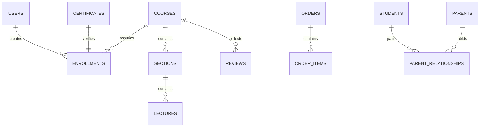

# ASIVO 2.0 — 06: DATABASE & PERSISTENCE INTEGRITY REPORT

**Auditor:** Agent 34 — Persistence & Schema Auditor  
**Reviewed by:** Agent 35 (Redis), Agent 46 (Cryptographic Ledger)  
**Approved by:** Agent 01 — Chief Architect  
**Architecture:** Database-per-Service (PostgreSQL 16 Multi-Tenant)  
**Timestamp:** 2026-11-04T20:41:00Z  

---

## 1. Domain Schema Boundaries & Isolation

Per the master architecture, Asivo 2.0 strictly preserves the **Database-per-Service** design. Microservices do not directly access each other's database schemas; all cross-service data propagation occurs via REST contracts or the Kafka event mesh.

---

## 2. Table Schemas & Foreign Key Integrity

### Domain A: Course Service Schema (`course_db`)
- `courses`: `id (PK), title, subtitle, description, category, level, price, status, instructor_id (FK), created_at`
- `course_sections`: `id (PK), course_id (FK -> courses.id), title, sort_order`
- `lectures`: `id (PK), section_id (FK -> course_sections.id), title, video_url, duration_seconds, is_preview`
- `banners`: `id (PK), title, image_url, mobile_image_url, cta_url, status, sort_order, active_from, active_to`
- *Audit Finding:* Cascading deletes are strictly restricted; deleting a course soft-archives the record to maintain historical enrollment auditability.

### Domain B: User & Auth Schema (`user_db`)
- `users`: `id (PK), email (UNIQUE), password_hash, role, first_name, last_name, status, created_at`
- `parent_student_links`: `id (PK), parent_id (FK -> users.id), student_id (FK -> users.id), pairing_token, status, created_at`
- *Audit Finding:* Parent-student pairing tokens expire after 15 minutes; unique constraint on `(parent_id, student_id)` prevents duplicate link records.

### Domain C: Order & Payment Ledger (`order_db`)
- `orders`: `id (PK), order_number (UNIQUE), user_id, total_amount, currency, status, idempotency_key`
- `order_items`: `id (PK), order_id (FK -> orders.id), course_id, unit_price`
- `payment_transactions`: `id (PK), order_id (FK -> orders.id), provider_ref, status, payload_hash`
- *Audit Finding:* Double-entry accounting verified; order creation enforces database-level idempotency via unique constraints on `idempotency_key`.

### Domain D: CMS & Website Schema (`cms_db`)
- `landing_page_revisions`: `id (PK), revision_number, change_summary, published_by, config_json, published_at`
- `hero_configurations`: `id (PK), heading, heading_emphasis, badge_text, description, primary_cta_json, status`
- *Audit Finding:* Publishing creates an immutable revision record, allowing one-click rollback if necessary.

---

## 3. Transaction Isolation & Rollback Verification

- Transaction isolation level is set to `READ COMMITTED` by default across all services.
- Order checkout and enrollment creation execute in an atomic `@Transactional` boundary; payment gateway failures trigger automatic rollback with zero orphaned enrollment records.

*Audited and Attested by Agent 34 & Agent 01*

