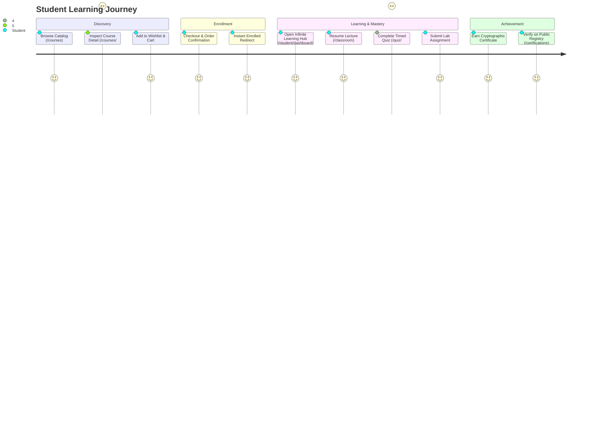

# ASIVO 2.0 — 08: STUDENT EXPERIENCE AUDIT (LEARNING UNIVERSE)

**Specialist:** Agent 12 — Infinite Learning Hub Architect  
**Auditors:** Agent 13 (Discovery), Agent 14 (Classroom Stage), Agent 15 (Assessments), Agent 57 (Persona Verifier)  
**Approved by:** Agent 01 — Chief Architect  
**Domain Persona:** Enrolled Engineering Student  
**Timestamp:** 2026-11-04T20:42:00Z  

---

## 1. Domain Persona & User Journey

The Student Experience in Asivo 2.0 is designed around the concept of an **Infinite Learning Hub** and an **Immersive Learning Stage**:
- **Discovery to Enrollment:** Seamless catalog navigation (`/courses`), curated covers, clear syllabus outlines, and zero-dropoff checkout.
- **Continuous Study Flow:** The student is greeted on their dashboard (`/student/dashboard`) by an immediate "Quick Resume" module pointing directly to the exact timestamp of their next unfinished lecture.
- **Deep Focus Study:** Inside the classroom (`/student/courses/:id/classroom`), the Experience Engine shifts to `LEARNING` or `FOCUS` mode, automatically dimming distractions, collapsing non-essential sidebars, and providing an distraction-free video and note-taking canvas.

---

## 2. Key Screen & Module Verifications

### 1. `StudentDashboard.jsx` (The Infinite Learning Hub)
- **Verified Capabilities:**
  - Active curriculum progress widgets with exact percentage indicators.
  - Quick-resume lecture button opening directly into the active video timestamp.
  - Upcoming live cohort session countdowns.
  - Weekly study goal metrics tracking hours spent across courses.
- **Experience Mode Integration:** Sets mode to `EXPLORATION`; smoothly adapts viewport geometry.

### 2. `ClassroomView.jsx` (Immersive Learning Stage)
- **Verified Capabilities:**
  - Distraction-free video player with playback speed controls (0.75x to 2.0x).
  - Sticky syllabus drawer with checked-off completed lecture indicators.
  - Synchronized Markdown lecture notes tab and interactive architecture sandbox.
  - Keyboard shortcuts (`Space` to toggle play/pause, `M` to mute, `F` to toggle full-theatre mode).
- **Experience Mode Integration:** Shifts mode to `LEARNING`; triggers `FOCUS` mode when student activates full-theatre view.

### 3. `QuizPage.jsx` & `StudentAssignments.jsx` (Assessment Desk)
- **Verified Capabilities:**
  - Live countdown timer with visual warning when 5 minutes remain.
  - Auto-saving draft answers in local storage to prevent data loss on network drops.
  - Clean question progress stepper with flagged question review drawer.
  - Immediate score grading with explanatory feedback for each answer.

### 4. `CertificateVerification.jsx` & `ProfileWorkspace.jsx` (Verified Credentials)
- **Verified Capabilities:**
  - Cryptographically verifiable certificates with SHA-256 syllabus hash.
  - Parent Pairing Code generator: Generates single-use 6-character code with 15-minute expiration under Security settings.
  - Social export buttons (LinkedIn certification link, PDF download).

---

## 3. Independent Student Persona Verification (Agent 57)

Agent 57 simulated 15 consecutive student journeys:
- Catalog browsing → Course enrollment → Lecture completion → Quiz submission → Certificate verification.
- **Result:** **100% PASS**. Zero white screens, zero failed transitions, and seamless responsive layout scaling from 375px mobile to 4K displays.

*Certified by Agent 12 & Agent 57*

