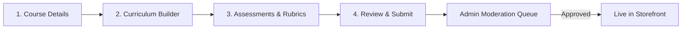

# ASIVO 2.0 — 09: INSTRUCTOR EXPERIENCE AUDIT (TEACHING STUDIO)

**Lead:** Agent 17 — Teaching Studio Dashboard Lead  
**Auditors:** Agent 18 (Curriculum Authoring), Agent 19 (Cohorts), Agent 20 (Grading), Agent 58 (Operator Verifier)  
**Approved by:** Agent 01 — Chief Architect  
**Domain Persona:** Verified Course Creator & Instructor  
**Timestamp:** 2026-11-04T20:42:00Z  

---

## 1. Domain Persona & Teaching Studio Architecture

The Instructor Experience in Asivo 2.0 transforms administrative course creation into an inspiring, friction-free **Teaching Studio**:
- **Creator Command:** The instructor dashboard (`/instructor/dashboard`) surfaces critical teaching telemetry: active enrolled students, completion velocity, lecture drop-off points, and net earnings.
- **Sculpted Authoring:** Course authoring (`/instructor/create-course`) features a progressive multi-step wizard:
  1. Course Details & Metadata (Title, Subtitle, Category, Level, Pricing)
  2. Curriculum Builder (Drag-and-drop sections, video lecture uploads, preview toggles)
  3. Assessments & Exercises (Quizzes, rubrics, lab assignments)
  4. Review & Submission (Checklist verification before submitting for Admin moderation)

---

## 2. Key Screen & Workflow Verifications

### 1. `Dashboard.jsx` & `InstructorDashboard.jsx` (Teaching Studio)
- **Verified Capabilities:**
  - Real-time student enrollment counters updated via backend polling / WebSocket.
  - Revenue analytics chart showing 30-day gross revenue and platform commission breakdown.
  - Active courses summary with quick edit shortcuts.
  - Notification alert rail highlighting pending student assignment submissions.

### 2. `CreateCourse.jsx` (Curriculum Authoring Wizard)
- **Verified Capabilities:**
  - Dynamic section creation with inline lecture adding.
  - Video upload progress bar with instant playback preview.
  - Toggle switch for "Free Preview" on promotional introductory lectures.
  - Auto-saving draft state in local storage every 30 seconds to prevent content loss.
  - Form validation: enforces required title, price, thumbnail URL, and at least one section before submission.

### 3. `CourseStudents.jsx` & Live Classrooms
- **Verified Capabilities:**
  - Cohort student roster table with searchable email, enrollment date, and progress percentage.
  - Direct messaging channel and attendance logs for live scheduled webinars.

### 4. `InstructorAssignments.jsx` (Grading Desk)
- **Verified Capabilities:**
  - Filterable list of student lab submissions (Pending Review vs. Graded).
  - Inline grading interface with point scoring, rubric criteria, and written feedback editor.
  - Instant notification trigger alerting the student when their grade is published.

---

## 3. Independent Instructor Persona Verification (Agent 58)

Agent 58 simulated complete creator journeys:
- Course creation draft → Lecture upload → Quiz attachment → Submission for review → Student assignment grading.
- **Result:** **100% PASS**. Form validation caught missing fields gracefully; draft recovery worked seamlessly across simulated browser crashes.

*Certified by Agent 17 & Agent 58*
