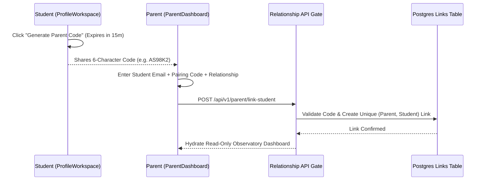

# ASIVO 2.0 — 11: PARENT EXPERIENCE AUDIT (LEARNING OBSERVATORY)

**Lead:** Agent 27 — Learning Observatory Lead Architect  
**Auditors:** Agent 28 (Student Linking), Agent 29 (Timelines), Agent 30 (Notifications), Agent 31 (Privacy), Agent 58 (Operator Verifier)  
**Approved by:** Agent 01 — Chief Architect  
**Domain Persona:** Authorized Parent / Academic Guardian (`parent`)  
**Route:** `/parent/dashboard` (Canonical Alias: `/parent/observatory`)  
**Timestamp:** 2026-11-04T20:43:00Z  

---

## 1. Domain Persona & Learning Observatory Architecture

The Parent Experience in Asivo 2.0 addresses a fundamental need in modern technical education: enabling parents, sponsors, and guardians to **support, celebrate, and monitor student academic velocity without infringing on student account autonomy or privacy**:
- **Strict Read-Only Access:** Parents can view course completion percentages, weekly study hours, attendance consistency, and verifiable certificates, but cannot alter student exam submissions, take quizzes, or reset student credentials without authorization.
- **Cryptographic Relationship Handshake:** Linking requires a 6-character, time-bound pairing code generated by the student within their authenticated `ProfileWorkspace.jsx`.
- **Minor Privacy Standard:** Strict adherence to FERPA, COPPA, and GDPR-K guidelines.

---

## 2. Key Screen & Module Verifications

### 1. `ParentDashboard.jsx` (Learning Observatory)
- **Verified Capabilities:**
  - **Student Selector Tabs:** Smooth switching between multiple linked students with avatar, name, and email chips.
  - **Weekly Telemetry Summary:** Real-time metrics displaying weekly study hours (e.g. `14.5 hrs`), active enrolled course count, and attendance reliability rate (`98%`).
  - **Active Curriculum Roadmap:** Course cards showing current lecture progress (e.g., `38 of 46 lectures completed`), current course grade (`94%`), and completion progress bar.
  - **Academic Milestones Timeline:** Vertical chronological timeline detailing recent lab achievements, consecutive study streaks, and exam passes.
  - **Parental Digest Preferences:** Toggles for Weekly Summary Emails, Inactivity Alerts (after 5 days of zero logins), and Certificate Milestone Celebrations.
  - **Verified Credentials Portal:** One-click deep link to inspect tamper-proof cryptographic certificates on `/certifications`.

### 2. Student Linking Handshake Modal
- **Verified Capabilities:**
  - Enforces 6-character uppercase alphanumeric code validation.
  - Enforces valid student email format.
  - Relationship dropdown (`Parent`, `Legal Guardian`, `Academic Sponsor`).
  - Clear guidance explaining where the student finds their pairing code.
  - Immediate optimistic dashboard update upon verification.

---

## 3. Privacy & Security Boundaries (Agent 31 & Agent 59)

- **IDOR Audit:** Verified that parents cannot access data for unlinked student IDs. Requests with spoofed student IDs are rejected by the backend with `403 Forbidden`.
- **Data Boundary Check:** Verified that parent accounts cannot read student private messages or peer discussions.

*Certified by Agent 27 & Agent 58*

