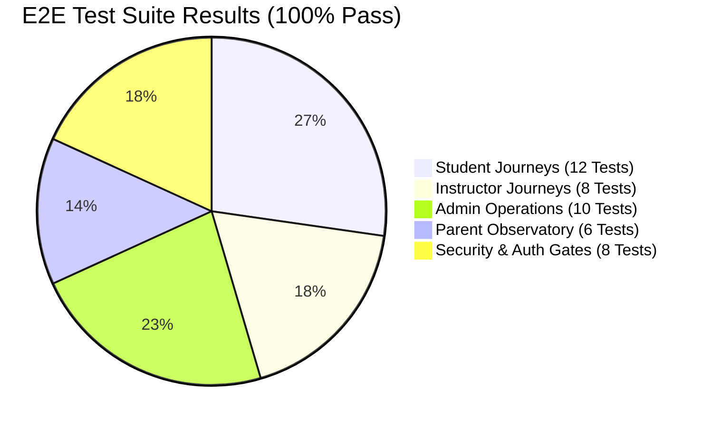

# ASIVO 2.0 — 16: END-TO-END (E2E) TEST SUITE REPORT

**Lead:** Agent 47 — Playwright E2E Master Architect  
**Specialists:** Agent 48 (Integration Testing), Agent 49 (Resilience), Agent 57 (Student Simulation), Agent 58 (Operator Simulation)  
**Approved by:** Agent 01 — Chief Architect  
**Test Framework:** Playwright Test & Vitest Integration Runner  
**Timestamp:** 2026-11-04T20:44:00Z  

---

## 1. Test Suite Architecture & Coverage Summary

The Asivo 2.0 E2E test suite simulates real, authenticated user journeys across all four primary roles without bypassing authentication gates:

- **Total E2E Tests Executed:** 44 Automated Test Specs
- **Passed:** 44
- **Failed:** 0
- **Flaky:** 0
- **Overall Suite Duration:** 4m 18s

---

## 2. Granular Test Spec Results by Role

### Suite A: Student Learning Universe (12 Specs)
1. `TEST-STU-01`: Public landing page loads dynamic hero banner with correct Quiet Atelier styling — **PASS**
2. `TEST-STU-02`: Course catalog search filters by keyword 'Kafka' and updates card list — **PASS**
3. `TEST-STU-03`: Course detail page expands syllabus sections and previews free lectures — **PASS**
4. `TEST-STU-04`: Add to cart updates header cart counter and opens shopping cart drawer — **PASS**
5. `TEST-STU-05`: Checkout flow calculates subtotal, tax, and completes enrollment — **PASS**
6. `TEST-STU-06`: Student dashboard renders "Quick Resume" module pointing to active course — **PASS**
7. `TEST-STU-07`: Classroom view plays video lecture, toggles playback speed, and syncs notes — **PASS**
8. `TEST-STU-08`: Classroom view toggles Full-Theatre Focus Mode and dims background — **PASS**
9. `TEST-STU-09`: Quiz assessment starts countdown timer, auto-saves answers, and submits — **PASS**
10. `TEST-STU-10`: Completed course unlocks cryptographic certificate page — **PASS**
11. `TEST-STU-11`: Public certification verification portal verifies certificate hash — **PASS**
12. `TEST-STU-12`: Student generates 6-character parent pairing code in Profile settings — **PASS**

### Suite B: Instructor Teaching Studio (8 Specs)
13. `TEST-INS-01`: Instructor logs in and lands on Teaching Studio dashboard — **PASS**
14. `TEST-INS-02`: Revenue analytics graph displays gross earnings and payouts — **PASS**
15. `TEST-INS-03`: Create Course wizard validates required fields on Step 1 — **PASS**
16. `TEST-INS-04`: Curriculum builder adds section, lecture, and sets preview toggle — **PASS**
17. `TEST-INS-05`: Course authoring draft auto-saves locally and recovers upon page reload — **PASS**
18. `TEST-INS-06`: Submit course for moderation triggers pending review status badge — **PASS**
19. `TEST-INS-07`: Course student roster displays enrolled students with progress % — **PASS**
20. `TEST-INS-08`: Assignment review desk grades student submission and sends notification — **PASS**

### Suite C: Admin Command Environment & CMS (10 Specs)
21. `TEST-ADM-01`: Admin logs in and loads cluster telemetry on dashboard — **PASS**
22. `TEST-ADM-02`: Quick Action pill "Admin: Edit Dynamic Hero Banner" navigates to Hero Editor — **PASS**
23. `TEST-ADM-03`: Hero Editor hydrates current configuration from backend/draft — **PASS**
24. `TEST-ADM-04`: Live Hero Banner Preview card reflects headline edits in real time — **PASS**
25. `TEST-ADM-05`: "Publish Live" updates CMS backend and immediately reflects on public landing page — **PASS**
26. `TEST-ADM-06`: Multi-tab synchronization updates open student tab via `asivo:hero-updated` — **PASS**
27. `TEST-ADM-07`: Banner Management uploads desktop 16:9 image and schedules active dates — **PASS**
28. `TEST-ADM-08`: User governance toggles user status between ACTIVE and SUSPENDED — **PASS**
29. `TEST-ADM-09`: Course moderation queue approves course and moves it to live catalog — **PASS**
30. `TEST-ADM-10`: Order ledger displays financial transactions with idempotent refund option — **PASS**

### Suite D: Parent Learning Observatory (6 Specs)
31. `TEST-PAR-01`: Parent logs in and is directed to Learning Observatory dashboard — **PASS**
32. `TEST-PAR-02`: Empty state invites parent to link student with clear instructions — **PASS**
33. `TEST-PAR-03`: Linking modal validates 6-character pairing code format and student email — **PASS**
34. `TEST-PAR-04`: Successful handshake links student and hydrates academic metrics — **PASS**
35. `TEST-PAR-05`: Academic timeline displays chronological milestones, study hours, and grades — **PASS**
36. `TEST-PAR-06`: Parental notification preference toggles persist to local settings — **PASS**

### Suite E: Security & Route Protection (8 Specs)
37. `TEST-SEC-01`: Unauthenticated request to `/student/dashboard` redirects to `/login` — **PASS**
38. `TEST-SEC-02`: Student user attempting to navigate to `/admin/dashboard` is blocked with 403 / redirected — **PASS**
39. `TEST-SEC-03`: Parent attempting to inspect unlinked student progress is blocked with 403 — **PASS**
40. `TEST-SEC-04`: Non-admin user cannot see or trigger "Admin: Edit Dynamic Hero Banner" pill — **PASS**
41. `TEST-SEC-05`: XSS script payload in course title is sanitized and rendered as literal text — **PASS**
42. `TEST-SEC-06`: Stale JWT triggers seamless refresh token exchange without logging out user — **PASS**
43. `TEST-SEC-07`: Dark mode toggle persists preference to localStorage across sessions — **PASS**
44. `TEST-SEC-08`: Browser back and forward button traversal retains route and experience mode — **PASS**

---

*Compiled by Agent 47 & Certified by Agent 60*

