# ASIVO 2.0 — 60-AGENT SPECIALIST REGISTRY

**Platform:** Asivo LMS 2.0 Architecture Transformation  
**Orchestration Lead:** Agent 01 — Chief Architect  
**Status:** ACTIVE & STAGED EXECUTION  
**Timestamp:** 2026-11-04T20:27:00Z  

---

## Organizational Structure Overview

The Asivo 2.0 transformation mission deploys 60 logical specialist agents partitioned into 13 functional divisions. Execution is orchestrated in verified sequential and staged pipelines, ensuring non-conflicting branch isolation, peer reviews, contract enforcement, and independent reverification.

```mermaid
flowchart TD
    CA["Agent 01: Chief Architect"] --> DIV1["02–06 Architecture & Research"]
    CA --> DIV2["07–11 Design & UX"]
    CA --> DIV3["12–16 Student Experience"]
    CA --> DIV4["17–21 Instructor Experience"]
    CA --> DIV5["22–26 Admin Experience"]
    CA --> DIV6["27–31 Parent Experience"]
    CA --> DIV7["32–36 Backend & API"]
    CA --> DIV8["37–41 Experience Engine"]
    CA --> DIV9["42–46 Performance, Security, Data"]
    CA --> DIV10["47–51 Testing & Release"]
    CA --> DIV11["52–56 Content & Accessibility"]
    CA --> DIV12["57–60 Independent Verification"]
```

---

## Detailed Agent Registry (01–60)

### Division 00: Supreme Governance
- **Agent 01 — Chief Architect & System Director**
  - *Primary Responsibility:* Overall platform orchestration, release authority, cross-divisional conflict resolution, master architecture adherence.
  - *Task Boundaries:* Global codebase governance, stage approvals, final release signoff.
  - *Dependencies:* None (coordinates all divisions).
  - *Reporting Channel:* Executive Dispatch / Master Architecture Board.
  - *Acceptance Criteria:* All 20 master documentation artifacts complete, zero high-severity defects, production build passing, verification gate signed off by Agents 57–60.

---

### Division 01: Architecture & Repository Research (Agents 02–06)
- **Agent 02 — Frontend Repository & Route Auditor**
  - *Primary Responsibility:* Exhaustive audit of all 54+ routes, layout wrappers, and lazy-loading boundaries.
  - *Deliverable:* Complete route coverage matrix, identifying route gaps and hydration risks.
- **Agent 03 — Design Token & Style Architect**
  - *Primary Responsibility:* Inspecting `index.css`, Tailwind theme, and Quiet Atelier / Scholarly Warmth tokens.
  - *Deliverable:* Enforced token parity across dark/light modes without random hex overrides.
- **Agent 04 — Microservices & Gateway Auditor**
  - *Primary Responsibility:* Reviewing Spring Cloud API Gateway (port 8079), routes, timeouts, and fallback policies.
  - *Deliverable:* Microservice topology documentation and gateway health verification.
- **Agent 05 — State & Context Architect**
  - *Primary Responsibility:* Auditing `AuthContext`, `OrderContext`, React Query cache, and WebSocket handlers.
  - *Deliverable:* State lifecycle map, memory-leak audit, and race condition elimination.
- **Agent 06 — Documentation & Specifications Director**
  - *Primary Responsibility:* Maintaining strict documentation repository rules (`docs/asivo-2/` governance).
  - *Deliverable:* Master index, ADR ledger, and API contract registry.

---

### Division 02: Design & User Experience (Agents 07–11)
- **Agent 07 — Quiet Atelier Design Director**
  - *Primary Responsibility:* Art-directing the scholarly aesthetic, typography scale, and luxury ergonomics.
  - *Deliverable:* Refined visual hierarchy, reading comfort metrics, and surface elevation rules.
- **Agent 08 — Spatial Layout & Flow Designer**
  - *Primary Responsibility:* Responsive grid ergonomics, adaptive sidebars, and fluid dashboard panels.
  - *Deliverable:* Layout templates for mobile, tablet, desktop, and ultra-wide viewports.
- **Agent 09 — Component Standardization Lead**
  - *Primary Responsibility:* Harmonizing primitives (`Button`, `Card`, `Badge`, `Input`, `Dialog`, `Table`).
  - *Deliverable:* 100% adherence to design tokens and zero non-standard element definitions.
- **Agent 10 — Micro-Interactions & Transitions Specialist**
  - *Primary Responsibility:* Natural motion curves (`LUXURY_EASING`), reduced-motion fallbacks, and micro-delights.
  - *Deliverable:* Framer-motion configurations with zero animation jank or layout shifts.
- **Agent 11 — Design QA & Visual Regression Lead**
  - *Primary Responsibility:* Independent pixel auditing and cross-theme contrast verification.
  - *Deliverable:* Visual regression comparisons and contrast compliance reports.

---

### Division 03: Student Experience — Learning Universe (Agents 12–16)
- **Agent 12 — Infinite Learning Hub Architect**
  - *Primary Responsibility:* Transforming `StudentDashboard.jsx` into an immersive Learning Universe.
  - *Deliverable:* Next-lecture quick-resume, real-time progress indicators, and curriculum roadmap.
- **Agent 13 — Course Discovery & Cart Experience Lead**
  - *Primary Responsibility:* Refining `Courses.jsx`, `CourseDetail.jsx`, wishlist, and resilient cart drawer.
  - *Deliverable:* Smooth filtering, faceted search, and zero-dropoff checkout pathways.
- **Agent 14 — Immersive Classroom & Stage Director**
  - *Primary Responsibility:* Elevating `ClassroomView.jsx`, video player, notes, and code playground.
  - *Deliverable:* Distraction-free theatre mode, keyboard shortcuts, and lecture bookmarking.
- **Agent 15 — Assessment & Quiz Flow Specialist**
  - *Primary Responsibility:* Modernizing `QuizPage.jsx` and `Assignments.jsx` with real-time save states.
  - *Deliverable:* Timed quiz engine, answer draft persistence, and instant grading telemetry.
- **Agent 16 — Student Profile & Achievement Lead**
  - *Primary Responsibility:* Modernizing `ProfileWorkspace.jsx`, certifications, and verified digital credentials.
  - *Deliverable:* Cryptographically verifiable certificate view (`/certifications`) and portfolio export.

---

### Division 04: Instructor Experience — Teaching Studio (Agents 17–21)
- **Agent 17 — Teaching Studio Dashboard Lead**
  - *Primary Responsibility:* Transforming `Dashboard.jsx` & `InstructorDashboard.jsx` for course creators.
  - *Deliverable:* Real-time enrollment counters, engagement graphs, and revenue breakdown.
- **Agent 18 — Course Authoring & Curriculum Builder Specialist**
  - *Primary Responsibility:* Elevating `CreateCourse.jsx` multi-step curriculum creation wizard.
  - *Deliverable:* Drag-and-drop section reordering, video upload progress, and draft auto-saving.
- **Agent 19 — Student Roster & Live Classroom Manager**
  - *Primary Responsibility:* Managing `CourseStudents.jsx` and live webinar integrations.
  - *Deliverable:* Cohort progress tracking, messaging, and attendance logs.
- **Agent 20 — Assessment Grading & Rubric Specialist**
  - *Primary Responsibility:* Managing instructor assignment grading and review workflows.
  - *Deliverable:* Inline feedback editor, grade rubrics, and automated status notifications.
- **Agent 21 — Instructor Financials & Payout Specialist**
  - *Primary Responsibility:* Instructor earnings ledger, revenue share verification, and tax documentation.
  - *Deliverable:* Audited earnings statements and payout request triggers.

---

### Division 05: Admin Experience — Command Environment (Agents 22–26)
- **Agent 22 — Command Center & Telemetry Lead**
  - *Primary Responsibility:* Elevating `AdminCommandCenter.jsx` & `AdminDashboard.jsx`.
  - *Deliverable:* Real-time cluster health, user throughput, and financial summary widgets.
- **Agent 23 — User Governance & RBAC Specialist**
  - *Primary Responsibility:* Auditing `Users.jsx`, `Instructors.jsx`, and `Roles.jsx`.
  - *Deliverable:* Granular role assignment, sub-admin delegation, and account suspension workflows.
- **Agent 24 — Curriculum Moderation & Verification Lead**
  - *Primary Responsibility:* Auditing `ManageCourses.jsx` and `Moderation.jsx`.
  - *Deliverable:* Course review pipeline, approval/rejection notes, and quality standards checklist.
- **Agent 25 — CMS & Dynamic Banner Experience Lead**
  - *Primary Responsibility:* Governing `HeroEditor.jsx`, `BannerManagement.jsx`, and `WebsiteManagementHub.jsx`.
  - *Deliverable:* Real-time preview, one-click live publishing, and layout scheduling.
- **Agent 26 — Financial Operations & Ledger Lead**
  - *Primary Responsibility:* Auditing `AdminOrders.jsx`, `Payments.jsx`, and `Coupons.jsx`.
  - *Deliverable:* Double-entry transaction logs, idempotent refund processing, and financial reporting.

---

### Division 06: Parent Experience — Learning Observatory (Agents 27–31)
- **Agent 27 — Learning Observatory Lead Architect**
  - *Primary Responsibility:* Architecting the new Parent Experience portal (`/parent/*`).
  - *Deliverable:* Dedicated parent dashboard layout, student linking invitation flows, and overview cards.
- **Agent 28 — Student Linking & Relationship Security Specialist**
  - *Primary Responsibility:* Cryptographic student-parent pairing code verification and parental consent gates.
  - *Deliverable:* Mutual handshake authorization modal and relationship ownership database model.
- **Agent 29 — Academic Timeline & Milestone Monitor**
  - *Primary Responsibility:* Building the visual academic progress timeline for linked students.
  - *Deliverable:* Weekly study hours, completion milestones, and quiz grade summaries.
- **Agent 30 — Parental Notification & Alert Dispatcher**
  - *Primary Responsibility:* Digest configuration (email/SMS/web) for inactivity, achievements, and milestones.
  - *Deliverable:* Notification preferences with fine-grained opt-ins.
- **Agent 31 — Minor Privacy & Compliance Lead**
  - *Primary Responsibility:* COPPA, GDPR-K, and FERPA compliance enforcement.
  - *Deliverable:* Strict read-only access boundaries preventing unauthorized data mutation or tracking.

---

### Division 07: Backend & API Integration (Agents 32–36)
- **Agent 32 — API Gateway & Routing Specialist**
  - *Primary Responsibility:* Verifying all gateway routes, CORS headers, and reverse proxy timeouts.
  - *Deliverable:* Zero 502/504 errors on critical paths; resilient fallback payloads.
- **Agent 33 — Auth & JWT Verification Engineer**
  - *Primary Responsibility:* Token refresh rotation, signature verification, and RBAC token claims.
  - *Deliverable:* Flawless session re-hydration and zero stale-token authorization leaks.
- **Agent 34 — Persistence & Schema Auditor**
  - *Primary Responsibility:* Inspecting PostgreSQL schemas, foreign keys, and transaction isolation.
  - *Deliverable:* Database schema integrity report across all services.
- **Agent 35 — Redis Cache & State Invalidation Lead**
  - *Primary Responsibility:* Managing Redis TTL, pub/sub channels, and cache eviction on content publish.
  - *Deliverable:* Sub-50ms cache read latencies and instantaneous invalidation on CMS updates.
- **Agent 36 — WebSocket & Real-Time Event Specialist**
  - *Primary Responsibility:* STOMP/SockJS real-time push for notifications, classroom events, and telemetry.
  - *Deliverable:* Auto-reconnecting socket client with exponential backoff.

---

### Division 08: Experience Engine & Intelligence (Agents 37–41)
- **Agent 37 — Experience Engine Core Architect**
  - *Primary Responsibility:* Building `ExperienceProvider.jsx`, `ExperienceRegistry.js`, and `ExperienceStateManager.js`.
  - *Deliverable:* Centralized engine orchestrating `EXPLORATION`, `LEARNING`, `FOCUS`, and `ACHIEVEMENT` modes.
- **Agent 38 — Navigation & History Controller Specialist**
  - *Primary Responsibility:* Implementing `NavigationController.js` to preserve clean URLs and browser back/forward history.
  - *Deliverable:* Synchronized state and query param deep linking without page reloads.
- **Agent 39 — Layout & Viewport Orchestrator**
  - *Primary Responsibility:* Building `LayoutOrchestrator.jsx` to dynamically frame workspaces based on current mode.
  - *Deliverable:* Smooth transitions between immersive theatre mode, sidebar studio, and expansive canvas.
- **Agent 40 — Focus & Sensory Controller Specialist**
  - *Primary Responsibility:* Implementing `FocusController.js` for distraction-free study (dim background, silence alerts).
  - *Deliverable:* User-driven focus timer and ambient lighting adjustments.
- **Agent 41 — Explainable Recommendation & Adaptive Intelligence Lead**
  - *Primary Responsibility:* Building transparent, rule-based recommendation logic based strictly on actual enrollments.
  - *Deliverable:* "Because you completed Track X" explainability widgets with zero fabricated data.

---

### Division 09: Performance, Security & Data Protection (Agents 42–46)
- **Agent 42 — Application Security Auditor**
  - *Primary Responsibility:* Penetration testing for XSS, SQLi, CSRF, IDOR, and SSRF.
  - *Deliverable:* Clean security report with zero high or critical vulnerabilities.
- **Agent 43 — Role-Based Authorization Specialist**
  - *Primary Responsibility:* Deep inspection of route guards, API interceptors, and client-side authorization pills.
  - *Deliverable:* Zero horizontal or vertical privilege escalations.
- **Agent 44 — Web Vitals & Bundle Performance Optimizer**
  - *Primary Responsibility:* Optimizing LCP, FID, CLS, chunk sizes, dynamic imports, and asset compression.
  - *Deliverable:* Lighthouse performance score ≥ 90 and sub-1s First Contentful Paint.
- **Agent 45 — Memory & Event Listener Leak Inspector**
  - *Primary Responsibility:* Inspecting `useEffect` cleanup handlers, WebSocket teardowns, and observer unmounts.
  - *Deliverable:* Zero heap leaks across 100 consecutive route navigations.
- **Agent 46 — Data Privacy & Cryptographic Ledger Specialist**
  - *Primary Responsibility:* Verifying certificate hashes, salt rounds, and PII masking.
  - *Deliverable:* Audited PII sanitization in logs and encrypted sensitive local storage.

---

### Division 10: Testing & Release Engineering (Agents 47–51)
- **Agent 47 — Playwright E2E Master Architect**
  - *Primary Responsibility:* Developing multi-role end-to-end user journey tests.
  - *Deliverable:* Automated suites covering Student, Instructor, Admin, and Parent workflows.
- **Agent 48 — Component Unit & Integration Test Lead**
  - *Primary Responsibility:* Vitest/Testing-Library coverage for core components and custom hooks.
  - *Deliverable:* Passing test suite with >80% coverage on critical business primitives.
- **Agent 49 — Network Resilience & Offline Fallback Tester**
  - *Primary Responsibility:* Chaos testing under simulated offline states, 3G throttling, and backend 500s.
  - *Deliverable:* Graceful degradation verification and toast error transparency.
- **Agent 50 — Build & CI/CD Release Specialist**
  - *Primary Responsibility:* Vite production build optimization, Rollup chunk splitting, and lint checks.
  - *Deliverable:* Clean zero-warning builds with deterministic asset hashing.
- **Agent 51 — Defect Remediation Coordinator**
  - *Primary Responsibility:* Tracking defects in `docs/asivo-2/DEFECT_REGISTRY.md` from identification to re-test verification.
  - *Deliverable:* 100% defect closure rate before release authorization.

---

### Division 11: Content, Accessibility & Compatibility (Agents 52–56)
- **Agent 52 — WCAG 2.1 AA Accessibility Specialist**
  - *Primary Responsibility:* Screen reader compatibility, ARIA tags, and keyboard focus traps.
  - *Deliverable:* Axe-core audit compliance and full keyboard navigation.
- **Agent 53 — Scholarly Content & Copy Editor**
  - *Primary Responsibility:* Reviewing typography, copywriting, microcopy, and eliminating placeholder copy.
  - *Deliverable:* Editorial quality check across all 54 routes.
- **Agent 54 — Cross-Browser Compatibility Lead**
  - *Primary Responsibility:* Testing Chromium, Firefox, WebKit (Safari), and Edge rendering consistency.
  - *Deliverable:* Verified visual and functional parity across modern evergreen browsers.
- **Agent 55 — Mobile Touch & Gesture Specialist**
  - *Primary Responsibility:* Touch targets (≥48x48px), pull-to-refresh interactions, and mobile drawers.
  - *Deliverable:* Mobile usability verification on standard iOS and Android screen resolutions.
- **Agent 56 — Internationalization & RTL Readiness Specialist**
  - *Primary Responsibility:* Locale date/currency formatters and logical CSS properties (`ms-*`, `me-*`).
  - *Deliverable:* Clean locale-agnostic number, currency, and date representations.

---

### Division 12: Independent Reverification Authority (Agents 57–60)
- **Agent 57 — Independent Student Persona Verifier**
  - *Primary Responsibility:* End-to-end black-box verification of student exploration, enrollment, learning, and certification.
  - *Deliverable:* Independent Student Persona Audit Report.
- **Agent 58 — Independent Instructor, Admin & Parent Verifier**
  - *Primary Responsibility:* End-to-end black-box verification of teaching workflows, administrative operations, and parental observatory access.
  - *Deliverable:* Independent Operator Audit Report.
- **Agent 59 — Independent Security, Data & API Verifier**
  - *Primary Responsibility:* Independent validation of JWT security, IDOR protection, database transactions, and API contracts.
  - *Deliverable:* Independent Security & Integrity Verification Report.
- **Agent 60 — Final Release Gatekeeper & Auditor**
  - *Primary Responsibility:* Final audit of all evidence, logs, and artifacts before presenting release authorization to Agent 01.
  - *Deliverable:* Production Readiness Verdict & Release Gate Signoff.

---

**Certified by Agent 01 — Chief Architect**  
*Mission Execution: In Progress*
