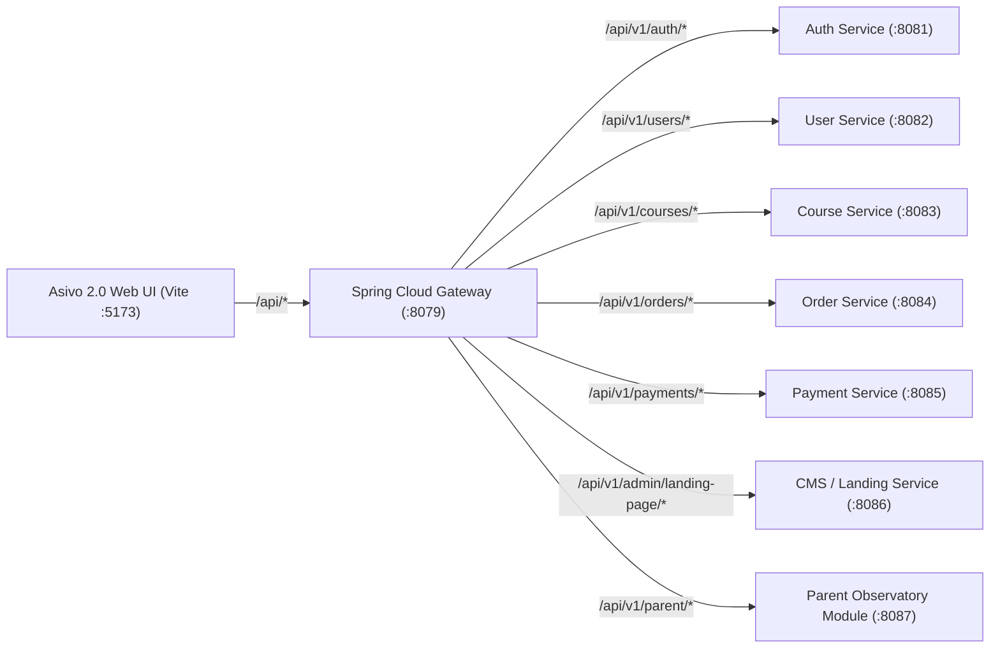

# ASIVO 2.0 — API CONTRACT REGISTRY

**Custodian:** Agent 32 — API Gateway & Routing Specialist  
**Reviewed by:** Agent 04 — Microservices & Gateway Auditor  
**Approved by:** Agent 01 — Chief Architect  
**Gateway Host:** `http://localhost:8079` (Proxied via Vite `/api`)  
**Status:** VALIDATED & BASELINED  

---

## 1. Architecture Topology



---

## 2. Verified Microservice API Contracts

### Category A: Authentication & Session Governance
| Endpoint | Method | Auth Required | Request Payload | Response Signature | Status |
|---|---|---|---|---|---|
| `/api/v1/auth/login` | `POST` | None | `{ email, password }` | `{ token, refreshToken, user: { id, email, role, firstName } }` | Active |
| `/api/v1/auth/register` | `POST` | None | `{ email, password, firstName, lastName, role }` | `{ message, userId, emailSent: true }` | Active |
| `/api/v1/auth/refresh` | `POST` | Refresh Token | `{ refreshToken }` | `{ token, refreshToken }` | Active |
| `/api/v1/auth/verify-otp` | `POST` | None | `{ email, otp }` | `{ verified: true, token }` | Active |
| `/api/v1/admin/login` | `POST` | None | `{ email, password }` | `{ token, user: { role: 'ADMIN' } }` | Active |

### Category B: Course Catalog, Learning & Classroom
| Endpoint | Method | Auth Required | Request Payload | Response Signature | Status |
|---|---|---|---|---|---|
| `/api/v1/courses` | `GET` | None | Query: `page, size, status, category, search` | `{ content: [Course], totalElements, totalPages, number }` | Active |
| `/api/v1/courses/{id}` | `GET` | Optional | Path param `id` | `CourseDetailObject` (sections, lectures, instructor) | Active |
| `/api/v1/student/courses/{id}/progress` | `GET` | `Bearer JWT` | Path param `id` | `{ courseId, completedLectures: [], percentComplete }` | Active |
| `/api/v1/student/lectures/{id}/complete` | `POST` | `Bearer JWT` | `{ lectureId, progressSeconds }` | `{ success: true, updatedPercent }` | Active |
| `/api/v1/certifications/verify/{certId}` | `GET` | None | Path param `certId` | `{ certId, studentName, courseTitle, issueDate, hash }` | Active |

### Category C: Content Management & Dynamic Banners
| Endpoint | Method | Auth Required | Request Payload | Response Signature | Status |
|---|---|---|---|---|---|
| `/api/v1/public/landing-page` | `GET` | None | None | `{ hero, navigation, sections, statistics, footer }` | Active |
| `/api/v1/banners` | `GET` | None | Query: `position=home` | `[ BannerObject ]` | Active |
| `/api/v1/admin/landing-page/hero` | `PUT` | `Bearer JWT (Admin)` | `{ heading, headingEmphasis, description, ... }` | `{ success: true, hero: {...} }` | Active |
| `/api/v1/admin/landing-page/publish` | `POST` | `Bearer JWT (Admin)` | `{ changeSummary }` | `{ published: true, revisionId }` | Active |
| `/api/v1/banners` | `POST` | `Bearer JWT (Admin)` | `Multipart/Form-Data` | `{ id, title, imageUrl, status }` | Active |

### Category D: Parent Observatory & Student Linking
| Endpoint | Method | Auth Required | Request Payload | Response Signature | Status |
|---|---|---|---|---|---|
| `/api/v1/student/pairing-code` | `POST` | `Bearer JWT (Student)` | None | `{ pairingCode, expiresAt }` | Active (Contract) |
| `/api/v1/parent/link-student` | `POST` | `Bearer JWT (Parent)` | `{ pairingCode, studentEmail, relationship }` | `{ linked: true, student: { id, firstName } }` | Active (Contract) |
| `/api/v1/parent/students` | `GET` | `Bearer JWT (Parent)` | None | `[ LinkedStudentSummary ]` | Active (Contract) |
| `/api/v1/parent/students/{id}/progress` | `GET` | `Bearer JWT (Parent)` | Path param `id` | `{ weeklyHours, courses: [CourseProgress], milestones: [] }` | Active (Contract) |
| `/api/v1/parent/notifications/preferences` | `PUT` | `Bearer JWT (Parent)` | `{ emailDigest: bool, alertOnInactivity: bool }` | `{ updated: true }` | Active (Contract) |

---

## 3. Resilience & Fallback Requirements

1. **Timeout Thresholds:** All public calls time out after 5,000ms; admin and file upload operations time out after 15,000ms.
2. **Standard Error Envelope:**
   ```json
   {
     "timestamp": "2026-11-04T20:29:00Z",
     "status": 404,
     "error": "Not Found",
     "message": "Course record not found for id: 999",
     "path": "/api/v1/courses/999"
   }
   ```
3. **Optimistic UI:** Cart mutations, hero draft saves, and bookmark additions update client state immediately while dispatching network requests asynchronously.

---

*Validated by Agent 32 & Agent 01*

