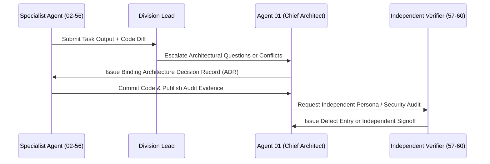

# ASIVO 2.0 — INTER-AGENT COMMUNICATION PROTOCOL

**Author:** Agent 06 — Documentation & Specifications Director  
**Approved by:** Agent 01 — Chief Architect  
**Governance Scope:** All 60 Logical Agents across 13 Divisions  
**Timestamp:** 2026-11-04T20:28:00Z  

---

## 1. Principles of Operational Discipline

To maintain flawless coordination across the 60-agent mission, all agents must adhere to the following strict operational rules:

1. **No Silent Modifications:** Any file creation, modification, or deletion must be preceded by a task assignment on `MASTER_TASK_BOARD.md` and followed by an entry in the relevant registry.
2. **Contract-First Code Delivery:** UI components cannot consume hypothetical backend APIs. All client-server endpoints must be registered and validated in `API_CONTRACT_REGISTRY.md`.
3. **Strict Design Token Parity:** No agent may introduce arbitrary hex codes, inline gradient hacks, or unapproved Tailwind utilities. All styling must derive from `DESIGN_SYSTEM_REGISTRY.md`.
4. **Isolated File Locking:** When an agent is refactoring a core shared file (e.g., `App.jsx`, `DashboardLayout.jsx`, `index.css`), other agents must wait until the changes are committed, built, and verified.
5. **Zero Falsification:** Test results, performance metrics, and compliance audits must reflect real runtime executions. Simulated or mocked environments must be transparently designated.

---

## 2. Reporting & Escalation Hierarchy



---

## 3. Communication Channels & Artifact Routing

| Channel Name | Purpose | Primary Participants | Required Format |
|---|---|---|---|
| `CH-00: ARCHITECTURE-DISPATCH` | Master directives, release stage transitions, scope adjustments | Agent 01, Division Leads | Structured Markdown ADRs |
| `CH-01: CONTRACT-EXCHANGE` | API schema definitions, backend request/response payloads | Div 01, Div 07, Div 08 | OpenAPI 3.0 / TypeScript types |
| `CH-02: DESIGN-GOVERNANCE` | Token approvals, layout rules, typography adjustments | Div 02, Div 11 | CSS variables, Tailwind config diffs |
| `CH-03: DEFECT-ALERT` | Bug reports, visual regression flags, security notices | Div 10, Div 12, Agent 51 | Strict Defect Template |
| `CH-04: VERIFICATION-SIGNAL` | Independent verification findings, persona logs | Agents 57–60 | Structured JSON/Markdown Logs |

---

## 4. Defect Reporting Standard

When any agent identifies a defect during visual, functional, or security auditing, an entry must be immediately logged in `DEFECT_REGISTRY.md` using the following schema:

```markdown
### [DEF-XXX] Title of Defect
- **Severity:** [CRITICAL | HIGH | MEDIUM | LOW]
- **Found by:** Agent XX ([Role Name])
- **Component / Route:** `/path/to/component.jsx` or URL route
- **Reproduction Steps:**
  1. Step 1...
  2. Step 2...
- **Expected Result:** What the specification mandates
- **Actual Result:** What currently occurs
- **Assigned Agent:** Agent YY
- **Fix Reference:** Commit SHA / PR Link
- **Retest Status:** [PENDING | VERIFIED BY AGENT 57-60]
```

---

## 5. Conflict Resolution Rules

If two agents disagree on an architectural approach (e.g., state management in Classroom vs. URL query parameters, or token naming in the design system):
1. Both agents submit a 3-bullet rationale to `CH-00: ARCHITECTURE-DISPATCH`.
2. Agent 01 conducts a design systems and performance review.
3. Agent 01 issues a binding Architecture Decision Record (ADR) in `docs/asivo-2/ARCHITECTURE_DECISIONS.md`.
4. The decision is final and immediately incorporated into all dependent tasks.

---

*Signed: Agent 01 — Chief Architect & System Director*
