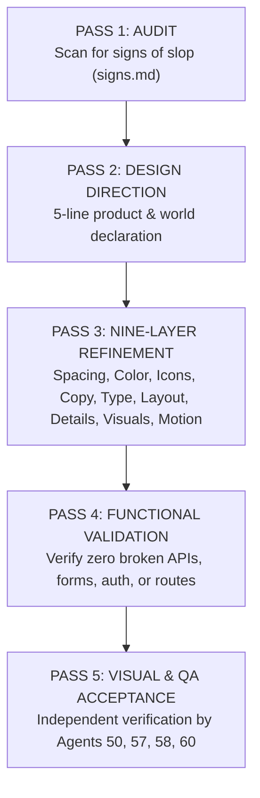

# ASIVO 2.0 — MANDATORY UNSLOP DESIGN GOVERNANCE

**Standard Reference:** [`heydamir/unslop`](https://github.com/heydamir/unslop)  
**Original Author & Creator:** Damir Sokolovsky ([@heydamir](https://x.com/heydamir), [heydamir.design/unslop](https://heydamir.design/unslop))  
**License Attribution:** Creative Commons Attribution 4.0 International (CC BY 4.0)  
**Pinned Git Commit:** `a6f121eee5f29c2f74976b75456feae8b66afb3a`  
**Installed Locations:**  
- `.agents/skills/unslop/`  
- `.claude/skills/unslop/`  
- `.agent/skills/unslop/`  
**Authority:** Agent 01 (Chief Architect) & Agent 07 (Lead Unslop Design Director)  
**Status:** MANDATORY & ENFORCED ACROSS ALL 60 AGENTS  
**Timestamp:** 2026-11-04T20:54:00Z  

---

## 1. Objective & Design Philosophy

The integration of the **Unslop** methodology by Damir Sokolovsky establishes an enforceable, craft-centered design audit and refinement standard throughout Asivo 2.0.

The core objective is to **eliminate generic AI-looking interfaces** ("slop")—such as arbitrary purple/blue gradients, glowing borders, gradient text, emoji labels, "New ✨" badges, glossy floating blobs, uppercase over-tracked labels, and pulsing distractions—and replace them with a **distinct, human, coherent, naturally designed educational product**.

### The Core Principle: Craft vs. Slop
> *"The difference between slop and craft is where the richness goes. Slop spreads color and effects over the chrome, the backgrounds, buttons, borders and labels. Craft keeps the chrome quiet and puts the richness into one or two moments of content that people remember, like a rendered object, a beautiful chart or an image from the product's world."* — Damir Sokolovsky

---

## 2. Agent Assignments & Responsibilities (60-Agent Integration)

| Agent ID | Assigned Role | Unslop Governance Responsibility |
|---|---|---|
| **Agent 07** | **Lead Unslop Design Director** | Lead Unslop design direction, approve 5-line direction statements, eliminate AI slop patterns. |
| **Agent 08** | **Design Token Architect** | Preserve and govern canonical Quiet Atelier tokens; ensure zero unapproved hex overrides. |
| **Agent 09** | **Typography & Layout Auditor** | Typography hierarchy audit, sentence case enforcement, spacing grid multiples of 4px. |
| **Agent 10** | **Motion & Animation Specialist** | Animation and motion refinement; eliminate gratuitous parallax; enforce `LUXURY_EASING`. |
| **Agent 11** | **Responsive Visual Specialist** | Responsive visual refinement across mobile (375px), tablet (768px), and desktop (1440px). |
| **Agents 12–16** | **Student Experience Division** | Apply Unslop to all Student pages (Learning Universe, Infinite Hub, Classroom Stage, Quiz Desk). |
| **Agents 17–21** | **Instructor Experience Division** | Apply Unslop to all Instructor pages (Teaching Studio, Curriculum Authoring, Student Rosters). |
| **Agents 22–26** | **Admin Experience Division** | Apply Unslop to all Admin pages (Command Environment, User Governance, Hero Editor, Banners). |
| **Agents 27–31** | **Parent Experience Division** | Apply Unslop to all Parent pages (Learning Observatory, Student Linking, Academic Timelines). |
| **Agent 45** | **Sensory & Memory Auditor** | Accessibility and sensory verification after visual changes; ensure zero DOM memory leaks. |
| **Agent 50** | **Visual Regression Engineer** | Screenshot governance, before-and-after visual comparisons, zero orphaned artifact files. |
| **Agent 57** | **Independent Student Verifier** | Independent student experience review; verify real learning interactions without visual clutter. |
| **Agent 58** | **Independent Operator Verifier** | Independent role experience review for Instructors, Administrators, and Parents. |
| **Agent 60** | **Final Release Gatekeeper** | Final visual acceptance and release signoff across all three mandatory validation gates. |

---

## 3. Mandatory 5-Pass Design Workflow

Every route, workspace, and reusable component in Asivo 2.0 must pass the following 5-phase refinement pipeline:



### PASS 1 — AUDIT
Systematically inspect the screen against `references/signs.md` and log every defect:
- Purple to blue or violet to pink gradients on cards or backgrounds.
- Gradient text in headings, numbers, or brand logos.
- Colored glows (`shadow-[0_0_20px_...]`), glowing pill badges, or neon borders.
- Radial color washes or blurred blobs behind content.
- Emoji used as nav icons, label decorations, or status badges (🏠, 🚀, ✨, 🔥).
- Arbitrary non-grid spacing values (`mt-[13px]`, `py-[11px]`).
- Greeting headlines like `Welcome back, User! 👋` instead of purposeful page titles.
- Wordy placeholder text (`Search anything across the universe...`).
- Fake statistics or repetitive cards side-by-side with identical layouts.

### PASS 2 — DESIGN DIRECTION
Before editing code, establish five concise lines derived from the product's actual world:
1. **Product:** What it does and for whom, in one plain sentence.
2. **Character:** 2–3 concrete sensory words (e.g., `calm, exact, scholarly warm`). Words like *clean, modern, sleek, minimal, premium* are banned.
3. **World:** The physical place or material the product belongs to (e.g., *architectural atelier, high-concurrency server racks, physical paper and dark espresso ink*).
4. **Moments:** 1 or 2 specific places where the screen gets rich craft (e.g., *real terminal Kafka event visualizer, rendered cryptographic certificate seal*).
5. **Signature:** One small detail only this product possesses (e.g., *Quiet Atelier terracotta clay underline decoration `decoration-[#9A6B56]/40 underline-offset-8`*).

### PASS 3 — REFINEMENT (The 9 Craft Layers)
1. **Spacing:** Enforce strict 4px grid rhythm. Align icon boxes, label text lines, and right-aligned numbers.
2. **Color:** Ground surfaces in the Quiet Atelier neutral ramp (`#F5F2EC` Light / `#151413` Nocturnal). Chrome remains quiet. Plum `#5B3E57` used as deliberate primary accent.
3. **Icons:** Replace all emojis with uniform Lucide line icons (16px or 18px with 1.5 stroke). Icons take muted or secondary text colors.
4. **Copy:** Eliminate hype words (*supercharge, seamless, revolutionize, unlock*). State what the system does with factual precision.
5. **Typography:** Scale headings with weight 700/800 only where hierarchy demands; body at 400; metadata in tabular monospace figures.
6. **Layout:** Balanced measure; text paragraphs constrained to 65–75 characters per line.
7. **Details:** Subtle hairline borders (6–10% opacity) rather than heavy drop shadows.
8. **Visuals:** Replace AI stock blobs with real product previews, code blocks, or architectural diagrams.
9. **Motion:** Standardize on `LUXURY_EASING` (`[0.16, 1, 0.3, 1]`) with instant snapping under `prefers-reduced-motion`.

### PASS 4 — FUNCTIONAL VALIDATION
Verify that visual refinements have not disrupted:
- Form validation & submit handlers
- API gateway network calls & error handling
- Multi-role routing & navigation guards
- Mobile responsive touch targets (≥44px)
- Accessibility & WCAG AA contrast standards

### PASS 5 — VISUAL VERIFICATION
- Capture before-and-after evidence under desktop (1440px), tablet (768px), and mobile (375px) viewports.
- Compare Light and Dark Nocturnal themes.
- Re-inspect empty states, loading skeletons, and error screens.

---

## 4. Distinct Role-Based Character Standards

Unslop does **not** make every page look identical. Each persona environment maintains its own purposeful character while sharing the unified Quiet Atelier design tokens:

### 1. Student — Spatial & Expressive
- **Character:** Spatial composition, subtle depth, and immersive learning interactions.
- **Visual Feel:** Inspiring, focused, distraction-free. Prominent active course quick-resume, clear progress milestones, and distraction-free classroom theatre mode.

### 2. Instructor — Creative & Productive
- **Character:** Focused editing, structured workspaces, and efficient creator controls.
- **Visual Feel:** Structured studio. Multi-step curriculum wizard, drag-and-drop lecture authoring, clear student submission grading desks, and concise revenue telemetry.

### 3. Admin — Precise & Authoritative
- **Character:** High information density, operational clarity, and trustworthy telemetry.
- **Visual Feel:** Command console. Cluster health status, real-time live hero preview editor, user governance tables, and double-entry transaction ledgers with zero decorative fluff.

### 4. Parent — Calm & Reassuring
- **Character:** Clear progress, understandable language, and transparent academic information.
- **Visual Feel:** Observatory. Read-only academic milestone timelines, weekly study hours, attendance reliability, and transparent FERPA/COPPA minor privacy boundaries.

---

## 5. Three-Gate Final Approval Criteria

Every screen in Asivo 2.0 requires three independent signoffs before being marked complete:

```
[ Gate 1: Design Approved ]       --> Unslop 9-pass refinement & Quiet Atelier token compliance
[ Gate 2: Functionality Approved ] --> Real API integration, forms, auth, and state persistence
[ Gate 3: Independent QA Approved ]--> Persona simulations by Agents 57, 58, 59, and 60
```

*Final Release Authority: Agent 01 (Chief Architect)*
