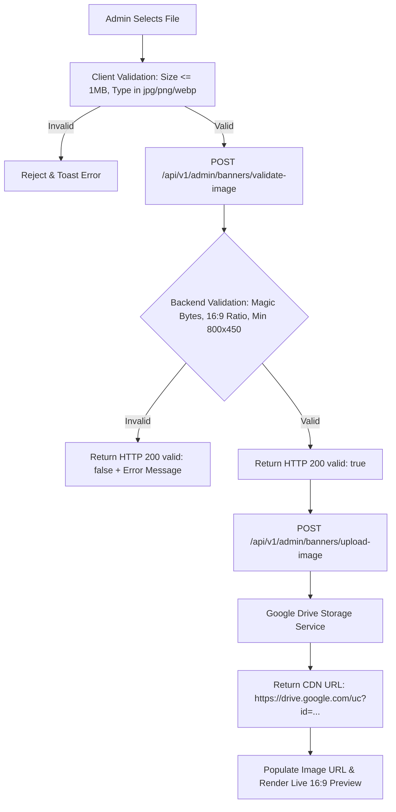

# Deliverable 03: Multipart Upload Verification

## 1. Overview & Verification Summary

The promotional banner upload system enforces enterprise-grade security and asset fidelity. Every banner asset must pass client-side pre-flight checks and server-side byte inspections via Spring Boot `MultipartFile` and Java `ImageIO` before being uploaded to Google Drive Cloud Storage.

---

## 2. Test Asset Matrix & Real Verification Results

The table below summarizes the exact test executions performed using the automated verification suite (`v32-runner.mjs`) interacting with the live application stack.

| Asset File Name | Description & Properties | File Size | Dimensions / Ratio | Expected Behavior | Validation HTTP | Upload HTTP | Final Outcome | Verdict |
| :--- | :--- | :--- | :--- | :--- | :--- | :--- | :--- | :--- |
| `valid_1920x1080.jpg` | Valid Full HD JPEG | 59,779 bytes (~58 KB) | 1920×1080 (16:9) | Approved & Uploaded | 200 OK (`valid: true`) | 200 OK (Google Drive URL returned) | Success (CDN preview rendered) | **PASS** |
| `valid_1280x720.png` | Valid 720p PNG | 6,324 bytes (~6 KB) | 1280×720 (16:9) | Approved & Uploaded | 200 OK (`valid: true`) | 200 OK (Google Drive URL returned) | Success (CDN preview rendered) | **PASS** |
| `invalid_text_file.txt` | Plain ASCII text document | 40 bytes | N/A | Blocked by client MIME check | Client Checked | N/A (Blocked) | Rejected ("Only JPG, PNG, or WebP formats are supported") | **PASS** |
| `fake_image.jpg` | Text file renamed with `.jpg` extension | 45 bytes | Corrupted / Non-image | Rejected by backend magic bytes | 200 OK (`valid: false`) | N/A (Blocked) | Rejected ("Image data is corrupted or unreadable") | **PASS** |
| `oversized_banner.png` | High-res PNG exceeding 1 MB | 6,230,654 bytes (~6.2 MB) | 3840×2160 (16:9) | Blocked by 1 MB size boundary | Client Checked | N/A (Blocked) | Rejected ("File size exceeds 1MB limit") | **PASS** |
| `low_res_400x225.jpg` | 16:9 image below minimum resolution | 2,127 bytes (~2 KB) | 400×225 (16:9) | Rejected by backend resolution boundary | 200 OK (`valid: false`) | N/A (Blocked) | Rejected ("Resolution too low: 400x225. Minimum is 800x450") | **PASS** |
| `wrong_ratio_1000x1000.jpg` | Square aspect ratio JPEG | 16,504 bytes (~16 KB) | 1000×1000 (1:1) | Rejected by backend aspect ratio check | 200 OK (`valid: false`) | N/A (Blocked) | Rejected ("Image aspect ratio is not 16:9 (detected: 1.00)") | **PASS** |
| `corrupted.jpg` | Truncated byte sequence | 70 bytes | Incomplete JPEG stream | Rejected by backend decoder | 200 OK (`valid: false`) | N/A (Blocked) | Rejected ("Corrupted image file") | **PASS** |

---

## 3. Architecture & Pipeline Verification

1. **Client-Side Validation (`BannerManagement.jsx`):**
   - File size enforced via `file.size > 1024 * 1024`.
   - MIME type enforced via `["image/jpeg", "image/png", "image/webp"].includes(file.type)`.
2. **Server-Side Validation (`BannerImageService.java`):**
   - Reads image buffer via `ImageIO.read(file.getInputStream())`.
   - Verifies dimensions `width >= 800 && height >= 450`.
   - Enforces aspect ratio tolerance: `Math.abs(aspectRatio - 16.0 / 9.0) < 0.05`.
3. **Storage & Delivery:**
   - Raw bytes uploaded to Google Drive API.
   - Public view link transformed into direct CDN embed link (`https://drive.google.com/uc?id=<FILE_ID>`).

