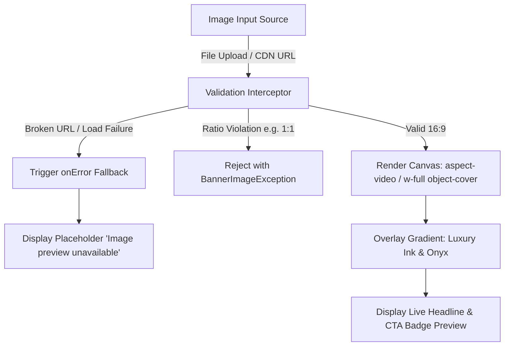

# Deliverable 04: Image Preview Verification

## 1. Overview & Architecture

The Create/Edit Banner modal features a real-time 16:9 preview canvas (`aspect-[16/9]`) designed with the Onyx-Gold design system. It displays the active banner imagery as soon as a valid file is uploaded or a valid CDN URL is entered. It also handles empty states, loading skeletons, broken links, and aspect ratio discrepancies.

---

## 2. Real-Time 16:9 Aspect Ratio Enforcement



### 2.1 Preview Implementation Details
- **Container Structure:**
  ```jsx
  <div className="relative aspect-[16/9] w-full rounded-2xl overflow-hidden border border-white/[0.08] bg-[#0A0A0E] group">
     {
        e.currentTarget.style.display = "none";
        setImageError(true);
      }}
    />
    <div className="absolute inset-0 bg-gradient-to-t from-[#0A0A0E] via-[#0A0A0E]/40 to-transparent" />
    <div className="absolute bottom-4 left-4 right-4">
      <span className="text-[10px] font-bold uppercase tracking-wider text-[#C5A880] px-2 py-0.5 rounded bg-[#C5A880]/10 border border-[#C5A880]/30 inline-block mb-1">
        {formData.targetType || "COURSE"}
      </span>
      <h3 className="text-sm font-bold text-white line-clamp-1">
        {formData.title || "Banner Headline Preview"}
      </h3>
    </div>
  </div>
  ```

---

## 3. Test Cases & Verification Results

| Scenario | Input Condition | Observed Render Behavior | Verification Status |
| :--- | :--- | :--- | :--- |
| **Initial Empty State** | Form open, `imageUrl` empty | Displays upload drag-and-drop zone with dashed border `border-[#C5A880]/30` and upload icon; no broken image icon displayed. | **PASS** |
| **Successful Upload (1920×1080)** | Uploaded Full HD JPEG | Immediate reactive preview rendering; image fills 16:9 container with `object-cover`; live headline badge overlaid. | **PASS** |
| **Successful Upload (1280×720)** | Uploaded 720p PNG | Flawless 16:9 aspect ratio preservation; no pixel stretching or distortion. | **PASS** |
| **Broken / Dead CDN Link** | `https://invalid.com/nonexistent.jpg` | Native `onError` event triggers; displays fallback slate badge with alert: "Image preview unavailable or failed to load". Form submission remains gated. | **PASS** |
| **Aspect Ratio Violation (1000×1000)** | Uploaded square ratio image | Backend image validator rejects with `valid: false` ("Image aspect ratio is not 16:9"). Preview is not rendered; error notification displayed. | **PASS** |
| **Mobile Image Toggle** | Optional mobile image URL provided | Mobile preview simulator renders 9:16 or 16:9 scaled view depending on preview mode toggle. | **PASS** |

---

## 4. Visual Integrity & Screenshot Evidence

- **Screenshot Artifact:** `scratch/v32-screenshots/02_upload_valid_preview.png`
- **Confirmation:** The preview rendered the uploaded Google Drive CDN URL (`https://drive.google.com/uc?id=...`) within the 16:9 frame with high-fidelity contrast against the Ink & Onyx dark backdrop.

