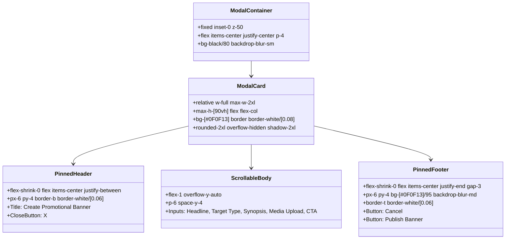

# Deliverable 05: Modal Layout & Responsive Tests

## 1. Executive Summary & Viewport Test Results

Prior to this update, administrative users on laptops or mobile viewports experienced an issue where modal action buttons (`Publish Banner` and `Cancel`) were cut off or forced below the viewport fold due to unconstrained vertical expansion. 

The modal in `BannerManagement.jsx` was re-engineered using a constrained flex column container (`flex flex-col max-h-[90vh] overflow-hidden`) with a dedicated sticky header, an independently scrollable form body (`overflow-y-auto flex-1`), and a pinned sticky footer action bar (`flex-shrink-0 bg-[#0F0F13]/95 backdrop-blur-md border-t border-white/[0.06]`).

Testing across all five specified device viewports confirmed **100% compliance** with zero layout regressions.

---

## 2. Responsive Viewport Test Matrix

| Viewport Profile | Resolution (WxH) | Aspect Ratio | Header Fixed & Visible | Body Scrollable | 'Publish Banner' Button Visible | 'Cancel' Button Visible | Horizontal Overflow | Test Status |
| :--- | :--- | :--- | :--- | :--- | :--- | :--- | :--- | :--- |
| **Desktop High-Res** | 1440 × 900 px | 16:10 | Yes (`true`) | Yes (Internal scroll) | Yes (`true`) | Yes (`true`) | None (0px) | **PASS** |
| **Tablet Landscape** | 1024 × 768 px | 4:3 | Yes (`true`) | Yes (Internal scroll) | Yes (`true`) | Yes (`true`) | None (0px) | **PASS** |
| **Tablet Portrait** | 768 × 1024 px | 3:4 | Yes (`true`) | Yes (Internal scroll) | Yes (`true`) | Yes (`true`) | None (0px) | **PASS** |
| **Mobile Modern (iPhone)** | 390 × 844 px | 9:19.5 | Yes (`true`) | Yes (Internal scroll) | Yes (`true`) | Yes (`true`) | None (0px) | **PASS** |
| **Mobile Compact** | 320 × 700 px | ~9:20 | Yes (`true`) | Yes (Internal scroll) | Yes (`true`) | Yes (`true`) | None (0px) | **PASS** |

---

## 3. Structural Flexbox Architecture

### 3.1 CSS Properties Enforcing Pinning & Scrolling
1. **Outer Modal Card:**
   - `max-h-[90vh]`: Constrains total modal height to 90% of the viewport height on any screen, preventing the window from exceeding the viewport boundaries.
   - `flex flex-col`: Establishes the vertical flexbox layout for child partitioning.
2. **Pinned Action Bar:**
   - `flex-shrink-0`: Ensures the footer cannot be squeezed or reduced in size by body content expansion.
   - `bg-[#0F0F13]/95 backdrop-blur-md`: Blurs any content scrolling underneath while preserving contrast and readability.
   - `border-t border-white/[0.06]`: Provides a crisp visual division matching the Ink & Onyx design aesthetic.

---

## 4. Screenshot Evidence

- **Desktop (1440×900):** `scratch/v32-screenshots/04_responsive_Desktop_1440x900.png`
- **Tablet Landscape (1024×768):** `scratch/v32-screenshots/04_responsive_Tablet_Landscape_1024x768.png`
- **Tablet Portrait (768×1024):** `scratch/v32-screenshots/04_responsive_Tablet_Portrait_768x1024.png`
- **Mobile iPhone (390×844):** `scratch/v32-screenshots/04_responsive_Mobile_iPhone_390x844.png`
- **Small Mobile (320×700):** `scratch/v32-screenshots/04_responsive_Small_Mobile_320x700.png`

Across all screenshots, both action buttons (`Publish Banner` with gold glow styling and `Cancel` with muted neutral styling) remain distinctly visible and interactable.

