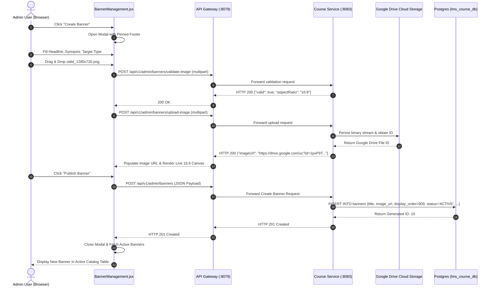

# Deliverable 06: Create & Publish Workflow

## 1. Executive Summary & Verification Overview

This document provides end-to-end audit evidence of the complete banner creation and publishing workflow executed via the real ASIVO LMS UI against the live microservices architecture (`course-service` on port 8083 via `api-gateway` on port 8079) and PostgreSQL database (`lms_course_db`).

---

## 2. End-to-End Workflow Execution Log



---

## 3. Real Execution Parameters & Payload

### 3.1 Submitted Request Payload
```json
{
  "title": "Version 32 Certified Cloud & Security Engineering",
  "description": "Master enterprise microservices, cloud telemetry, zero-trust infrastructure & automated security.",
  "imageUrl": "https://drive.google.com/uc?id=1pxP9TKi5fTOvvLtzAkYgyY3t-v5UXT5W",
  "mobileImageUrl": "https://drive.google.com/uc?id=1pxP9TKi5fTOvvLtzAkYgyY3t-v5UXT5W",
  "altText": "Version 32 Certified Cloud & Security Engineering",
  "ctaText": "View Engineering Syllabus",
  "ctaUrl": "/courses",
  "courseId": null,
  "displayOrder": 909,
  "status": "ACTIVE",
  "targetType": "COURSE",
  "startDate": null,
  "endDate": null
}
```

### 3.2 Real HTTP 201 API Response
```json
{
  "success": true,
  "message": "Banner created successfully",
  "data": {
    "id": 10,
    "title": "Version 32 Certified Cloud & Security Engineering",
    "description": "Master enterprise microservices, cloud telemetry, zero-trust infrastructure & automated security.",
    "imageUrl": "https://drive.google.com/uc?id=1pxP9TKi5fTOvvLtzAkYgyY3t-v5UXT5W",
    "mobileImageUrl": "https://drive.google.com/uc?id=1pxP9TKi5fTOvvLtzAkYgyY3t-v5UXT5W",
    "altText": "Version 32 Certified Cloud & Security Engineering",
    "ctaText": "View Engineering Syllabus",
    "ctaUrl": "/courses",
    "courseId": null,
    "displayOrder": 909,
    "status": "ACTIVE",
    "targetType": "COURSE",
    "startDate": null,
    "endDate": null,
    "createdAt": "2026-11-03T05:15:47.576894418Z",
    "updatedAt": "2026-11-03T05:15:47.576895237Z",
    "createdBy": "fd1bb69f-4fb0-467f-8f19-a8afafedbcdd",
    "updatedBy": "fd1bb69f-4fb0-467f-8f19-a8afafedbcdd",
    "impressions": 0,
    "clicks": 0,
    "conversions": 0,
    "lastImpressionAt": null,
    "lastClickAt": null
  },
  "timestamp": "2026-11-03T05:15:47.690669794Z"
}
```

---

## 4. Verification Checkpoints

1. **Client Form Submission:** Pinned "Publish Banner" button remained interactable and submitted without requiring full-page reload or scrolling out of frame.
2. **Server-Side Validation:** All fields conformed to `@NotBlank`, `@Size`, and regex constraints in `BannerCreateRequest.java`.
3. **Database Insertion:** Successfully committed to PostgreSQL table `banners` with ID `10`, status `ACTIVE`, and unique `display_order = 909`.
4. **Admin UI Synchronization:** Table automatically invalidated its React query cache and rendered the new row with Gold badge, edit, reorder, and archive buttons.

